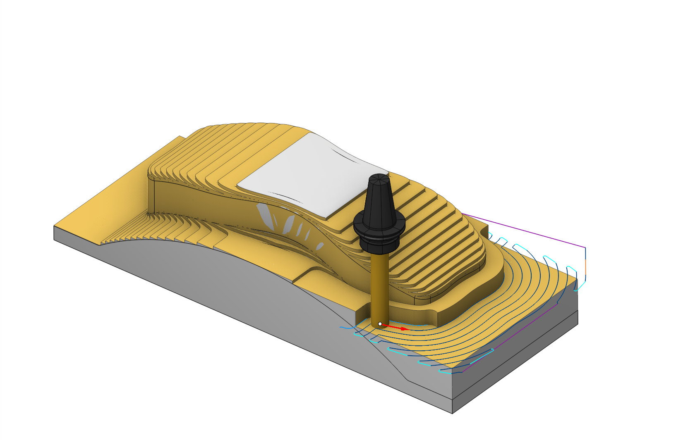
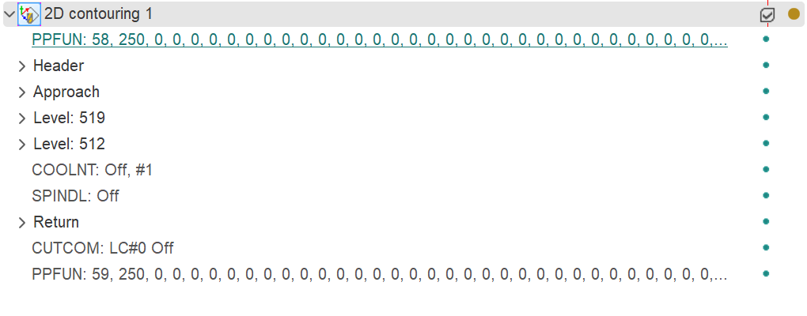
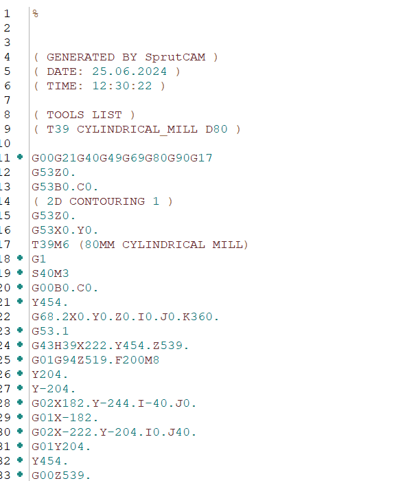

# Simulação

## Área de aplicação:

Os sistemas CAM oferecem diferentes modos de modelagem, cada um alterando o método de modelagem. Esses modos têm suas próprias vantagens e desvantagens. O <strong>Voxel 5D</strong> é o modo padrão, oferecendo modelagem rápida para prototipagem rápida. No entanto, a modelagem <strong>Solid</strong> ([Detalhes](10331.md)), embora demore mais, oferece maior precisão. Por exemplo, ao trabalhar com detalhes intrincados, como pequenos furos em uma peça grande, a modelagem <strong>Solid</strong> é a escolha preferida devido à sua alta precisão. Em última análise, a seleção do modo de modelagem depende dos requisitos específicos do projeto e do nível de detalhe desejado.

Clique no marcador **Simulation** para ativar o modo de simulação. O modo permite:

- controlar visualmente o processo de corte;
- ver a qualidade da usinagem e descobrir possíveis defeitos;
- comparar a peça usinada com o modelo de origem;
- descobrir e marcar fragmentos problemáticos do percurso da ferramenta usando diferentes critérios;
- editar o percurso da ferramenta calculado para atender aos requisitos do usuário;
- otimizar os avanços.

Ao simular operações de fresamento, sólidos verdadeiros são usados para representar a ferramenta e o bruto. Assim, a qualidade do bruto resultante não depende da ferramenta nem da orientação da visualização. O método usado é ideal para a simulação de vários eixos.

Ao simular operações de torneamento, sólidos de revolução são usados para representar a ferramenta e o bruto, independentemente da forma dos modelos de origem. Isso é feito para obter o efeito de um bruto girando na máquina. Se uma operação de fresamento seguir uma operação de torneamento, o modelo sólido verdadeiro será usado novamente para a simulação.

<strong>Tipo de simulação (localizado na guia Parameters de cada operação): [Detalhes](100112.md)</strong>

<strong>Movimento do percurso da ferramenta (formato CLData/ <strong>G-code</strong> ).</strong>

O modo de simulação dá acesso ao percurso da ferramenta (CLDATA) de cada operação. Se a operação estiver calculada, o resultado calculado será representado pela sequência de comandos CLDATA. Os comandos CLDATA são unidos em uma estrutura hierárquica organizada de acordo com as características do tipo de operação concreto.

Clique aqui para expandir...

<strong>Os dados podem ser apresentados no formato ClData ou G-code.</strong>

<strong>CLData.</strong> O ClData é um formato de dados que permite a representação de informações geométricas e topológicas, facilitando a criação de programas de usinagem precisos e eficientes. [Detalhes](10287.md)

<strong>G-code.</strong> O G-code é uma linguagem de programação de controle numérico padronizada usada para controlar os movimentos e as operações das máquinas CNC. [Detalhes](10291.md)

## Controle do processo de simulação (botões).

O modo de simulação de usinagem permite que o usuário obtenha uma imagem do modelo que está sendo usinado durante o processo de usinagem. Isso permite que o usuário verifique visualmente a qualidade da usinagem e analise a presença de material residual e de cortes excessivos. [Detalhes](722.md)
