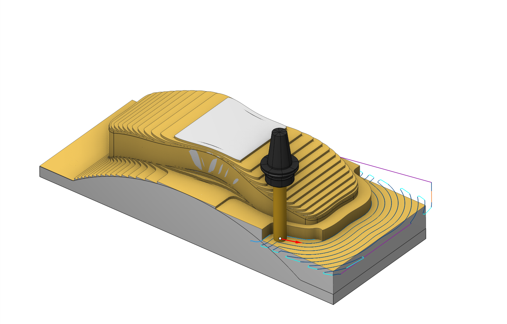
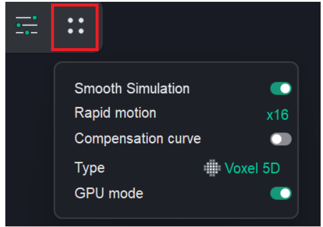
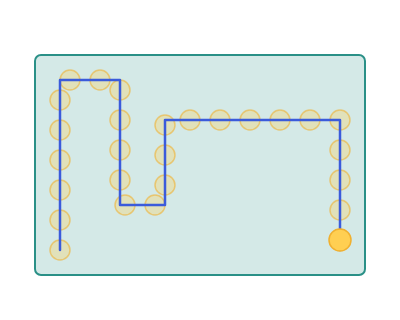
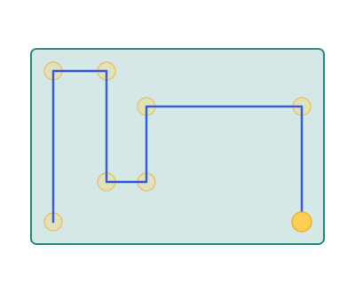
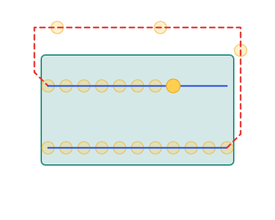
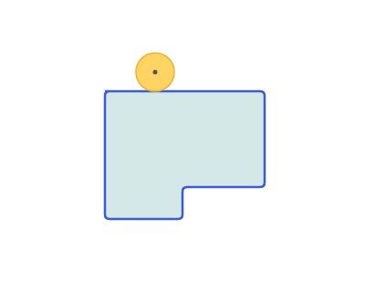
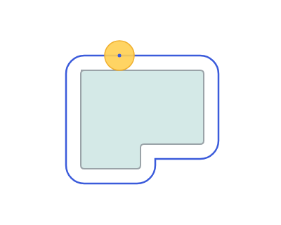
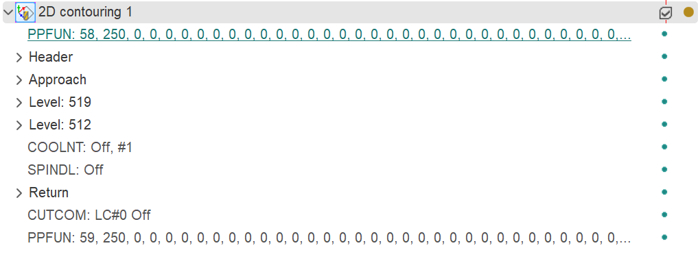
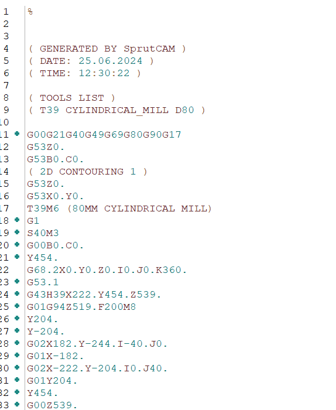

# Simulation

## Application area:

CAM systems offer different modeling modes, each changing the modeling method. These modes come with their own advantages and disadvantages. **Voxel 5D** is the default mode, offering quick modeling for rapid prototyping. However, **Solid** ([Details](10331.md)) modeling, while taking longer, provides greater precision. For example, when working on intricate details, such as small holes in a large part, **Solid** modeling is the preferred choice due to its high accuracy. Ultimately, the selection of modeling mode depends on the specific project requirements and the desired level of detail.

Click the **Simulation** bookmark to switch on the simulation mode. The mode allows:

- to control by eyes the cutting process;
- to see the machining quality and to discover the possible defects;
- to compare the machined part with the source model;
- to discover and to mark the problem tool path fragments using the different criterions;
- to edit the calculated tool path to bring to the requirements of the user;
- to optimize the feed rates.

While simulating mill operations true solids are used to represent a tool and a workpiece. Thus, the quality of a resulting workpiece does not rely neither on the tool or the view orientation. The used method ideally suit for multi-axis simulation.

While simulating turn operations solids of revolution are used to represent a tool and a workpiece irrespective to the form of the source models. It is so to gain an effect of a revolving workpiece on a machine. If a mill operation follows a turn one, the true solid model is used for its simulation again.

**Simulation type (Located on the Parameters tab for each operation): [Details](100112.md)**

### Simulation settings.

Click here to expand..

In **Simulation** mode, click the button with four dots on the toolbar above the 3D view to open the settings.

**Smooth Simulation.** When on, the tool moves along the toolpath in equal steps, so long and short moves are shown at the same pace. The step depends on the simulation speed. When off, the simulation goes move by move: in one step the tool jumps to the end of the next move, whatever its length. The simulation speed and **Rapid motion** do not apply then. On by default.

**Rapid motion.** How many times faster than the cutting moves the rapid moves are shown: x2, x4, x8, x16, x32, x64 or x128; x16 by default. A larger value saves time on long positioning moves. Works only with **Smooth Simulation** on. It changes only the display: the toolpath, the NC program and the machining time stay the same.

**Compensation curve.** Shows the toolpath the way the CNC runs it with cutter radius compensation (G41/G42): the toolpath line is offset by the compensation radius set in the operation's radius compensation parameters. Only sections with radius compensation change, that is, the **Control**, **Wear** and **Reverse Wear** modes. With **Computer** the toolpath is already offset, and the option changes nothing. When off, the toolpath is shown as programmed. Off by default.

**Type.** Type of the workpiece model in simulation: **Solid**, **Voxel 3D** or **Voxel 5D**. The types are described in the **Simulation** group of the machine setup panel ([Details](1021.md)).

**GPU mode.**

**GPU mode.** Performs material removal and displays the workpiece model using the graphics card. This speeds up simulation and reduces CPU load. The checkbox is shown only for **Voxel 5D**; **Solid** and **Voxel 3D** always use the CPU.

The checkbox is enabled by default. The choice is saved for the current user and applies to all projects, including after restarting the application. Changing the checkbox resets the simulation workpiece, just like changing the model type, so simulation starts again from the initial workpiece.

The simulation result is the same as with the CPU: gouges and collisions between the tool holder and the workpiece are checked, operation colors are displayed, and project saving and workpiece export work as usual.

The checkbox is unavailable (grayed out) if the graphics card or driver does not meet the GPU simulation requirements ([Details](284.md#gpu-simulation-requirements)). Simulation then uses the CPU. If a GPU failure occurs, for example because video memory runs out, the application automatically continues on the CPU. The checkbox remains unavailable until the application is restarted.

GPU mode applies to simulation on the **Simulation** tab. Background simulation of operations continues to use the CPU. [Details](18921.md).

If the displayed workpiece model looks incorrect, clear **GPU mode** and repeat the simulation on the CPU. If the CPU result is correct, contact support.

**Preparing GPU simulation.**

Before the first GPU simulation, the application performs a one-time preparation for the graphics card. The installer normally completes this in advance, so the **Preparing GPU simulation** window usually appears only after a graphics driver update or if preparation during installation did not complete.

The window appears when preparation takes longer than one second. It displays *Compiling shaders - about N s left* and the explanation *Needed once after an installation or a graphics driver update*. Wait for preparation to finish; it does not need to be repeated for subsequent simulations.

**Tool path motion (CLData/ G-code format ).**

The simulation mode gives the access to the tool path (CLDATA) of each operation. If the operation is calculated then the calculated result is represented by the sequence of the CLDATA commands. The CLDATA commands are united into the hierarchical structure that is organized corresponding to the features of the concrete operation type.

Click here to expand..

**The data can be presented in either ClData or G-code format.**

**CLData.** ClData is a data format that allows for the representation of both geometric and topological information, facilitating the creation of accurate and efficient machining programs. [Details](10287.md)

**G-code.** G-code is a standardized numerical control programming language that is used to control the movements and operations of CNC machines. [Details](10291.md)

## Controlling simulation process (buttons).

Machining simulation mode allows the user to obtain an image of the model being machined during the machining process. This allows the user to visually check the machining quality, analyze the presence of any rest material and over-cuts. [Details](722.md)
