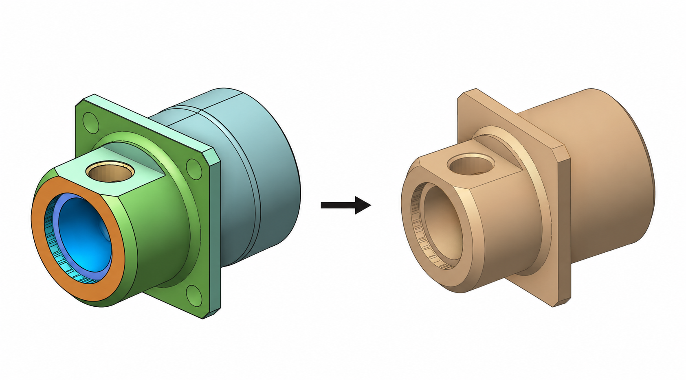
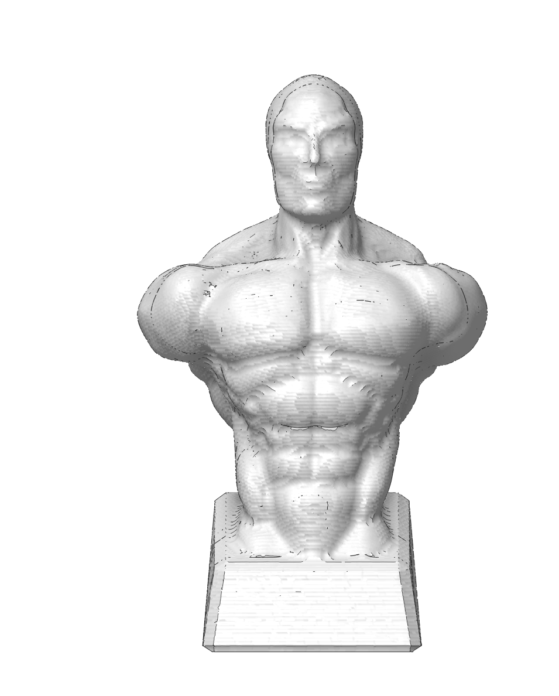
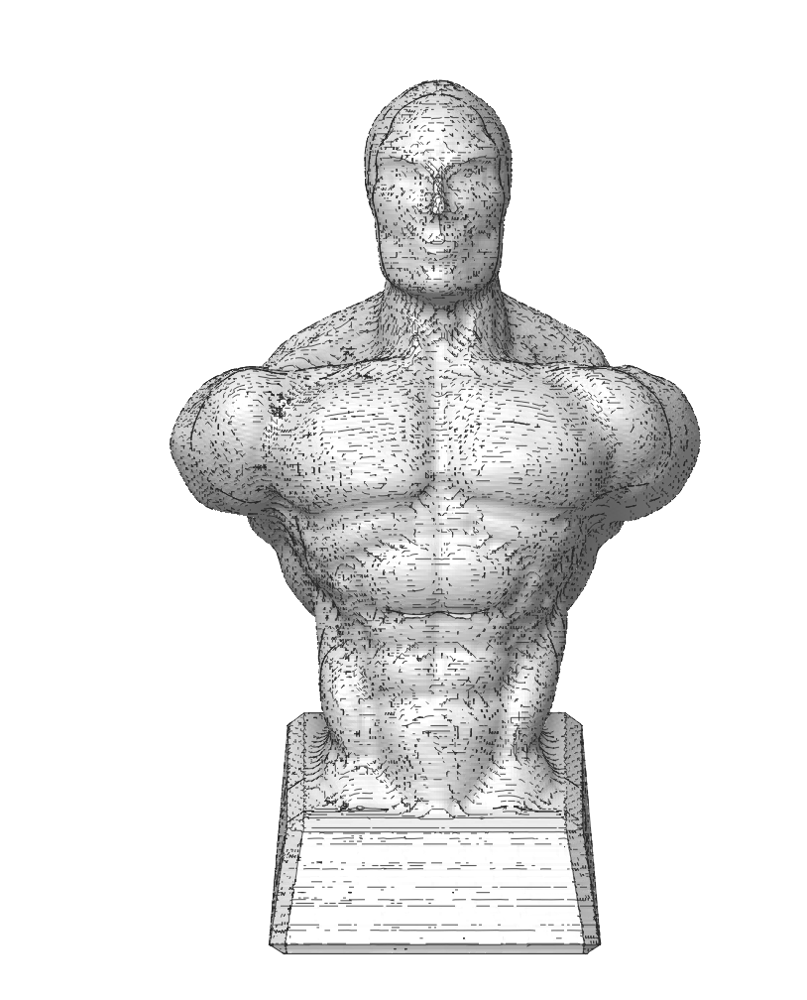

# シミュレーション結果をモデルとしてエクスポート

## 適用分野:

<strong>シミュレーション</strong>ページに表示されるシミュレーション結果はファイルとして保存でき、後で別のプロジェクトの<strong>ワーク</strong>として再利用できます。また、<strong>STL</strong>形式で保存すれば、サードパーティ製ソフトウェアでも利用可能です。これにより、あるプロジェクトで加工した部品の加工済み状態を次のプロジェクトへ引き継ぐことができ、すでに加工されたストックを基準として加工を継続できます。

一般的な利用例:

- 長時間に及ぶ加工を複数のプロジェクトに分割し、各プロジェクト間で中間状態のストックを引き継ぐ場合。
- 加工済みモデルを、そのまま後続工程の<strong>ワーク</strong>として再利用し、形状精度を損なうことなく加工を続ける場合。
- シミュレーションで生成したストックを、中立的なメッシュ形式（STLなど）で外部のCAD/CAMソフトウェアへ受け渡す場合。

### シミュレーション結果の保存

シミュレーション結果は、以下のいずれかの方法で保存できます。どちらを選択しても、<strong>名前を付けて保存</strong>ダイアログが表示されます。

<strong>シミュレーションページのコンテキストメニュー</strong> シミュレーションウィンドウ内で右クリックし、<strong>シミュレーション結果を保存</strong>を選択します。

<strong>メインメニュー</strong> 左上のツールバーにある<strong>保存</strong>メニューを開き、<strong>エクスポート</strong>→ <strong>シミュレーション結果</strong>を選択します。

<strong>名前を付けて保存</strong>ダイアログで、ファイル名を入力し、<strong>ファイルの種類</strong>ドロップダウンリストから保存形式を選択します。

- <strong>シミュレーション結果（高精度）</strong>（*.camsr）

- <strong>シミュレーション結果（STL・精度低下あり）（*.stl）</strong>

### ファイル形式

<strong>シミュレーション結果（高精度）（*.camsr）</strong>

シミュレーション専用のネイティブ形式です。シミュレーションで計算されたモデルを変換することなく、<strong>そのままの高精度</strong>な状態で保存します。

- <strong>精度の低下なし</strong> モデルは元の状態のまま保存され、ワーク素材として再読み込みした際も、近似処理を行うことなく、そのまま使用されます。
- CAMシステム内でファイルを再利用する場合に<strong>推奨</strong>される形式です<strong>。</strong> 既定の保存形式として設定されています。

<strong>シミュレーション結果（STL・精度低下あり）（*.stl）</strong>

標準的なSTL三角形メッシュ形式です。

- <strong>汎用性</strong> 多くのCAD/CAMアプリケーションや、STL形式に対応したソフトウェアで利用できます。
- <strong>精度低下あり</strong>エクスポート時に、高精度なシミュレーションモデルは三角形メッシュへ変換されます。再度読み込む際はメッシュとして読み込まれ、再処理が行われるため、再利用されるストックは元のモデルを<strong>近似</strong>したものとなり、元の高精度モデルそのものではありません。

### 保存したシミュレーション結果をワーク素材として再利用する

<strong>*.camsr</strong> ファイルは、別のプロジェクトでワークとして読み込むことができます。

1. 加工ページの<strong>ワーク</strong>タブを開きます。
2. <strong>シミュレーション結果</strong>ボタンをクリックします。
3. *.camsr ファイルを選択します。

保存された加工済みモデルが、そのままワーク素材として追加されます。ボクセル化の再実行や形状の精度低下を伴うことなく、その状態から加工を続行できます。

> 注記
>
> *.camsr ファイルには、保存時の単位系が記録されています。現在のプロジェクトと異なる単位系で保存されたファイルを読み込もうとすると、インポートは<strong>中止</strong>されます。これは、自動的な単位変換（mm ↔ inch）が現在サポートされていないためです。シミュレーション結果を保存・再利用する際は、保存元と同じ単位系のプロジェクトで使用してください。
