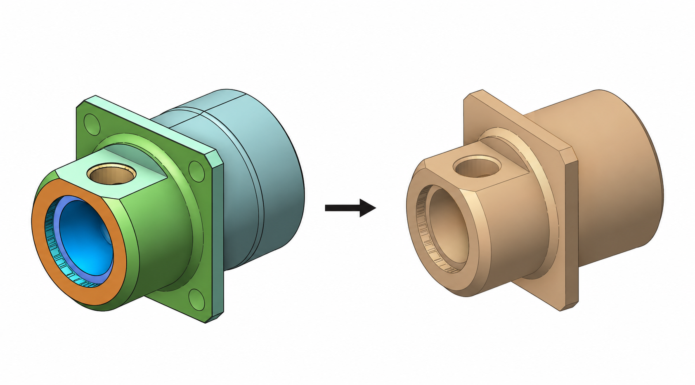
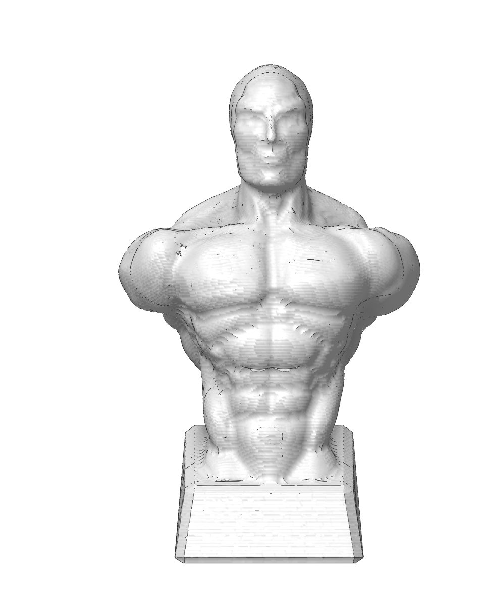
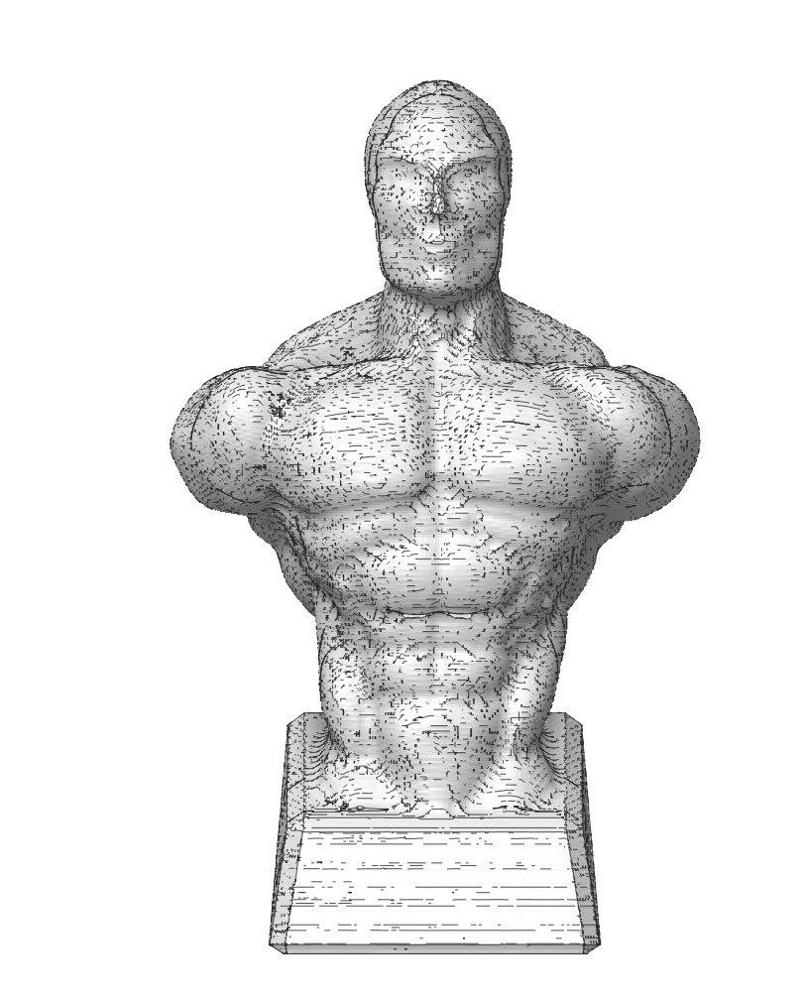

# Export simulation result as model

## Application area:

The simulation result shown on the **Simulation** page can be saved to a file and later reused as a **workpiece** in another project, or, for the **STL** format, in third-party software. This carries the machined state of a part from one project into the next, so machining continues from the already-processed stock.

Typical scenarios:

- Splitting a long machining job into several projects and passing the intermediate stock between them.
- Reusing the exact machined model as the **workpiece** for a follow-up setup without loss of detail.
- Handing the simulated stock to external CAM/CAD software through a neutral mesh format.

### Saving the simulation result.

Two entry points are available. Both open the **Save As** dialog.

**Context menu on the Simulation page.** Right-click in the simulation window and choose **Save simulation result**.

**Main menu.** Open the **Save** menu (disk icon in the top-left toolbar) and, under **Export**, choose **Simulation result**.

In the **Save As** dialog, enter a file name and select the format in the **Save as type** drop-down:

- **Simulation result, precise (*.camsr).** Selected by default.

- **Simulation result, STL with losses (*.stl).**

### File formats.

**Simulation result, precise (*.camsr)**

The native simulation format. It stores the **exact simulation model** as computed, with no conversion.

- **No loss of precision.** The model is preserved as-is; when imported back as a workpiece it is used directly, without any approximation step.
- **Recommended** whenever the file is reused inside the CAM system. This is the default option.

**Simulation result, STL with losses (*.stl)**

The standard STL triangle mesh.

- **Universal.** Opens in most CAM/CAD applications and any tool that reads STL.
- **Lossy.** The precise model is converted to a triangle mesh on export; on re-import it is loaded as a mesh and re-processed, so the reused stock is an **approximation** of the original rather than the exact model.

### Reusing a saved result as a workpiece.

A *.camsr file can be loaded back into another project as the workpiece:

1. Go to the **Workpiece** tab on the Machining page.
2. Click the **Sim result** button.
3. Select the *.camsr file.

The exact machined model is added as the workpiece, and machining can continue from it — no re‑voxelization, no detail loss.

> Note
>
> The *.camsr file records the measurement units it was saved in. If you import a result whose units differ from the current project's, the import is **canceled**, because automatic unit conversion (mm ↔ inch) is not supported yet. Save and reuse results within the same unit system.
