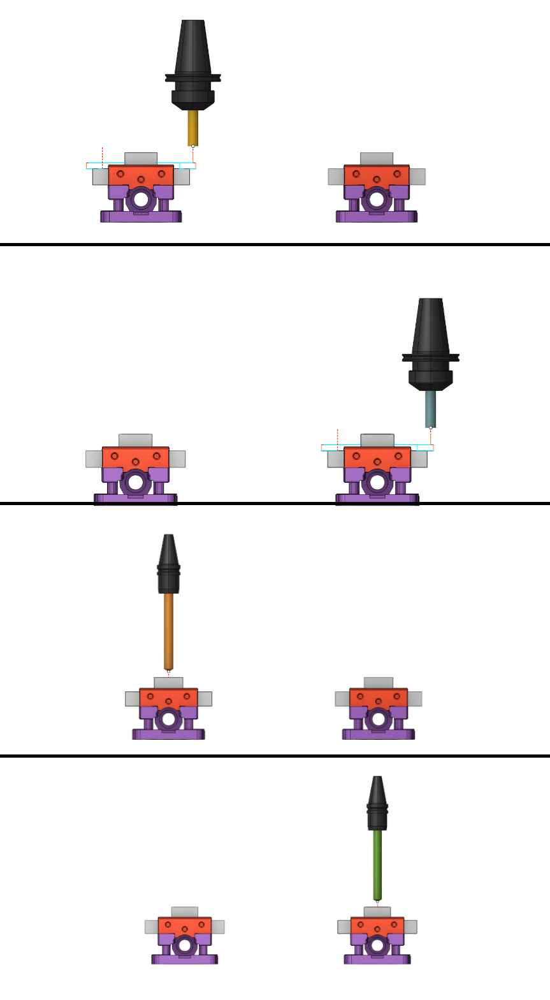

# Modalità di sequenziamento

## Ambito di applicazione:

Le operazioni all'interno del gruppo del pezzo definiscono la sequenza di lavorazione di questo solo pezzo. Di fatto definiscono il materiale residuo del grezzo per ogni operazione successiva. Se il progetto contiene più di un pezzo, la sequenza di lavorazione reale può essere ridefinita, ad esempio per ridurre al minimo i cambi utensile o le rotazioni della torre di bloccaggio (tombstone). Per attivare la modalità di sequenziamento utilizzare il pulsante sul pannello principale. In questa modalità viene visualizzato l'albero delle operazioni <strong>riordinato</strong>.

Per impostazione predefinita le operazioni vengono ordinate automaticamente per ridurre al minimo i cambi utensile. È possibile modificare manualmente l'ordine di lavorazione tramite <strong>trascinamento</strong> o con i pulsanti freccia del pannello di sequenziamento. Il <strong>pulsante freccia</strong> sposta l'operazione selezionata prima/dopo quella precedente/successiva. Il <strong>pulsante di ordinamento</strong> ripristina l'ordinamento automatico. Le regole dell'ordinamento automatico sono definite nel menu a comparsa seguente.

I collegamenti tra le operazioni non possono essere calcolati prima che sia stabilito l'ordine di lavorazione reale. Per questo motivo il calcolo dei collegamenti è stato separato dal processo di calcolo principale. Il flusso di lavoro completo per i progetti con più pezzi comprende le seguenti fasi:

- Posizionamento del pezzo nello spazio di lavoro della macchina
- Progettazione del processo di lavorazione per ciascun pezzo. Calcolo del percorso utensile senza i collegamenti (avvicinamenti e ritorni).
- Simulazione del processo con la modalità di sequenziamento disattivata, per verificare la correttezza del cambio del grezzo ecc.
- Riordino delle operazioni nella <strong>modalità di sequenziamento.</strong>
- Calcolo dei collegamenti tra le operazioni.
- Simulazione del processo nella modalità di sequenziamento per verificare i collegamenti e i cambi utensile tra le operazioni.
- Generazione del percorso utensile

## Elementi principali:

### Sort (ordina).

Questo pulsante serve per ordinare automaticamente le operazioni con determinate priorità. <strong>La priorità di ordinamento è determinata dalla posizione dei gruppi nell'elenco</strong>

Fare clic qui per espandere..

<strong>Tool.</strong> Gruppo per l'ordinamento per utensile.

<strong>Side.</strong> Gruppo per l'ordinamento per lato.

<strong>Part.</strong> Gruppo per l'ordinamento per pezzo.

<strong>Feature.</strong> Gruppo per l'ordinamento per elemento del pezzo.

<strong>By operations.</strong> Gruppo per l'ordinamento per operazione.

<strong>Swiss lathe.</strong> Gruppo per l'ordinamento per operazione di tipo svizzero (tornio a fantina mobile).

<strong>Reset sorting.</strong> Ripristina l'ordinamento automatico delle operazioni.

<strong>Delete group in tree.</strong> Se un gruppo è disattivato, non viene visualizzato nell'albero di ordinamento.

<strong>Increase sorting priority.</strong> Aumenta la priorità.

<strong>Decrease sorting priority.</strong> Riduce la priorità.

### Move up / Move Down (sposta su / sposta giù)

Servono per l'ordinamento manuale di una specifica operazione.

### Link (collega).

Calcola le operazioni selezionate con i collegamenti. Le transizioni tra le operazioni vengono visualizzate come linee

### Unlink (scollega).

Calcola le operazioni selezionate senza collegamenti.
