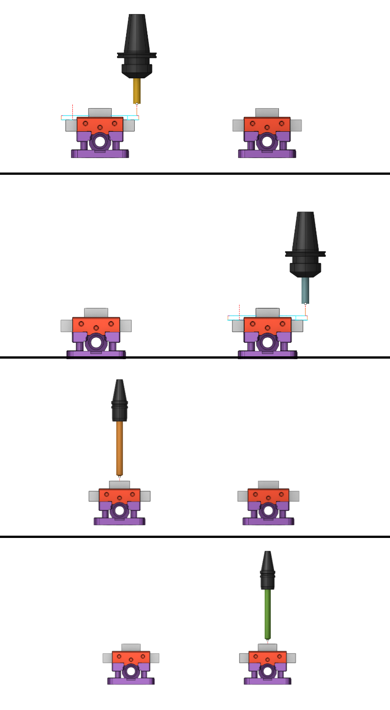

# シーケンスモード

## 適用分野：

パーツグループ内の操作は、その部品のみの加工順序を定義します。実際には、各後続操作に対する残留ワークを定義します。プロジェクト内に複数のパーツが含まれている場合、実際の加工順序を再定義することができます。たとえば、工具交換の回数を最小限に抑えるためや、トゥームストーン（多面治具）の回転回数を減らすなどの最適化を目的として並べ替えることが可能です。メインパネルのボタンを使用してシーケンスモードをオンにします。 このモードでは、<strong>並べ替え</strong>られたオペレーションツリーが表示されます。

デフォルトでは、工具交換を最小限に抑えるため、オペレーションは自動的にソートされます。 <strong>ドラッグ＆ドロップ</strong>、またはシーケンシングパネル上の<strong>矢印ボタン</strong>を使用して、加工順序を手動で変更することが可能です。矢印ボタンは、選択したオペレーションを前後に移動させます。<strong>ソート</strong>ボタンは、自動並べ替えが復元されます。自動並べ替えのルールは、次のポップアップメニューで定義されます。

加工間の 実際の加工順序が設定されるまで 計算することはできません。そのため、リンク計算はメインの計算プロセスから切り離されています。複数パーツプロジェクトにおける標準的なワークフローは、以下の手順で構成されます。

- マシンのワークスペース内へのパーツの配置
- 各パーツの加工プロセスの設計。リンク（アプローチとリターン）を含まないツールパスの計算
- シーケンスモードを無効にした状態でのプロセスのシミュレーションを行い、ワーク交換の正確性などを確認
- <strong>シーケンスモード</strong>でのオペレーションの並べ 替え
- オペレーション間のリンクの計算
- シーケンスモードでプロセスをシミュレーションし、各操作間のリンクおよび工具交換を確認
- ツールパス生成

## 主な要素：

### ソート

このボタンは、特定の優先順位でオペレーションを自動的に並べ替えるために使用します。<strong>ソートの優先順位は、リスト内のグループの位置によって決まります。</strong>

拡大

<strong>工具</strong> 工具ごとに並べ替えるグループ

<strong>サイド</strong> 加工面や側面ごとに並べ替えるグループ

<strong>パーツ</strong> パーツごとに並べ替えるグループ

<strong>フィーチャー</strong> パーツの要素ごとに並べ替えるグループ

<strong>オペレーション</strong> 工程ごとに並べ替えるグループ

<strong>スイス製旋盤</strong> スイス旋盤のオペレーションごとに並べ替えるグループ

<strong>ソートをリセット</strong> 自動並べ替えをリセット

<strong>ツリー内のグループを削除</strong> グループが無効になっている場合、ソートツリーには表示されません。

<strong>ソートの優先順位を上げる</strong> 優先順位を上げます。

<strong>ソートの優先順位を下げる</strong> 優先順位を下げます。

### 上に移動／下に移動

特定の操作を手動で並べ替えるために使用します。

### リンク

選択したオペレーションを計算します。オペレーション間の移動は線で表示されます。

### リンクを解除

選択したオペレーションを計算します。
