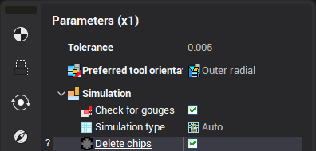
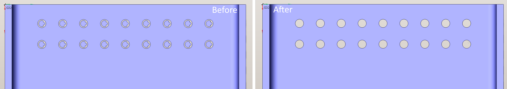

# チップ削除機能

この機能は、ワークのうち部品形状を含まない部分（チップ=切りくず）を削除します。

そのため、<strong>正しい</strong>結果を得るには、部品形状（パーツ）が存在していることが<strong>重要</strong>です。

この機能は、以下の2つの方法で実行できます。

1. 「シミュレーション」ページの ボタンをクリックします。
2. 「パラメータ」タブ内のオペレーションパラメータで オプションを有効にします。 この場合、オペレーションのシミュレーション終了時に、切りくずが自動的に削除されます。

例：

