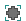
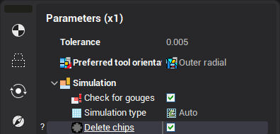
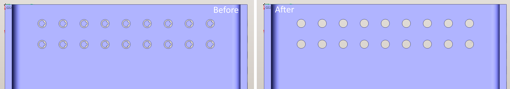

# Remoção de cavacos na simulação

A função exclui partes do bruto (ou simplesmente cavacos) que não contêm a geometria da peça. (Portanto, a presença da peça é <strong>essencial</strong> para a <strong>correção</strong> do resultado.)

A função pode ser executada de duas maneiras:

1. Clicando no botão  na página "Simulation"
2. Ativando a opção  nos parâmetros da operação, na guia "Parameters". Nesse caso, os cavacos serão excluídos automaticamente ao final do processo de simulação da operação.

Exemplo:

