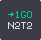
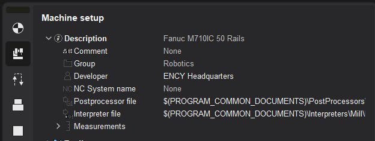
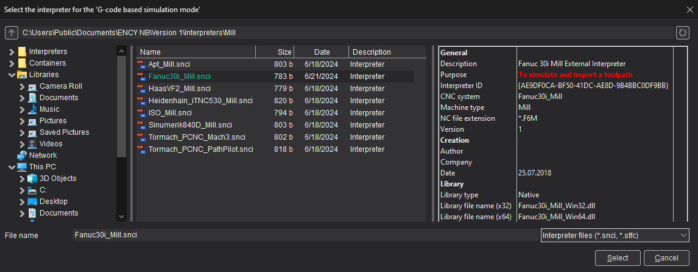
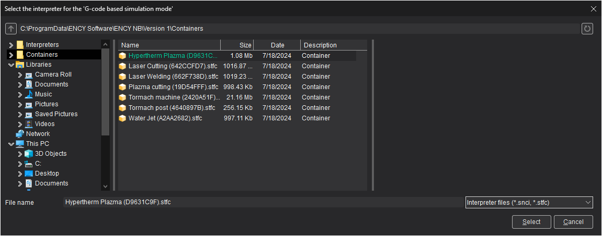
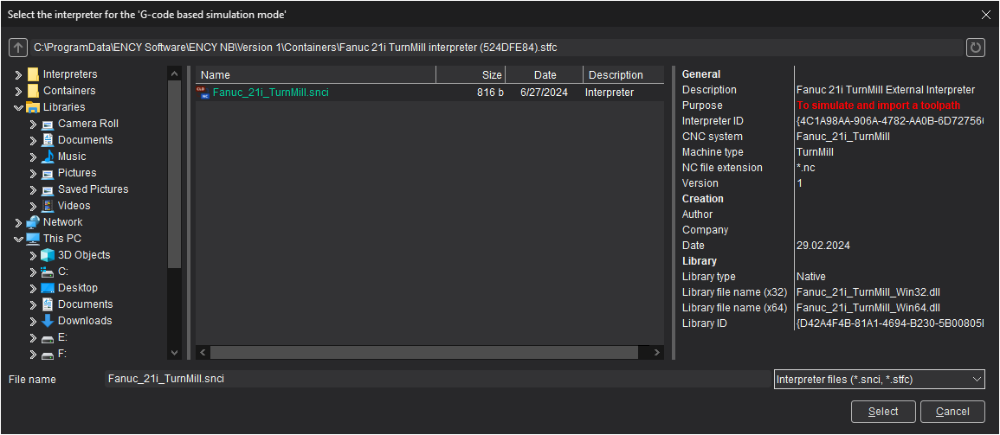
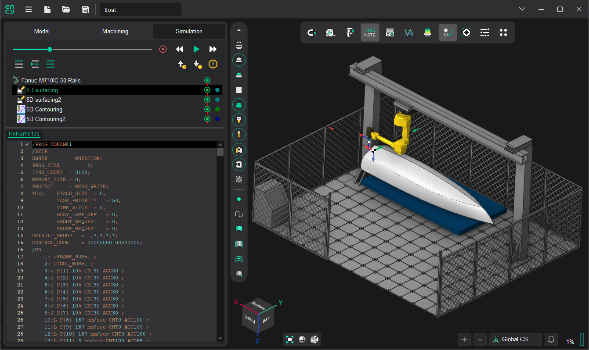

# NCプログラムによる加工シミュレーション

NCプログラム（NC）による加工シミュレーションモードでは、加工をシミュレーションする際にポストプロセッサの実装上の特性を考慮することができます。このモードでは、 [各オペレーションの計算時に](12.md)システムが自動的にNCプログラムを生成します。シミュレーションの操作方法は、[通常のシミュレーション操作](722.md)と同じです。

<strong>NCによるモデリングモードを有効</strong>

<strong>モデリング</strong>タブがアクティブな状態で、ツールバー上の  ボタンをクリックして有効化します。

<em><strong>注記</strong>： [マルチタスクモード](10269.md) を使用している場合、このボタンは切り替え操作ができなくなります。</em>

制御プログラム（NCテキスト）に基づくシミュレーションは、選択された[ポストプロセッサーファイル](730.md)および、工作機械の[マシンセットアップ](341.md)パラメータパネルで定義された[インタープリターファイル](10020.md)に基づいて実行されます。

> インタープリターは、[$(PROGRAM_PERSONAL)/Interpreters ディレクトリ](715.md)に格納された工作機械の制御機設定ファイル（*.snci）です。

選択時には、プレビューパネルでインタープリター情報（説明、用途、スタンドタイプ、作成者など）を確認できます。

コンテナからインタープリターを選択する機能もサポートされています。これを行うには、[インタープリターを含むコンテナ](10024.md)を取得してください。その後、インタプリタの選択ウィンドウを開き、コンテナフォルダに移動します。

取得したコンテナをフォルダとして開き、そのコンテナ内でモデリングに使用するインタプリタを選択します。

> 工作機械のキネマティックスキーマで既定のポストプロセッサーとインタープリターを設定する
>
> 工作機械のキネマティック図において、ポストプロセッサーファイル名およびインタープリターファイル名を「デフォルト」として設定することが可能です。これを行うには、機械図のXMLファイルに、対応するファイルへの参照を含む SPPFile および SNCIFile タグを追加し、CAMシステムを再起動します。
>
> これにより、CAMシステムで機械を選択した際に、ポストプロセッサーおよびインタープリターがあらかじめ設定された状態となり、その値はキネマティック図から取得されます。必要に応じて、ENCYのユーザーインターフェースから、現在のプロジェクトに対してポストプロセッサーおよびインタープリターの値を上書きすることも可能です。
>
> 例:
>
> `SCType ID="Fanuc 30i" Caption=""Fanuc 30i" type=""Fanuc30i" Enabled="true"` `... other tags... /` `SPPPFile DefaultValue="$(PROGRAM_PERSONAL)\Postprocessors\Mill\Fanuc (30i)_Mill.sppx"/` `SNCIFile DefaultValue="$(PROGRAM_PERSONAL)\Interpreters\Mill\Fanuc (30i)_Mill.snci"/`. `... other tags... /` `/SCType`

<strong>NCによるモデリングの特徴</strong>

このモードが有効になっている場合、[工具軌跡の計算](12.md)後に、ENCYは事前に選択されたポストプロセッサー設定ファイルを使用してCNC工作機械用の制御プログラムを自動生成し、その制御プログラムのテキストを工具軌跡へ変換します。生成されたツールパスは、ポストプロセッサーの実装上の特性を考慮したものになります。選択されたオペレーションの制御プログラムのテキストは、シミュレーションモードページの下部、工程オペレーション一覧の直後に表示されます。

制御プログラムの行にマウスポインターをしばらく合わせると、対応する軌跡ツリーのノード（CLData加工コマンド）の説明がツールチップに表示されます。

<em><strong>注記：</strong>マウスポインターを少し動かすか、任意のキー（Esc、または制御プログラム内の移動キーである↓、↑など）を押すと、ツールチップを非表示にできます。</em>

制御プログラムのテキストの左側には、補助情報を表示するための領域があります。各行には、行番号に加えて、 [軌跡ツリー内の関連するすべてのノードの状態](742.md) が表示されます。表示されるアイコンの意味は、CLDataの加工コマンドで使用されるものと同様です。これにより、軌跡ツリーにエラーのあるノードが含まれる制御プログラムのブロック（行）を明確に特定できます。  および  ボタンを使用すると、エラー箇所の間で制御プログラムのテキストを移動できます。

<strong>外部インタープリターのサポート</strong>

制御プログラムテキストに基づくシミュレーションでは、サードパーティ製のインタプリタを使用することが可能です。 インタプリタ設定ファイル（*.snci）には、制御プログラムテキストを解釈するために使用されるプログラムライブラリへの参照が含まれている必要があります。「Creating your own interpreter」ページでは、独自のインタープリターの作成方法（設定ファイルおよびアプリケーションプログラミングインターフェース（API））について説明しています。
