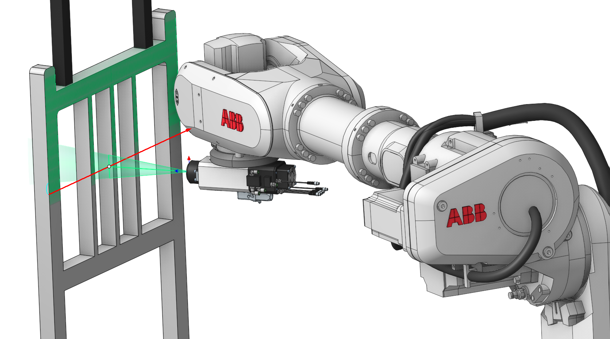
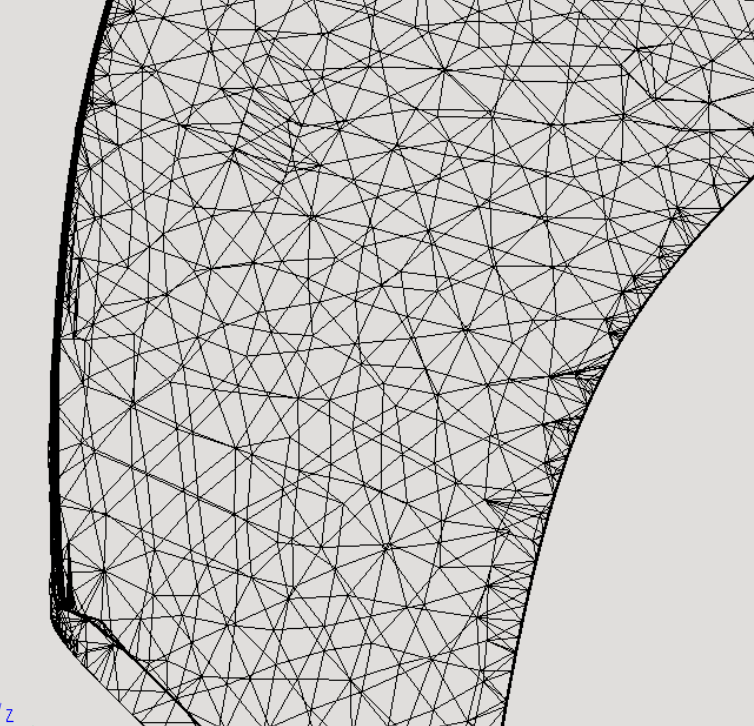
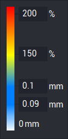

# Simulazione della verniciatura

## Ambito di applicazione:

La simulazione della verniciatura consente di vedere le zone dei pezzi che verranno verniciate e di controllare lo spessore del futuro strato di vernice (a seconda del tipo di verniciatura scelto).

## Suggerimenti per la creazione di un progetto di verniciatura

### 1. Raccomandazioni per il modello

Fare clic qui per espandere..

Prima di caricare il modello nel nostro sistema CAM, si consiglia di prepararlo eliminando gli elementi piccoli e non necessari per la verniciatura e semplificandolo il più possibile.

Se si carica un modello STL o PLY, si consiglia di renderne uniforme la mesh con un software specifico, più o meno come nella figura seguente.

<em>Semplificando il modello secondo queste raccomandazioni, si otterrà una simulazione della verniciatura molto più fluida e veloce.</em>

### 2. Preparazione dell'operazione per la verniciatura

Fare clic qui per espandere..

Prima di creare un'operazione di verniciatura, occorre caricare il pezzo nella pagina "Model" (modello). Dopo aver creato l'operazione, eseguire le seguenti azioni:

- impostare per l'operazione il pezzo da verniciare;
- impostare per l'operazione un grezzo vuoto;
- selezionare il tipo <strong>Painting simulation</strong> (simulazione della verniciatura) nei parametri dell'operazione.

### 3. Scelta del tipo di verniciatura

Fare clic qui per espandere..

Nel sistema sono disponibili due tipi di simulazione della verniciatura:

- <strong>Simple.</strong> (semplice) Questo tipo di simulazione della verniciatura mostra quali zone del modello verranno verniciate. Dopo aver selezionato questo tipo, resta solo da calcolare il percorso utensile e visualizzare il risultato della verniciatura nella pagina "Simulation" (simulazione).
- <strong>Thickness measurement.</strong> (misura dello spessore) Questo tipo mostra non solo le zone da verniciare, ma anche lo spessore approssimativo del futuro strato di vernice. Per utilizzarlo correttamente, eseguire le seguenti fasi:

1. impostare l'avanzamento di lavoro
2. impostare la portata di vernice

Successivamente è possibile eseguire il calcolo dell'operazione e passare alla pagina <strong>Simulation</strong>.

### 4. Modifica dei parametri della simulazione

Fare clic qui per espandere..

Per ottenere prestazioni migliori o una qualità migliore del processo di simulazione, è possibile modificare la risoluzione del modello e la tolleranza del percorso utensile. Per ulteriori informazioni, vedere [qui](906.md).

### 5. Controllo dello spessore del risultato della verniciatura

Fare clic qui per espandere..

Per controllare lo spessore del risultato della simulazione della verniciatura, fare clic sul pulsante "Verify compare" (è descritto [qui](10006.md)): verrà visualizzato un modulo come quello nella figura seguente:

Questo modulo consente di gestire i parametri per il controllo visivo della distribuzione della vernice sul modello.

Per semplificare il processo si utilizza una semplice mappa di colori. Inizia con un colore trasparente e passa gradualmente al colore dell'operazione corrente. Successivamente passa al giallo e poi al rosso.

Il colore dell'operazione corrente rappresenta i valori di spessore accettabili. Per impostarlo occorre specificare un intervallo di valori: qualsiasi valore di spessore compreso in questo intervallo sarà considerato accettabile. Tali zone del modello verranno visualizzate a colore "pieno", senza trasparenza.

Se in alcune zone del modello lo spessore della vernice è insufficiente, queste verranno visualizzate con lo stesso colore, ma con un certo grado di trasparenza. Il grado di trasparenza dipende da quanto il valore di spessore corrente si discosta dal valore accettabile.

Se lo spessore della vernice è eccessivo, sul modello compariranno i colori giallo e rosso. Questi valori sono impostati come percentuale dello spessore massimo accettabile (ad es. 150% e 200%).

Per salvare le modifiche premere Invio o spostare lo stato attivo su un altro campo.

