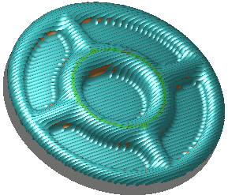
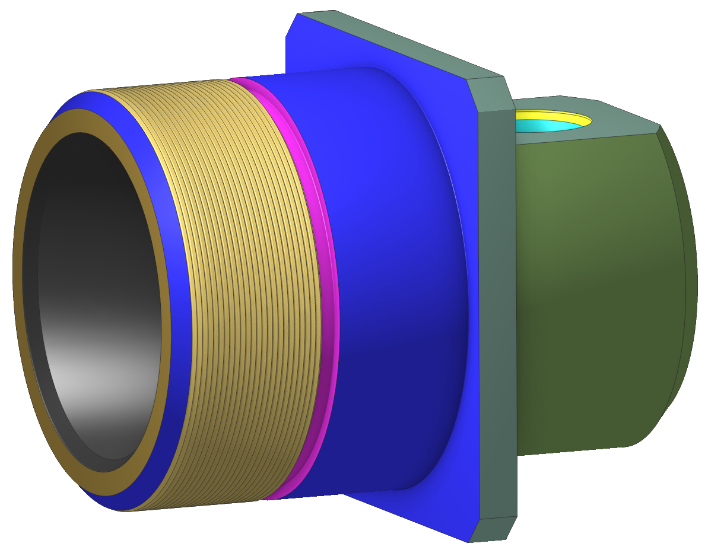

# ソリッドシミュレーション

 

## 適用分野：

ソリッドシミュレーション方式では、ワークモデルをポリゴンソリッドとして表現します。これにより、多数の微細形状や鋭角なコーナーを持つ複雑な部品を正確に表現することができます。この方式は、角柱状部品の加工シミュレーションに適しています。また、ターンミーリング加工にも非常に適しており、特にねじ切りミーリングのシミュレーションにおいて高い効果を発揮します。

<strong>注意</strong>：5軸ツールパスにおけるミーリングのシミュレーションは、ベータ版では制限付きで動作します。
