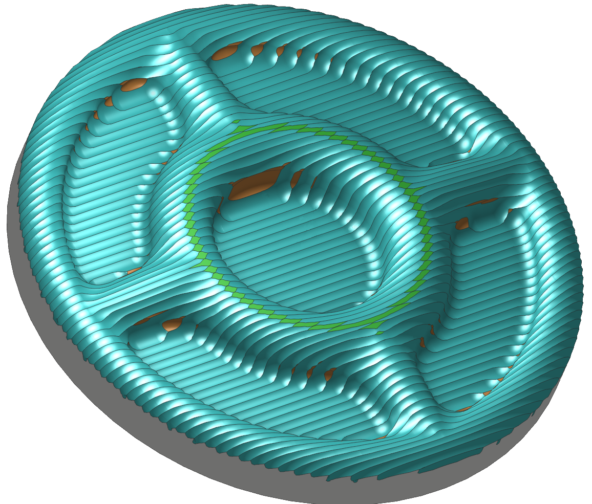
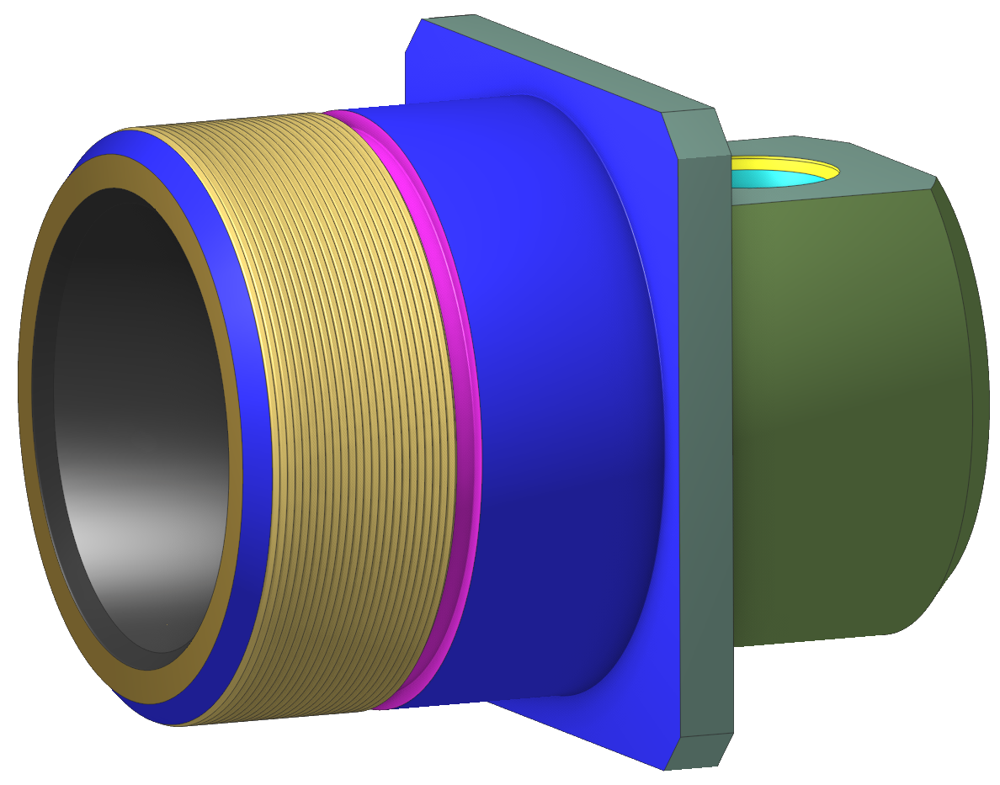

# Solid-Simulation

## Anwendungsbereich:

Bei der **Solid**-Simulation wird das Rohteil als polygonaler Volumenkörper dargestellt. Dadurch lassen sich komplexe Bauteile mit vielen kleinen Merkmalen und scharfen Kanten präzise abbilden. Das Verfahren eignet sich besonders für die Simulation prismatischer Bauteile sowie für Drehfräsprojekte, insbesondere beim Gewindefräsen.

**Hinweis:** Die Frässimulation von 5-Achs-Werkzeugwegen ist in der Betaversion nur eingeschränkt verfügbar.
