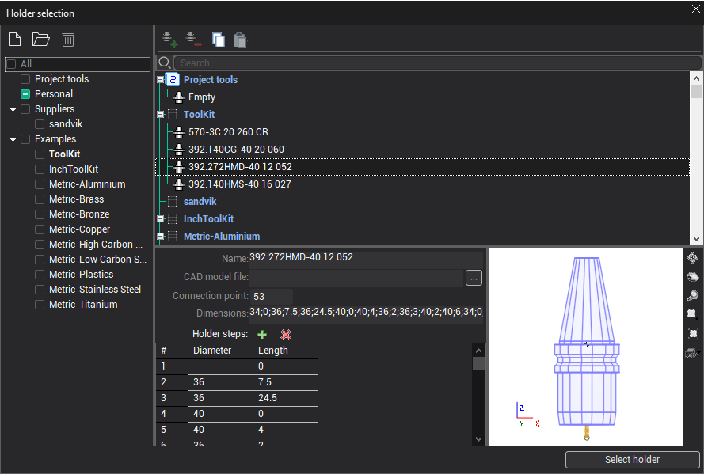

# Auswahlfenster für Fräswerkzeughalter

Das Auswahlfenster für den Fräswerkzeughalter wird über die Schaltfläche auf der Registerkarte **Holder** im [Werkzeugfenster](38.md) geöffnet.

Links befindet sich die Bibliotheksauswahl. Die Halterliste enthält die Halter der markierten Bibliotheken unterhalb des ausgewählten Knotens. Zusätzlich kann die Halterliste des aktuellen Projekts ausgewählt werden. Die bevorzugte Bibliothek wird fett dargestellt. Bibliotheken in den Ordnern **Suppliers** und **Examples** sind schreibgeschützt.

In der Mitte wird die Halterliste der ausgewählten Bibliothek angezeigt.

Unten werden die Parameter und die Vorschau des ausgewählten Halters angezeigt.

Die obere Symbolleiste enthält folgende Funktionen:

- Neuen Halter hinzufügen.
- Ausgewählten Halter löschen.
- Ausgewählten Halter in die Zwischenablage kopieren.
- Halter aus der Zwischenablage einfügen.

Das Feld **Name** legt den Anzeigenamen des Halters als frei wählbare Zeichenfolge fest.

Mit **CAD model filename** wird eine Datei im Format *.stl oder *.osd angegeben. Das darin enthaltene 3D-Modell dient zur Darstellung des Halters und zur Kollisionsprüfung während der Simulation. Die Schaltfläche öffnet den standardmäßigen Windows-Dateiauswahldialog.

**Connection point** bezeichnet den Abstand zwischen dem höchsten Punkt des Halters und seinem Anschlusspunkt an der Maschinenspindel.

Die Halterabmessungen können im Textfeld oder in der Stufentabelle eingegeben werden. Beide Darstellungen werden beim Bearbeiten automatisch synchronisiert.

Im Textfeld werden die Abmessungen als durch Semikolons getrennte Zahlenpaare angegeben. Jedes Paar enthält Durchmesser und Länge einer Stufe.

Mit den Schaltflächen  können Stufen hinzugefügt und entfernt werden.
