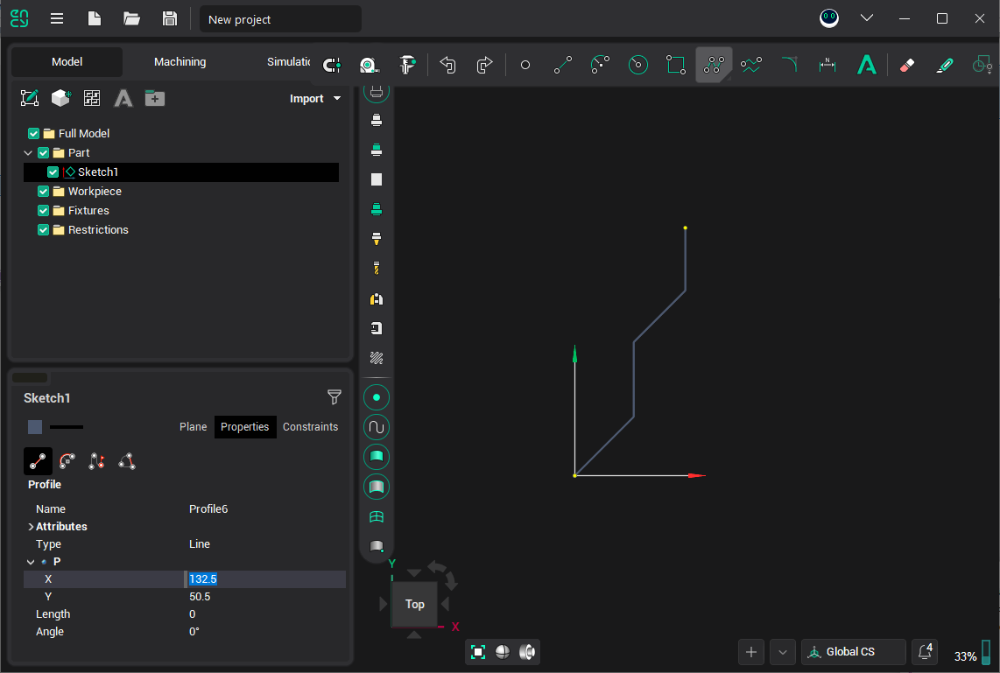
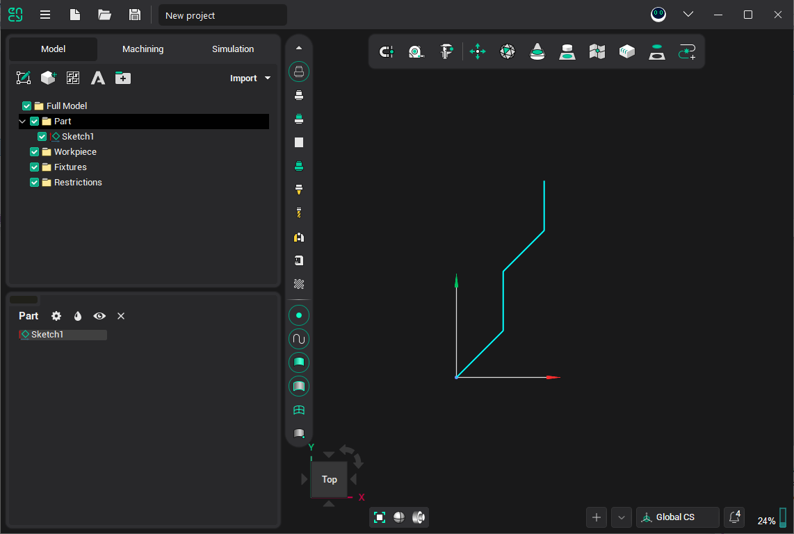
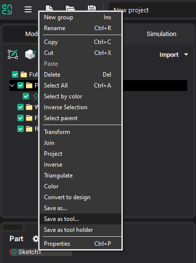
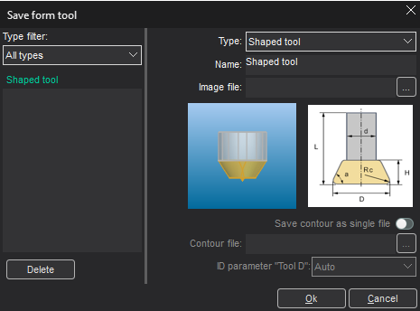
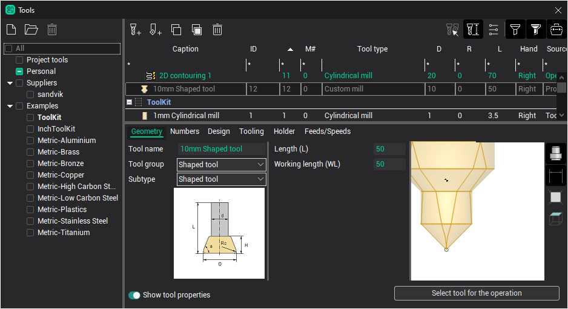

# カスタム工具の作成

成形加工を行うためにカスタム工具を使用します。

この種の加工に対応するため、CAMシステムでは輪郭（形状）を用いたカスタム工具の定義機能が実装されています。

Mill 工具の場合、工具の輪郭を母線（生成線）として定義する必要があります。この機能は、[2D 輪郭加工](404.md), [3D 輪郭加工](700.md) および[5D 輪郭加工](10129.md) の各オペレーションで利用可能です。

曲線はモデルから直接取得するか、 <strong>スケッチ</strong> 機能を使用して作成できます。

カスタム工具を作成するには、以下の手順を実行します。

 <strong>作図</strong> モードに切り替え、工具の形状（プロファイル）を作図します。必要に応じて、この輪郭はパラメータ化することも可能です。

リストまたはビュー上で対象を選択します。リスト内の項目を右クリックしてコンテキストメニューを表示し、 <strong>工具として保存</strong>をクリックします。

すべての工具形状ファイルは、「C:\ProgramData\ENCY Software\ENCY\Version 1\Tools\MillTools」フォルダに保存されます。

表示されるダイアログで、形状の種類、名称、および適用する工具スキーム（任意）を指定します。

ウィンドウ左側には、形状タイプのフィルタおよびこれまでに作成された形状の一覧が表示されます。必要に応じて、既存の形状の名称変更や削除を行うことができます。

輪郭を一つのファイルとして保存 – このオプションを有効にすると、形状のジオメトリをその定義情報とは別に保存することができます。

次に表示される <strong>形状パラメータ</strong> ダイアログで、輪郭ファイル名を指定します。後からこの輪郭を読み込んで編集することも可能です。

最後に、[工具ウィンドウ](38.md)で新しく作成した工具タイプを選択することができます。

重要な点として、工具ライブラリをコピーする際、輪郭ファイルは一緒にコピーされませんのでご注意ください。そのため、工具ライブラリを別のコンピュータへコピーする場合は、輪郭ファイルを手動でコピーする必要があります。
