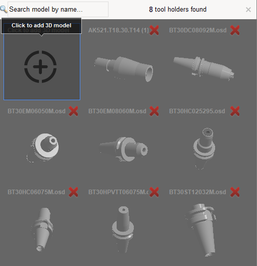
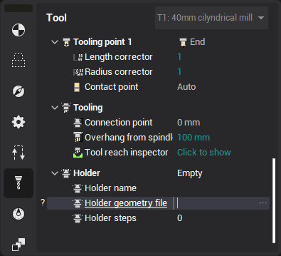
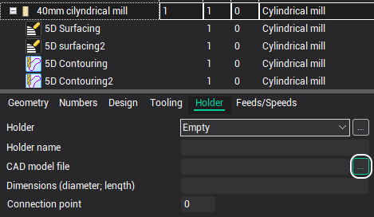
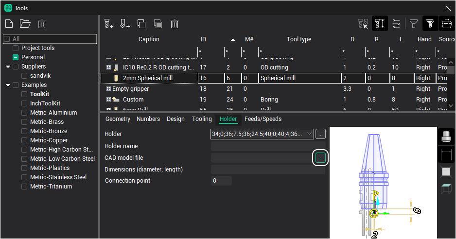

# ホルダー(*.osd) ウィンドウ

ホルダの3Dモデル（*.osd）を開いて追加するためのウィンドウが実装されています。

このウィンドウでは、あらかじめコンピュータ上に用意したホルダモデルを追加することができます。

このウィンドウに追加されたホルダは、設定ファイルに保存され、次回以降は自動的に読み込まれます。

このウィンドウは、以下の場所から開くことができます。

1. インスペクター、工具タブ 
2. オペレーションパラメータ、ホルダータブ 
3. ホルダー選択ウィンドウ 
