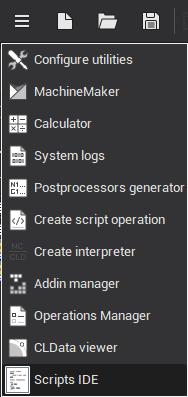
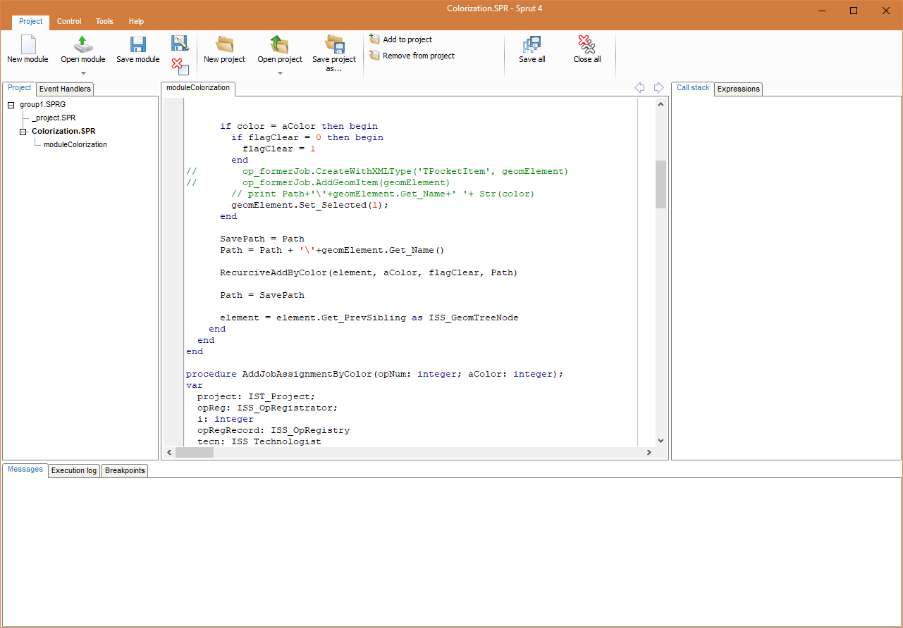
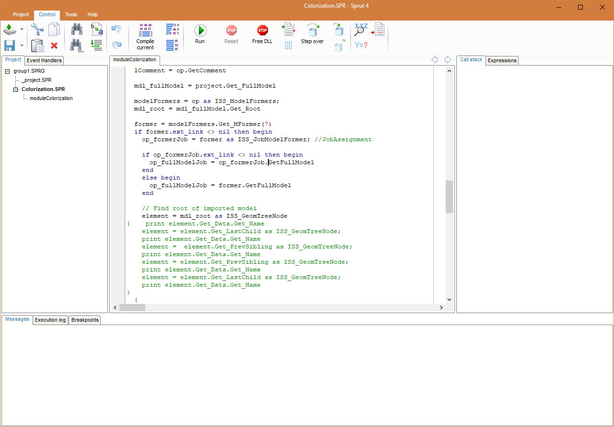

# Scripts IDE

La finestra Scripts IDE può essere aperta dal sottomenu "Utilities" (utilità) selezionando . Scripts IDE consente di creare, eliminare e modificare moduli di script e di assegnare gestori di eventi (procedure) ad alcuni oggetti del sistema.

Sul lato sinistro della finestra sono presenti tre pannelli principali per gestire gli script e le procedure di gestione degli eventi: il pannello "Objects" (oggetti), il pannello "Events" (eventi) e il pannello "Scripts".

Il pannello "Script units" (unità di script) mostra un elenco di file, chiamati unità di script. Ciascuno di questi file può contenere codice scritto nel linguaggio ENCY PL. Le unità di script possono essere memorizzate in modi diversi.

- Come file esterni, memorizzati come di consueto nel file system del computer. Questo metodo di salvataggio consente di utilizzare lo stesso codice di programmazione in più progetti.
- Come file incorporati nel file di progetto *.stcp. Un file di questo tipo può contenere codice di programmazione relativo a un singolo progetto e utilizzabile da posizioni diverse del progetto.
- Come file memorizzati all'interno dell'operazione tecnologica. Questo metodo serve a conservare il codice di programmazione che si applica a una sola operazione. In seguito tale operazione può essere salvata come parametri predefiniti.

Nella parte centrale della finestra si trova un editor di codice, in cui è possibile visualizzare e modificare il codice delle unità di script. Per visualizzare il codice di una determinata unità, fare doppio clic sul nome dell'unità nell'elenco del pannello "Scripts". Ogni unità si apre in una scheda separata dell'editor di codice. In questo modo è possibile modificare contemporaneamente più file.

Per gestire le unità e le schede, utilizzare i pulsanti della barra degli strumenti nella parte superiore della finestra.

Il pulsante "Create script" (crea script)  consente di creare una nuova unità di script vuota. A seconda della voce selezionata nell'elenco "Scripts", la nuova unità verrà memorizzata all'interno dell'operazione, all'interno del progetto oppure come file esterno. Dopo aver premuto il pulsante si apre una finestra di dialogo in cui occorre specificare un nome univoco dell'unità (il nome del file, nel caso di un file esterno).

Il pulsante "Open script" (apri script)  consente di aprire un file esterno in Scripts IDE e di aggiungerlo all'elenco delle unità di script del sistema. Dopo aver fatto clic sul pulsante si apre una finestra standard di selezione del file.

Il pulsante "Save script" (salva script)  salva nel file le modifiche al testo dello script attivo (scheda attiva) apportate nell'editor di codice. Se lo script è memorizzato all'interno di un'operazione o di un progetto, le modifiche vengono salvate soltanto all'interno dell'operazione (progetto). In tal caso, per scrivere le modifiche su disco, occorre salvare anche il progetto.

Il pulsante "Delete active script" (elimina lo script attivo)  rimuove fisicamente l'unità di script attiva.

Il pannello "Objects" contiene gli oggetti che possono avere gestori di eventi. L'elenco degli eventi disponibili per l'oggetto selezionato è mostrato nel pannello "Events" sottostante.

Un evento è un messaggio che compare in vari punti del calcolo del percorso utensile. Gli eventi sono pensati per offrire all'utente la possibilità di influire in qualche modo sulla generazione del percorso utensile. Ogni volta che l'evento viene generato per un oggetto, viene chiamata la routine di gestione assegnata.

Gli oggetti chiave di ENCY che possono contenere eventi sono le operazioni tecnologiche. Pertanto l'elenco degli oggetti nell'editor di script è molto simile all'elenco delle operazioni del processo tecnologico. A loro volta, le operazioni possono avere oggetti figlio che possono avere eventi.

Il gestore di eventi è una routine (funzione o procedura) <strong>ENCY PL</strong> in cui l'utente può descrivere nel linguaggio di programmazione l'esecuzione di determinate azioni al verificarsi dell'evento. In ENCY, per assegnare una procedura alla gestione di un determinato evento di un oggetto, selezionare l'oggetto desiderato nell'elenco degli oggetti e scegliere l'evento desiderato nell'elenco degli eventi. Quindi, nel campo "Script unit" accanto al nome dell'evento, impostare (scegliendolo dall'elenco) il nome dell'unità di script in cui cercare la procedura di gestione. Nel campo "Method name" (nome del metodo) occorre specificare il nome della procedura. Se la procedura di gestione dell'evento non è ancora stata scritta, è possibile creare automaticamente un prototipo vuoto del gestore. A tale scopo, fare doppio clic con il mouse sull'evento desiderato nell'elenco oppure fare clic sul pulsante  accanto al nome dell'evento. Se nel campo "Script unit" è presente il nome di un'unità esistente, la nuova procedura verrà aggiunta a tale unità; in caso contrario verrà aggiunta all'unità attualmente aperta nell'editor di codice.

Pannello del menu Control

Il menu "Control" (controllo) contiene gli strumenti che aiutano a modificare, a verificare la sintassi e a eseguire il debug degli script.

Il pulsante "Compile" (compila)  consente di verificare la presenza di errori di sintassi nel codice.

Il pulsante "Run" (esegui)  serve a riprendere l'esecuzione dello script dopo una pausa.

Il pulsante "Reset" (ripristina)  serve a reimpostare l'esecuzione dello script e il calcolo del percorso utensile.

Il pulsante "Run to line" (esegui fino alla riga)  esegue lo script finché l'esecuzione non raggiunge la riga corrente nell'editor.

Il pulsante "Pause" (pausa)  sospende l'esecuzione dello script.

Il pulsante "Step over" (passo successivo, senza entrare)  esegue il comando corrente dello script senza entrare nel sottoprogramma richiamato (procedura o funzione).

Il pulsante "Step in" (entra nel sottoprogramma)  esegue il comando corrente dello script ed entra nel codice del sottoprogramma richiamato.

Il pulsante "Step out" (esci dal sottoprogramma)  esegue il codice del sottoprogramma corrente e si sospende quando l'esecuzione ritorna al sottoprogramma chiamante.

Il pulsante "Add breakpoint" (aggiungi punto di interruzione)  contrassegna una riga del codice in cui l'esecuzione deve essere sospesa.

Nella parte inferiore di Scripts IDE si trovano i pannelli "Messages" (messaggi), "Execution Log" (registro di esecuzione) e "Breakpoints" (punti di interruzione). Il pannello Messages contiene vari messaggi del sistema e del compilatore. Il pannello Execution log contiene l'output del sistema e di stampa. "Breakpoints" mostra l'elenco dei punti di interruzione.
