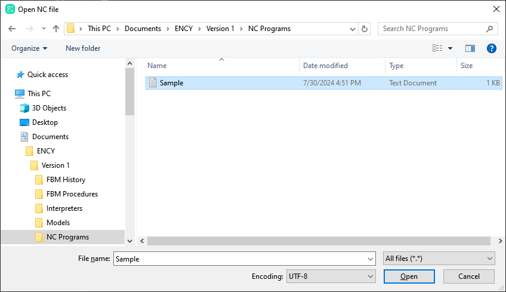
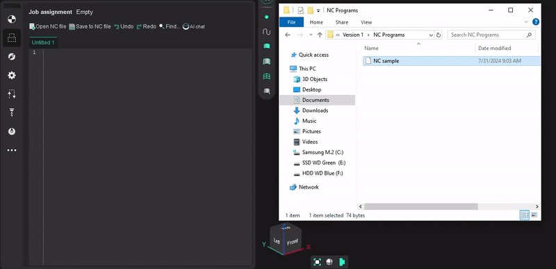
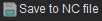
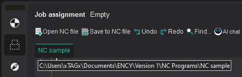
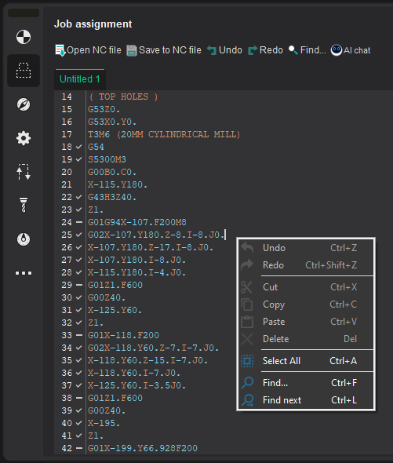
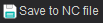
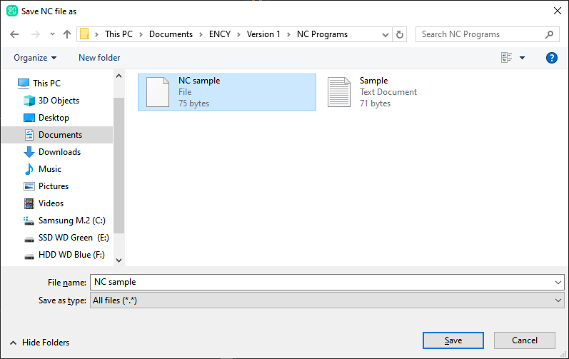
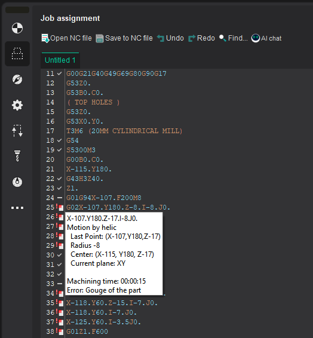
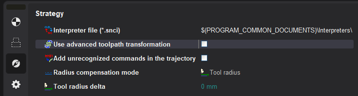

# Auftragszuweisung für G-Code-basierte Operationen

Die [Auftragszuweisung](301.md) dieser Operationen besteht aus NC-Text.  Der Text kann auf folgende Arten festgelegt werden:

1. **Manuell eingeben** im integrierten Texteditor:
  > NC-Beispiel mit G- und M-Codes (ISO 7 Bit)
  >
  > <details>
  > <summary>Beispiel anzeigen</summary>
  >
  > ```
  >
  >
  > G0 X50 Y50 Z100
  >
  > Z0
  >
  > G1 Y0 F1000
  >
  > X100
  >
  > Y100
  >
  > X0
  >
  > Y0
  >
  > X50
  >
  > Y50
  >
  > G0 Z100
  > ```
  >
  > </details>
2. **Aus einer externen Datei laden** und bei Bedarf bearbeiten. Eine Datei kann auf zwei Arten geöffnet werden:
  1. Über den Dateiauswahldialog, der mit folgender Schaltfläche geöffnet wird: ; 
  2. Per Drag-and-drop: Ziehen Sie die gewünschte Datei aus dem Windows-Explorer bei gedrückter linker Maustaste in den integrierten Texteditor und lassen Sie die Maustaste dort los.
    > Demonstration: Datei per Drag-and-drop öffnen
    >
    > <details>
    > <summary>Video anzeigen</summary>
    >
    > 
    >
    > </details>

Standardmäßig trägt das Operationsparameter-Panel die Bezeichnung **Job assignment Empty**. Die Editorregisterkarte heißt bei neuen Projekten `Untitled #`, bei bereits gespeicherten Projekten `Project_Name #`. Dabei steht `#` für die laufende Registerkartennummer. Nach dem Speichern über  oder dem Öffnen einer externen NC-Datei übernimmt die Registerkarte deren Dateinamen. Der vollständige Pfad erscheint im Tooltip. Bei der Datei `NC sample.txt` aus dem Ordner **NC Programs** im gemeinsamen Dokumentverzeichnis des CAM-Systems heißen Panel und Registerkarte beispielsweise **Job assignment** und `NC sample.txt`.




*Hinweis: Änderungen, die außerhalb des integrierten Editors an der verwendeten NC-Datei vorgenommen werden, werden nicht automatisch erkannt. Öffnen Sie die geänderte Datei erneut, um die Auftragszuweisung zu aktualisieren.*

Der integrierte Editor bietet Syntaxhervorhebung für die wichtigsten Strukturen der CNC-Programmiersprache sowie zahlreiche [Tastenkombinationen zur Textbearbeitung](10381.md).

Die wichtigsten Textbearbeitungsfunktionen stehen auch im Kontextmenü zur Verfügung. Öffnen Sie es durch Rechtsklick in den Textbereich auf der Seite **Job assignment**.



Ein fett dargestellter Registerkartenname mit abschließendem **\*** kennzeichnet Änderungen gegenüber dem zuletzt geöffneten oder gespeicherten Dateistand.

| Registerkartenname |   |
|---|---|
| Ohne Änderungen | Mit Änderungen |
| Drill cycles | **Drill cycles*** |

Der Stern verschwindet und der Registerkartenname wird wieder normal dargestellt, wenn:

- Die Änderungen mit  gespeichert werden. Bei bisher nicht gespeichertem, manuell eingegebenem NC-Text werden Speicherort und Dateiname abgefragt. Andernfalls kann die bestehende Datei überschrieben oder der Text unter einem neuen Namen gespeichert werden. 
- Alle Änderungen seit dem letzten gespeicherten Stand über  oder **Ctrl + Z** rückgängig gemacht wurden.

*Hinweis: Versehentlich rückgängig gemachte Änderungen lassen sich mit  oder **Shift + Ctrl + Z** wiederherstellen.*

Verweilt der Mauszeiger kurz über einer NC-Textzeile, zeigt ein Tooltip die zugeordneten Knoten des Werkzeugbahnbaums bzw. CLData-Befehle an.



*Hinweis: Der Tooltip wird ausgeblendet, sobald Sie den Mauszeiger leicht bewegen oder eine Taste drücken, beispielsweise **Esc**, **↓** oder **↑**.*

> Einschränkung der Tooltip-Anzeige
>
> Die Tooltips stehen nur bei deaktiviertem **[Use advanced toolpath transformation](10379.md)** zur Verfügung. Nach der Umwandlung maschinenbezogener CLData in geometrische CLData ist keine eindeutige Zuordnung zwischen NC-Textzeilen und den resultierenden Knoten mehr möglich.
>
> 

Links neben dem NC-Text befindet sich eine Randleiste mit Zusatzinformationen. Vor der Operationsberechnung zeigt sie die Zeilennummern. Nach der Berechnung erscheint zusätzlich der [Status der zugeordneten Werkzeugbahnknoten](742.md). Die Symbole entsprechen denen der CLData-Technologiebefehle. So lässt sich erkennen, welcher NC-Satz fehlerhafte Bahnknoten enthält.

> Zuordnung zwischen NC-Text, CLData-Befehl und Werkzeugbahn
>
> Klicken Sie bei einer berechneten G-Code-basierten Operation im Modus **Technology** auf eine NC-Textzeile und wechseln Sie zu **Simulation**. Der erste zugehörige CLData-Knoten wird ausgewählt und der entsprechende Bahnabschnitt im Grafikfenster hervorgehoben, sofern vorhanden. Umgekehrt können Sie im Simulationsmodus einen Bahnabschnitt oder CLData-Knoten anklicken. Beim Wechsel zu **Technology → Job assignment** wird die erste zugehörige NC-Textzeile markiert, sofern eine Zuordnung besteht.
