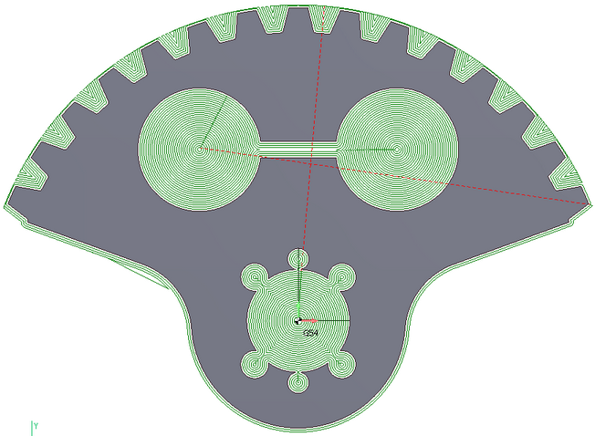
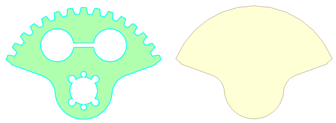
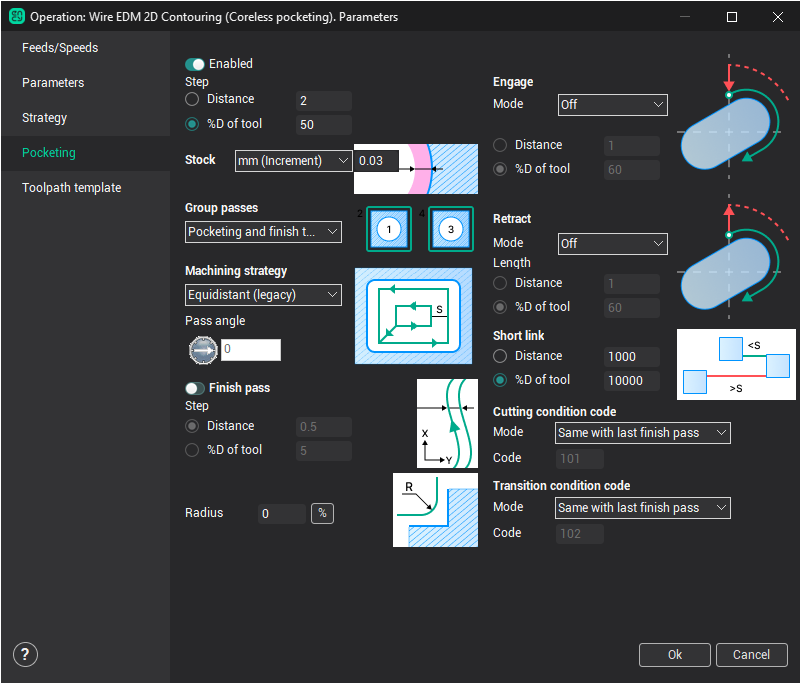
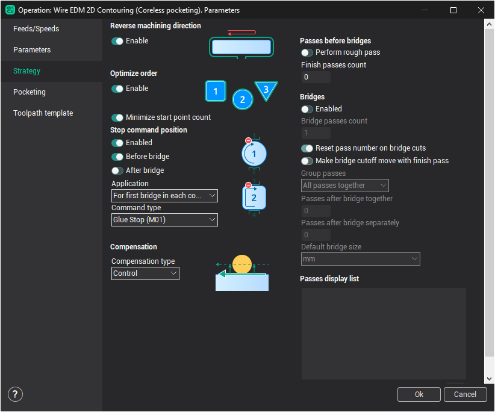

# Abertura de cavidades sem núcleo por eletroerosão a fio

A usinagem de bolsões sem núcleo por eletroerosão a fio foi projetada para remover material de áreas sem a queda de pedaços de metal. A trajetória do fio geralmente começa em furos pré-usinados localizados mais perto do centro do bruto. Ela consiste em passadas equidistantes ou em ziguezague, que removem sucessivamente todo o material dentro dos bolsões.

Ao usar a usinagem de bolsões, especifique na [definição da tarefa](10229.md) somente contornos fechados. Esses contornos podem estar aninhados uns nos outros e descrever tanto ilhas quanto furos (bolsões). Além dos itens da definição da tarefa, o [bruto](738.md) também deve ser especificado para o cálculo correto da trajetória do fio na usinagem de bolsões.

|  |   |
|---|---|
| Definição da tarefa | Bruto |

A usinagem de bolsões por eletroerosão a fio não é uma operação separada do sistema CAM. Ela é uma opção adicional incluída nas operações existentes de contorno por eletroerosão [2D](10246.md) e [4D](10247.md). Assim, a usinagem de bolsões por eletroerosão a fio remove o material de desbaste e, em seguida, as passadas ao longo dos contornos realizam o acabamento da peça com condições de corte especiais.

Para ativar a usinagem de bolsões, marque a caixa de seleção correspondente na página **Pocketing** da janela de parâmetros da operação de eletroerosão a fio.

Quando essa caixa de seleção está marcada, os painéis de edição de parâmetros ficam disponíveis (como estratégia e passo de usinagem, formas de agrupar as passadas etc.). Muitos desses parâmetros são semelhantes aos parâmetros correspondentes das operações de fresamento.

Se for necessário executar somente a usinagem de bolsões de desbaste, sem passadas de acabamento ao longo do contorno, desmarque a caixa de seleção **Perform rough passes** na página **Strategy** da janela de parâmetros da operação.

