# スワーフ

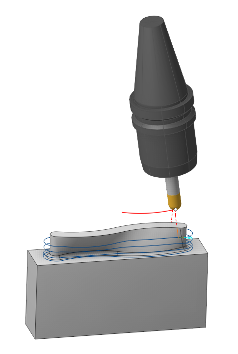

径方向パス間の距離です。

## 適用分野：

このオペレーションは、フライス工具の側面を使用して複雑な線織面を加工します。5軸オペレーションに分類され、工具の傾きを自動的に調整するか、ツールパス上のベクトルを変更して手動で調整できます。主に仕上げに使用しますが、荒加工パスにも対応しています。

### ジョブ割り当て：

このオペレーションには、<strong>下エッジ基準</strong>と<strong>2つのカーブ基準</strong>の2種類の計算アルゴリズムがあります。選択した方法によって、ジョブ割り当ての内容および<strong>加工設定</strong>タブで使用できるパラメータの一部が決定されます。

<strong>下エッジ基準</strong>

<strong>下エッジ</strong> 加工対象となるサーフェスの下側境界を定義する曲線です。 そのパラメータは、<strong>5D輪郭</strong>および<strong>6D輪郭加工</strong>オペレーションの<strong>カーブ</strong><strong>パラメータ</strong>で使用されるものと同様です。

<strong>2つのカーブ基準</strong>

<strong>1番目のカーブ</strong> 加工サーフェス（ワーク）の下側境界のカーブを定義します。

<strong>2番目のカーブ</strong> 加工サーフェス（ワーク）の上側境界のカーブを定義します。

<strong>同期線</strong> 下側カーブと上側カーブの対応関係を定義します。これにより、サーフェスが複数のセクションに分割されます。同期ラインの数が多いほど、サーフェスの形状再現精度が高くなります。

<strong>メッシュサポート</strong> 加工サーフェスを定義するための補助サーフェスです。複雑な形状のモデルで使用されます。自動生成されたサーフェスに追加して使用できるほか、「自動メッシュを使用」のチェックを外した（無効にした）場合は、自動生成サーフェスの代わりに使用できます。

<strong>両方の加工設定で利用可能なパラメータ</strong>

<strong>プロパティ</strong> 要素のプロパティを表示します。ストックを追加することも可能です。リスト内の項目をダブルクリックすることでも、このメニューを表示できます。

<strong>削除</strong> リストから項目を削除します。

<strong>制限</strong> 加工してはならない領域を制限できます。 [詳細を見る](101231.md)

### 加工設定:

#### 加工設定：

このパラメータグループでは、目的に応じたツールパスを作成できます。

詳細を表示

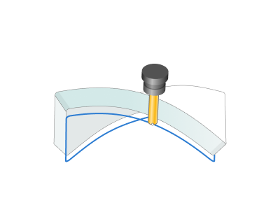

<strong>自動</strong> 切削回数や加工欠陥を最小限になるように、最適なツールパスを計算します。

<strong>最短距離</strong> 上側カーブと下側カーブの距離が最も短くなるように、ツールパスを計算します。

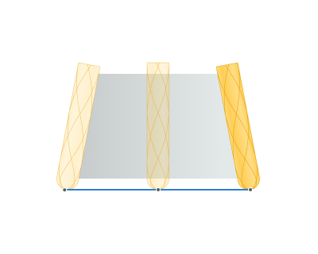

<strong>ガイドカーブに垂直</strong> 主カーブ（下側カーブ）に対して垂直となるようにツールパスを計算します。

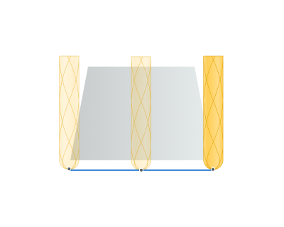

<strong>リーン角度</strong> 移動方向に対して直交する平面内で適用される、追加の工具傾斜角度です。

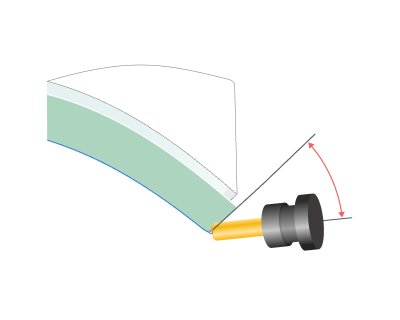

<strong>カスタムベクトルを使用。</strong> デフォルトでは、指定したサーフェスに沿うように工具ベクトルを自動配置します。このオプションを有効にすると、グラフィックウィンドウの任意の点で工具の傾きを手動調整できます。このグループのパラメータは、<strong>5D輪郭加工および6D輪郭加工</strong>の<strong>カーブパラメータ</strong>と同じです。[詳細](10129.md)

.png)

<strong>別の面を使用</strong> 加工する側を反対側に切り替えます。

<strong>自動メッシュを使用</strong> 2つのカーブ間に自動生成されるメッシュを使用するかどうかを設定します。自動生成メッシュは、加工対象サーフェスのカーブ形状に沿わない場合があります。

#### ミーリングタイプ：

曲線加工オペレーションを除き、ほとんどすべてのオペレーションで設定できます。ツールパスの計算時に、必要な切削方式（ダウンカットまたはアップカット）を指定できます。

<strong>ミーリングタイプ</strong>のパラメータは、<strong>ウォータライン荒加工オペレーション</strong>と同じです。 [詳細を見る](736.md)

#### 工具接触点：

工具接触点（TCP）は、加工中に工具とワークのサーフェス、または幾何要素との主な接触位置を定義する、切削工具上の特定の位置のことです。

このグループのパラメータは、<strong>5Dサーフェイシング加工</strong>と同様に動作します。 [詳細を見る](10135.md)

#### 突き抜け：

アンダーカットが検出された場合に、工具を工具軸方向へ指定した距離だけシフトできます。アンダーカットがなく、かつ下側のサーフェスによって移動が制限される場合は、工具はシフトしません。

詳細を表示

.png)

#### 軸方向パス：

このオプションを有効にすると、加工サーフェスに沿った追加パスが生成されます。

詳細を表示

.png)

<strong>カスタム</strong> ユーザーが、<strong>ステップ</strong>および<strong>パス回数</strong>を設定します。

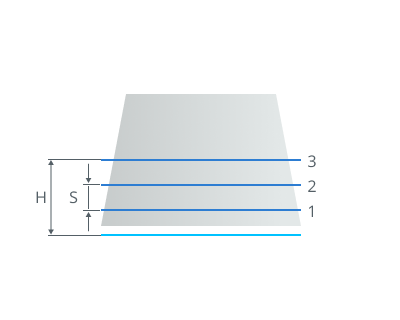

<strong>S</strong> — ステップ。<strong>H</strong> — 高さパラメータ。`*Step*`と`*Pass count*`に基づいて計算します。

<strong>ステップ</strong> 上限高さはシステムが自動的に決定します。パス間のステップ量は、ユーザーがパラメータで指定します。

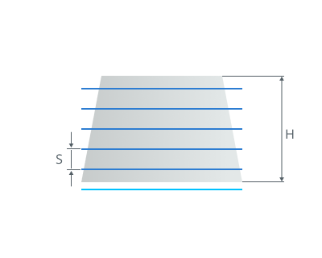

<strong>S</strong> - ステップ <strong>H</strong> - 高さパラメータです。モデルに基づいて自動計算されます。

<strong>回数</strong> 上限高さはシステムが自動的に決定します。ステップ量は、指定されたパス回数に基づいて計算されます。

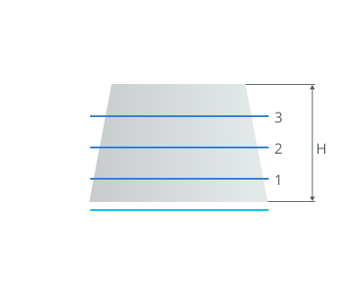

<strong>H</strong> - 高さパラメータです。モデルに基づいて自動計算されます。

<strong>パス回数</strong> 軸方向パスの回数を指定します。

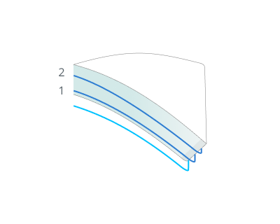

<strong>ステップ</strong> 軸方向パス間の距離を指定します。

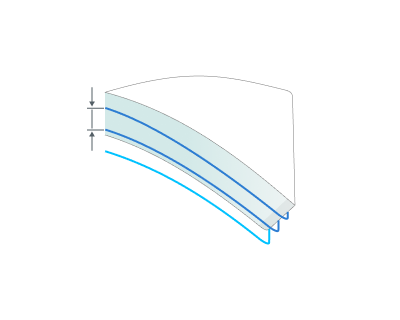

<strong>接触点</strong> 工具の接触点を開始点ラインから終了点ラインへ移動させます。<strong>このパラメータグループは、5Dサーフェシングオペレーションと同様の動作をします。</strong> [詳細を見る](10135.md)

#### 径方向パス：

このオプションを有効にすると、加工サーフェスに対して垂直な追加の荒加工パスが生成されます。

詳細を表示

.png)

このオプションを有効にすると、荒加工パスの実行順序を指定できます。

<strong>高さ</strong> 各高さの配置順に荒加工パスを実行します。

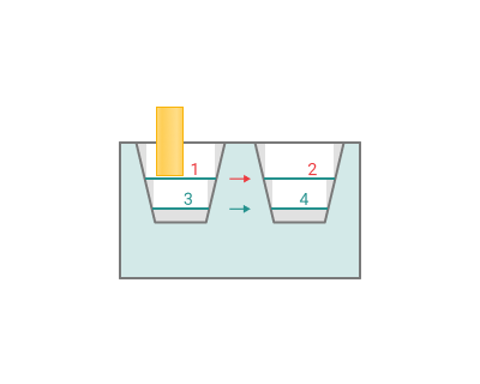

<strong>ストリング</strong> 各ストリングの配置順に荒加工パスを実行します。

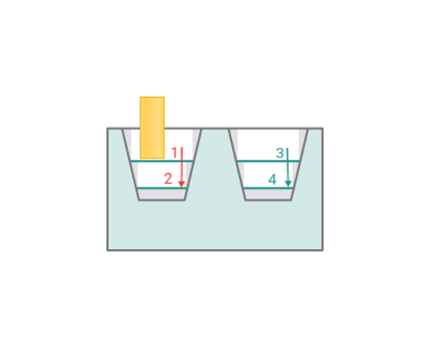

<strong>パス回数</strong> 径方向パスの回数を指定します。

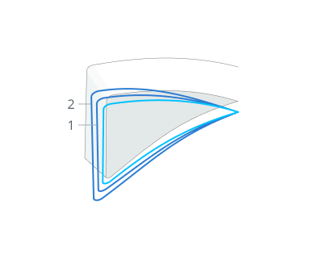

<strong>ステップ</strong> 径方向パス間の距離を指定します。

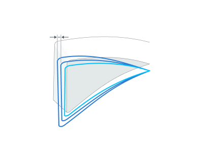

#### パスの延長（＋）／トリム（－）：

ツールパスの開始部分および終了部分を延長またはトリムできます。

詳細を表示

__Trim_(-)_passes.png)

<strong>開始</strong> 正の値を入力すると、ツールパスの加工パス開始位置を指定した量だけ延長します。 負の値を入力すると、パスの開始部分を指定した量だけ短くします。

<strong>終了</strong> 正の値を入力すると、ツールパスの加工パス終点位置を指定した量だけ延長します。 負の値を入力すると、パスの終了部分を指定した量だけ短くします。

#### 並べ替え：

サーフェス加工中におけるツールパスの順序を設定します 。

詳細を表示

<strong>加工順序</strong> パスの生成順序を指定します。

<strong>上方向</strong> パスは下から上に向かって生成されます。

<strong>下方向</strong> パスは上から下に向かって生成されます。

### パラメータ：

このタブには、パーツ、ワーク、治具などを制御し、ツールパスを変更するための主要なパラメータが含まれています。[詳細](100112.md)

### リンク／リード：

リンク／リードタブでは、早送り動作をパラメータで設定します。これらの動作には、工具交換位置からの工具アプローチ、切削パス開始点までの位置決め、最終切削後の退避、加工パス間の移動、および工具交換位置への復帰が含まれます。座標軸に沿った動作の順序、これらの動作の軌跡、および移動量を設定することができます。

詳細を表示

<strong>次の項目で構成されます。</strong>

<strong>アプローチ／リターン</strong> このパラメータグループは、工具交換位置から進入動作開始位置への工具の移動、および復帰の動作を管理します。 [詳細を見る](100116.md)

<strong>リンク</strong> 進入／退出リンクおよび加工動作間のリンクに関するルールを設定します。 [詳細を見る](100130.md)

<strong>リード</strong> 加工動作に対して、送り速度を使用した追加の進入および退避の動作を設定することができます。 [詳細を見る](100136.md)

<strong>安全な動作 安全サーフェス</strong>のタイプとワークから安全サーフェスまでの距離を設定します。加工サーフェスまたはツールパス間の移行を円滑にし、アプローチまたはリターンの最初の段階は、このサーフェスに向かって行われます。 [詳細を見る](100117.md)

<strong>高度なリンク設定 このパラメータグループは、主に5軸加工において、回転軸の最適な動きを考慮した軌道形成の特徴を指定します。</strong> [詳細を見る](100118.md)

<strong>距離</strong> リンクのルールで使用される距離です。 [詳細を見る](100140.md)

### 送り速度設定：

このダイアログを使用して、ユーザーは主軸回転速度、早送り速度、ツールパスの異なる領域の送り速度を設定できます。主軸回転速度は、毎分回転数または切削速度のいずれかで設定できます。設定値には下線が表示されます。もう一方の値は、工具径を考慮し、設定値に基づいて再計算されます。 [詳細を見る](100142.md)

### 変換：

オペレーション内で計算された工具の軌跡に対して座標変換を行うための工程のパラメータグループです。 [詳細を見る](10168.md)

### パーツ：

パーツは、干渉をチェックする対象空間を定義する幾何要素のグループです。 [詳細を見る](330.md)

### ワーク：

オペレーションのワークモデルは、加工対象の素材を定義します。 [詳細を見る](738.md)

### 治具：

治具には通常、チャック、グリップ、クランプなどの固定補助具と、その他の種類の制限領域を指定します。 [詳細を見る](10283.md)
