# Spritzlackieren

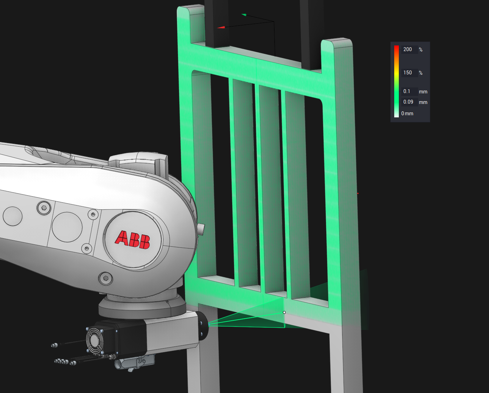

Beim **Spritzlackieren** wird ein Beschichtungsstoff wie Farbe, Tinte oder Lack durch die Luft auf eine Oberfläche gesprüht. Für schwer zugängliche Bereiche werden häufig Anlagen mit vielen Freiheitsgraden verwendet, beispielsweise Industrieroboter.

Das System unterstützt die Programmierung und Simulation dieses Verfahrens.

## Maschinenschema

Wählen Sie zunächst ein [geeignetes Maschinenschema](341.md). Bei korrekter Konfiguration enthält die Liste der unterstützten Anwendungen eines Werkzeuganschlusses **Spray painting**, wie unten dargestellt. Diese Einstellung bestimmt die verfügbaren Operationen und beeinflusst Standardwerte, beispielsweise den Simulationstyp.

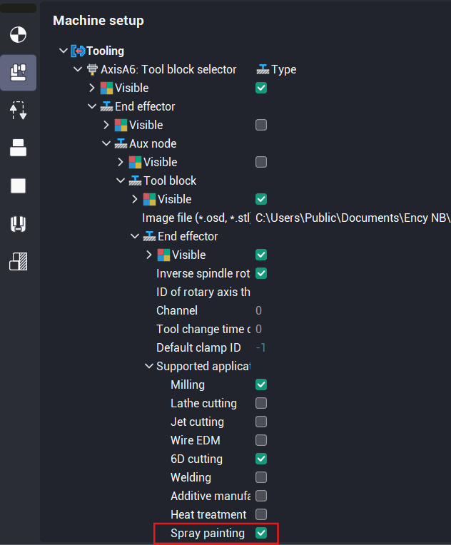

## Bearbeitungsoperationen

Die Gruppe **Spray** enthält vier speziell für das Spritzlackieren vorgesehene Operationen. Sie stehen nur bei einem Maschinenschema mit der unterstützten Anwendung **Spray painting** zur Verfügung.

1)  **Contour spraying:** Kontursprühen auf Grundlage von [6D-Konturieren](10129.md).

2)  **Surface spraying:** Flächensprühen auf Grundlage von [5D-Materialauftrag](10276.md).

3)  **Morph spraying:** Sprühen mit der Strategie [Morph](10138.md).

4)  **Rotary spraying:** Rotationssprühen auf Grundlage von [Rotationsschlichten](10136.md).

> Beim Erstellen einer Sprühoperation wird auf **Tool** automatisch ein Sprühwerkzeug ausgewählt. Auf **Parameters** wird **Painting** als **Simulation type** voreingestellt.
>
> Die verfügbaren Sprühwerkzeuge sind weiter unten beschrieben.

Wählen Sie die für die konkrete Bearbeitungsaufgabe geeignete Operation aus.

Wenn die Werkzeuglage an jedem Bahnpunkt gezielt gesteuert werden soll, eignet sich beispielsweise [Kontursprühen](10129.md) mit [benutzerdefinierten Werkzeugvektoren](10134.md).

Bei einem nicht kreisförmigen Sprühbild, beispielsweise einem elliptischen Sprühfächer, muss die Werkzeugausrichtung relativ zur Bahnrichtung eingehalten werden. Anlagen mit zusätzlichen Freiheitsgraden, etwa Industrieroboter, können das Werkzeug dazu um seine eigene Achse drehen.

Aktivieren Sie unter **[6th axis control](10263.md)** den Modus **Toolpath**, damit die Werkzeugausrichtung relativ zur Bahn erhalten bleibt.

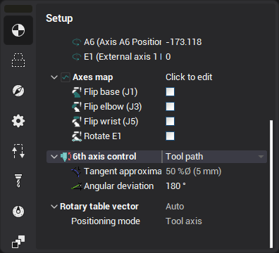

Für **Contour 6D** und **Contour spraying** steht die Option **To inverse odd curves** zur Verfügung. Sie kehrt die Richtung ungeradzahliger Durchgänge automatisch um, ohne dass der Werkzeugwinkel zur Bahntangente manuell angepasst werden muss.

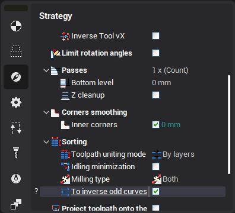

Diese Operationen bieten außerdem **Optimize Tool vX**.

Die Option richtet den X-Vektor des Werkzeugs für alle Durchgänge gleichsinnig aus, indem sie ihn bei Bedarf umkehrt. Dadurch werden Drehbewegungen minimiert.

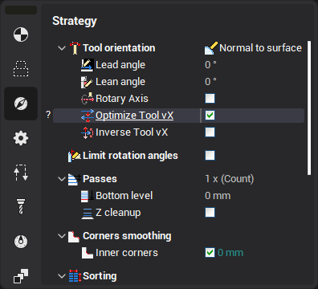 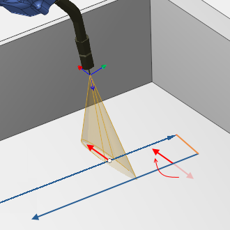

## Sprühwerkzeuge

Das System enthält eine eigene Gruppe von Sprühwerkzeugen mit unterschiedlichen Sprühbildern.

Die folgende Tabelle beschreibt die verfügbaren Typen.

| Werkzeugtyp | Abbildung |
|---|---|
| **Full cone (Vollkegel).** Beschichtet die gesamte Kreisfläche annähernd gleichmäßig. | 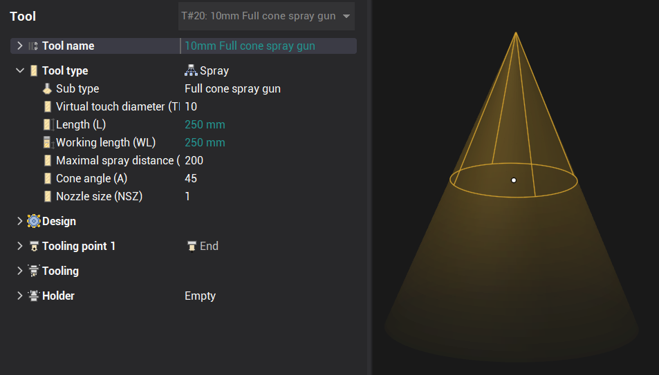 |
| **Hollow cone (Hohlkegel).** Beschichtet einen schmalen Ring am Rand; die Mitte bleibt frei. | 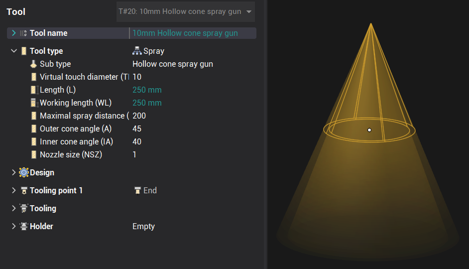 |
| **Elliptic flat fan (Elliptischer Flachstrahl).** Das elliptische Sprühbild wird durch zwei Winkel längs und quer zur Hauptrichtung festgelegt. **Mounting angle** dreht die Hauptrichtung. | 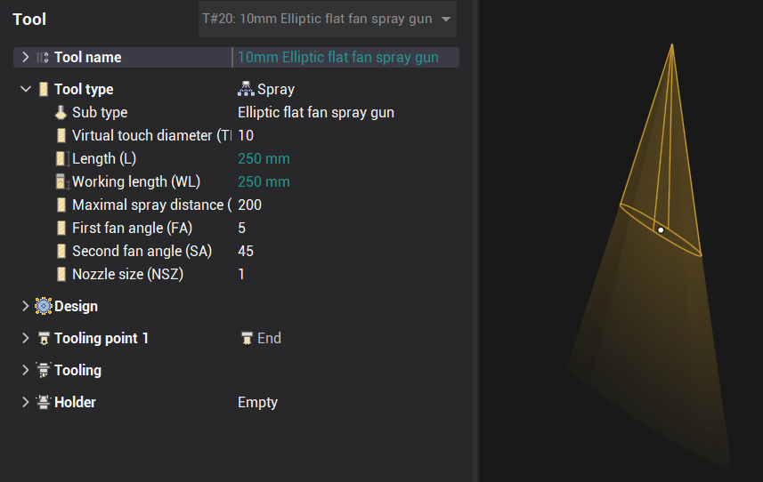 |
| **Elliptic linear fan (Elliptischer Fächer mit Längenangaben).** Zwei Breiten längs und quer zur Hauptrichtung bestimmen das elliptische Sprühbild im Arbeitsabstand. **Mounting angle** dreht die Hauptrichtung. | 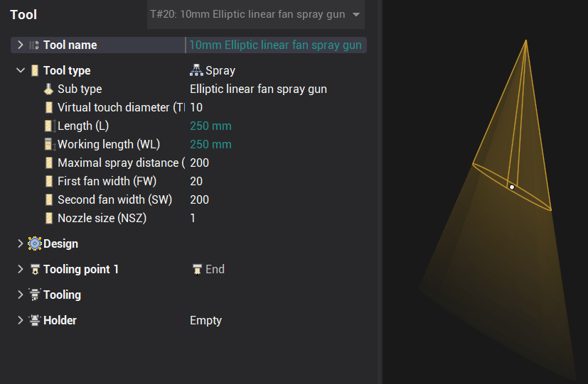 |
| **Rectangular flat fan (Rechteckiger Flachstrahl).** Vielseitig einstellbares Sprühbild, mit dem sich auch mehrere nebeneinander angeordnete Düsen simulieren lassen. **Mounting angle** dreht die Hauptrichtung. | 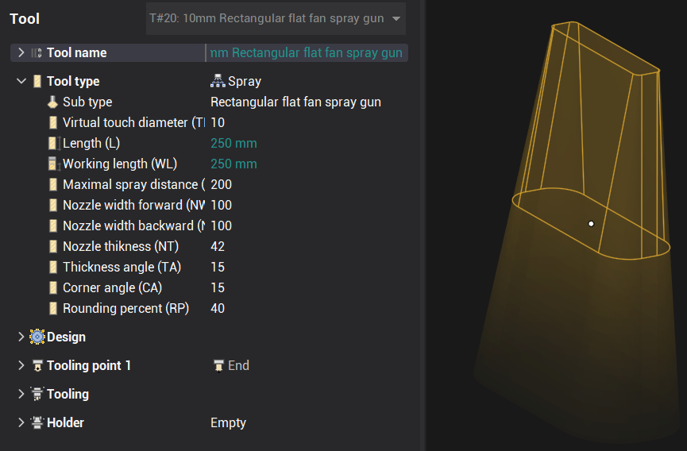 |

Alle Sprühwerkzeuge besitzen den Parameter **Virtual touch diameter**. Er definiert den Durchmesser eines virtuellen kugelförmigen Werkzeugs, wie unten dargestellt. Dieses dient bei der Bahnberechnung zur Bestimmung des Kontakts zum Bauteil. Dadurch können die allgemeinen Strategien zur Werkzeugwegerzeugung auch für Sprühwerkzeuge verwendet werden.

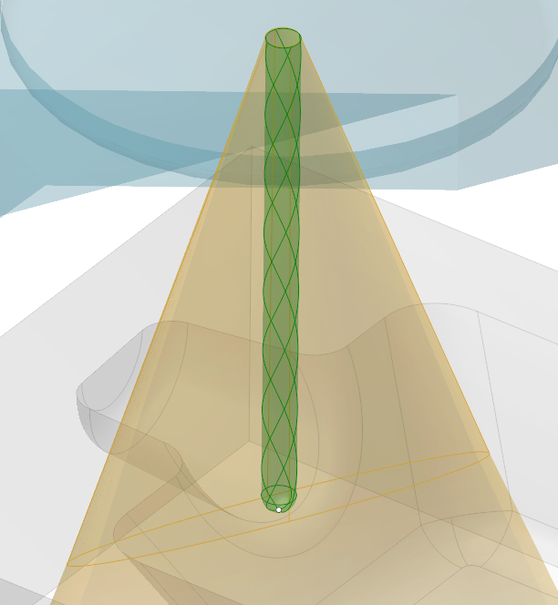

Eine vollständig eingerichtete Sprühoperation kann als Vorlage gespeichert und im selben oder in anderen Projekten wiederverwendet werden. Wählen Sie dazu im Kontextmenü der Operation **Save as user operation**. Weitere Informationen finden Sie unter [Benutzeroperationen](10069.md).

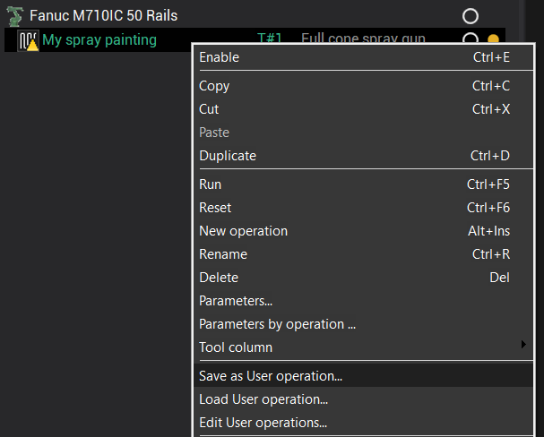 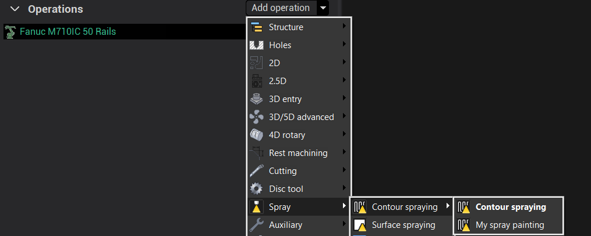

Nach der Bahnberechnung kann das Lackierergebnis auf der Registerkarte **Simulation** geprüft werden. Weitere Informationen enthält der Abschnitt [Lackiersimulation](10330.md).

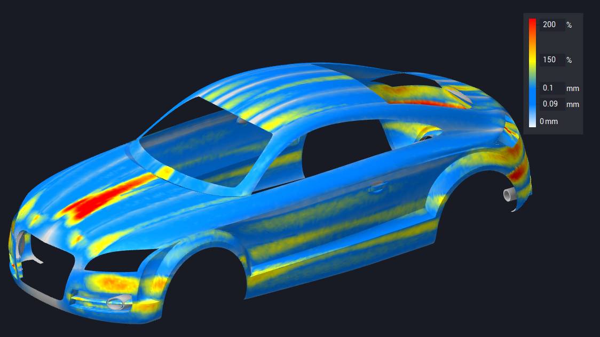
