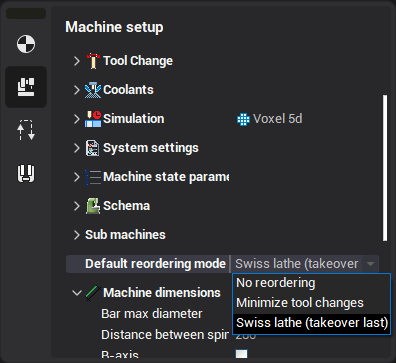

# スイス型旋盤のプログラミング

## 機械要件

スイス型旋盤は、複合旋盤加工部品の完全自動加工を目的として設計されています。通常、2つの主軸と2つ以上のチャンネルを備えています。ただし、CAMシステムでは3チャンネル以上を持つスイス型旋盤には対応していません。一般的なスイス型旋盤（Hanwha、NEXTTURN、Citizen Cincom）は、共通した構造を持っています。これらは2チャンネル、メイン主軸、カウンター主軸、およびメイン主軸またはカウンター主軸で加工を行うための工具グループを備えています。 この構造は、すべてのユーザー用スイス型旋盤スキーマの基礎となる <strong><em>..\ENCY\Supplements\SwissTemplate.xml</em></strong> に記述されています。 <strong><em>SwissTemplate.xml</em></strong>を基にした HANWHA 32 のマシン例も、標準パッケージのマシン一覧に含まれています。

## スイス旋盤プロジェクトテンプレート

プロジェクト作成手順は、連続加工計画とチャンネル同期という2つの段階で構成されます。

連続加工プロセステンプレートを以下に示します。

- その1（主軸）
  - バーフィード （棒材送り）
  - 主軸で加工するオペレーション
  - 切り落とし
  - 掴み換え（切り落としと同期）
- その2（カウンター主軸）
  - カウンター主軸で加工するオペレーション

以下の動画では、簡単なスイス型旋盤プロジェクトの作成手順を示しています。

## 順序変更とチャンネル同期

チャンネル分割の前に、オペレーション一覧の順序を並べ替える必要があります。これは、[シーケンスモード](1029.md)で行うことができます。スイス型旋盤では、操作の並べ替えは自動で行われるため、ユーザーによる手動操作は必要ありません。

デフォルトのオペレーション並べ替えモードは、スイステンプレートで設定されています。スイス型旋盤の並べ替えモードが有効な場合、2つ目のパーツのオペレーションは、並べ替え後の一覧の先頭に配置されます。

