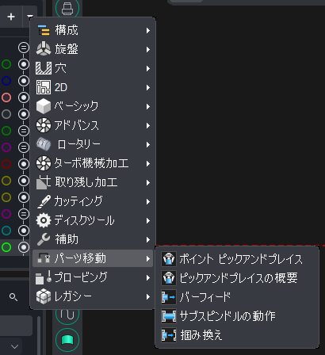

# Move part operations

There is the separate group of the operations which can move the part using robot or swiss-type/lathe machine. It comprises **Pick and Place**, **MTM Takeover**, **Bar feeding** and **Sub spindle working** operations.

