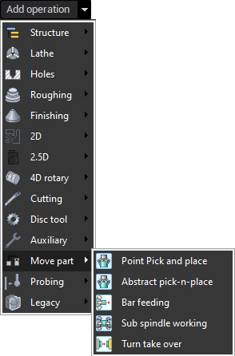

# パーツ移動

ロボット、またはスイス型旋盤や旋盤を使用してパーツを移動するための専用オペレーショングループがあります。<strong>Pick and Place</strong>、<strong>MTM Takeover</strong>、<strong>Bar feeding</strong>、および<strong>Sub spindle working</strong>が含まれます。

