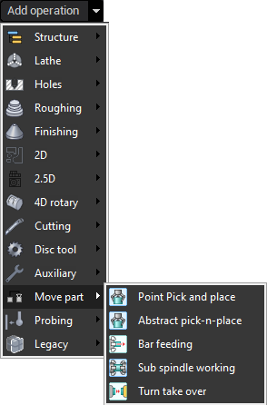

# パーツ移動

パーツを移動させるためのオペレーションには、ロボットまたはスイス型旋盤／汎用旋盤用の専用オペレーショングループがあります。このグループには、<strong>ピックアンドプレース</strong>、<strong>MTM （複合旋盤）掴み換え</strong>、<strong>バーフィード、</strong>および <strong>サブスピンドルの動作</strong>の各オペレーションが含まれます。 
