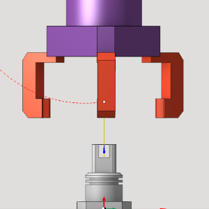
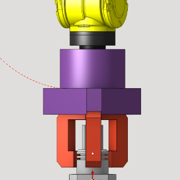
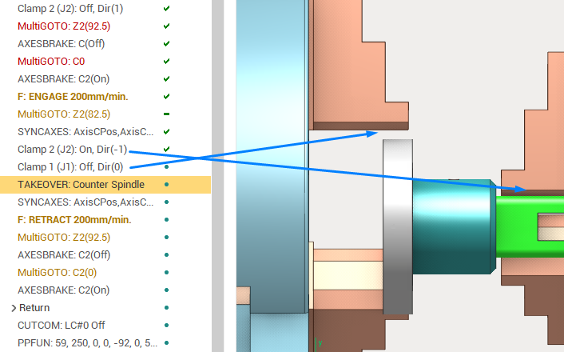
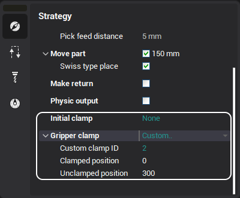
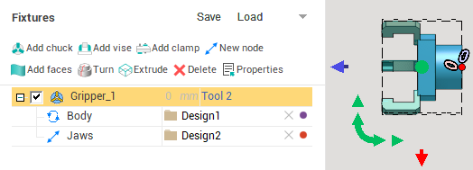

# Spannmittel steuern

Beim Bewegen eines Werkstücks muss häufig auch die übergebende oder aufnehmende Vorrichtung gesteuert werden. Beispielsweise werden Greiferbacken vor dem Aufnehmen geöffnet und anschließend zum Festhalten geschlossen. Die Spannmittelsteuerung fügt automatisch CLData-Befehle zum Zustandswechsel der Spannvorrichtungen während der Werkstückübergabe ein.

  

- CLData-Befehl für Spannmittel
- Automatische Spannmittelsteuerung
- Parameter der Spannmittelsteuerung
- Spannvorrichtungen zum Projekt hinzufügen
- Unterstützte Operationen

## CLData-Befehl für Spannmittel

Der CLData-Befehl **Clamp** beschreibt einen Zustandswechsel einer Spannvorrichtung. Er wird bei der Projektsimulation berücksichtigt und als spezieller M-Befehl an den Postprozessor übergeben. Das Format lautet:

**Clamp** *Clamp ID*: **On/Off**, **Dir**(*Direction*)

- **Clamp ID** ist die eindeutige Nummer der Spannvorrichtung. Die Vergabe wird im Abschnitt zum Hinzufügen von Spannvorrichtungen erläutert.
- **On/Off** gibt an, ob das Werkstück gespannt oder gelöst wird.
- **Direction** ist eine Ganzzahl (+1/-1/0), die die Bewegungsrichtung beim Spannen bzw. Lösen angibt. Beim Spannen nach innen ist der Achswert in geöffneter Stellung größer als in geschlossener Stellung; die Richtung ist daher -1. Beim Spannen nach außen, beispielsweise mit einem innen liegenden Spannmittel, ist sie +1. Beim Lösen kehrt sich die Richtung um. Der Wert 0 bedeutet identische Achswerte für beide Zustände und weist üblicherweise auf fehlerhafte Parameter hin.

## Automatische Spannmittelsteuerung

Die Operationen der Gruppe [Werkstück bewegen](10402.md), beispielsweise [Aufnehmen und Ablegen](10404.md), können **Clamp**-Befehle bei einer Werkstückübergabe automatisch erzeugen. Die eigentliche Zuordnung zum neuen Werkstückhalter erfolgt mit **Takeover**. Ist die Funktion in den Operationsparametern aktiviert, wird die folgende typische Übergabefolge erzeugt. Sie gewährleistet, dass das Werkstück stets von einer Vorrichtung gehalten wird:

1. Zielspannmittel schließen (`Clamp 2: On`).
2. Ausgangsspannmittel öffnen (`Clamp 1: Off`).
3. Werkstück vom Ausgangs- dem Zielspannmittel zuordnen (`Takeover`).

## Parameter der Spannmittelsteuerung

Die [Operationen zum Bewegen von Werkstücken](10402.md) enthalten folgende Parameter zur Ausgabe der Spannbefehle.

Die [Werkstückbewegungsoperationen](10402.md) können grundsätzlich bis zu drei Werkstückhalter verwenden, entsprechend den drei Phasen des Aufnahme- und Ablagevorgangs:

1. Das Werkstück befindet sich im Ausgangshalter.
2. Der Greifer, der ebenfalls als Werkstückhalter dient, transportiert es.
3. Das Werkstück wird im Zielhalter abgelegt.

Für diese Phasen sind drei Parametergruppen vorgesehen. Mehrere Phasen können denselben Halter verwenden. Einige Operationen haben außerdem einen vereinfachten Bewegungsablauf, was sich in den angezeigten Parametern widerspiegelt. Für eine einzelne Phase gelten folgende Einstellungen:

- **Clamp device (Spannvorrichtung).** Wählt das Spannmittel der jeweiligen Phase aus. Wie Vorrichtungen in diese Liste aufgenommen werden, ist unten beschrieben. **None** unterdrückt die Befehlsausgabe. Mit **Custom** kann eine Spannmittel-ID direkt angegeben werden, auch wenn die Vorrichtung weder im Maschinenschema noch unter den Spannmitteln vorhanden ist.
- **Clamped position (Spannstellung).** Achswert für den gespannten Zustand in dieser Phase.
- **Unclamped position (Lösestellung).** Achswert für den gelösten Zustand in dieser Phase.

Beispiele für diese Einstellungen finden Sie in den mitgelieferten Projekten mit Operationen der Gruppe **Move part**.

## Spannvorrichtungen zum Projekt hinzufügen

Das Projekt enthält eine automatisch gebildete Liste von Spannvorrichtungen mit jeweils einer ganzzahligen ID. Aus dieser Liste wird das Spannmittel für jede Übergabephase ausgewählt. Es werden drei Typen unterstützt.

1. **Spannmittel aus der Aufspannung.**  Auf der Registerkarte **Fixtures** der Maschinen-, Aufspannungs- oder Bauteilparameter können Vorrichtungen mit **Add chuck**, **Add vise** oder **Add clamp** erstellt oder aus einer **.mcp**-Datei geladen werden. Über ihre Parameter lässt sich beispielsweise der minimale und maximale Wert der Spannachse festlegen. Weitere Informationen enthält der Abschnitt [Spannmittel](10283.md).

2. **Spezielle Maschinenachse aus MachineMaker.** Ein Greifer oder eine Schweißzange kann als Maschinenachse mit der Kennzeichnung **clamp** angelegt werden. Diese Achse steuert den Spannzustand und gehört zum Maschinenschema, nicht zu den separat hinzugefügten Spannmitteln. Die [Werkstückbewegungsoperationen](10402.md) können sie automatisch spannen und lösen. Die Erstellung ist in der MachineMaker-Dokumentation beschrieben.
3. **Parametrische Spannbackenachsen.** Bei vielen Drehmaschinen sind die Backen der Haupt- oder Gegenspindel im Maschinenschema definiert. Sie drehen sich mit der Spindel und werden bei Simulation und Kollisionsprüfung berücksichtigt. Erkannte Backenachsen werden automatisch mit einer eigenen ID in die Spannmittelliste aufgenommen. Das mitgelieferte Projekt *Turn-Milling/Takeover.stcp* zeigt ein entsprechendes Schema und dessen Verwendung bei der [Werkstückübernahme](10406.md).

## Operationen mit automatischer Spannmittelsteuerung

- [Aufnehmen und Ablegen](10404.md)
- [Werkstückübernahme](10406.md)
- [Stangenvorschub](10408.md)
