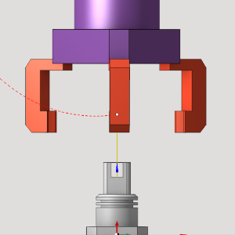
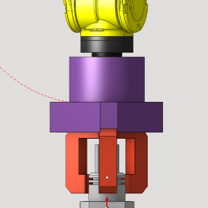
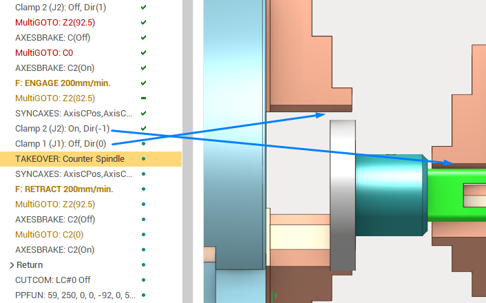
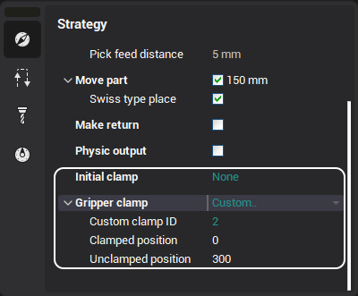
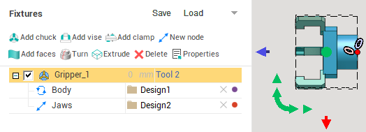

# クランプ装置の制御

パーツ移動オペレーションでは、多くの場合、初期位置から最終位置へパーツを搬送するための装置の制御が必要になります。例えば、パーツを把持する前にチャックの爪（ジョー）を開き、その後、パーツを固定するために爪を閉じる動作などです。このクランプ機能により、ワークをあるワークホルダーから別のワークホルダーへ移動する過程で、クランプ装置の状態を変更するためのCLDataコマンドを自動的に挿入することが可能になります。

  

- 新しいCLDataコマンド
- 自動クランプ制御
- クランプ制御パラメータ
- プロジェクトへのクランプ装置の追加
- 自動クランプ制御に対応するオペレーション一覧

## 新しいCLDataコマンド

クランプ装置の状態変化を示すために、新しい専用のCLDataコマンドが使用されます。このコマンドは、プロジェクトのシミュレーション時に考慮される他、専用の「M」コマンドとしてポストプロセッサーにも出力されます。`Clamp` CLDataコマンドの形式は以下の通りです。

<strong>Clamp</strong> `Clamp ID`: <strong>On/Off</strong>, <strong>Dir</strong>(`Direction`)

- `Clamp ID` 特定のクランプ装置を識別するために使用する固有の番号です。クランプIDの割り当て方法については、クランプ装置の作成に関するセクションを参照してください。
- <em>On/Off</em> は、パーツを把持するか解放するかを示すフラグです。
- **Direction** クランプ／アンクランプ動作時のクランプの移動方向を示す整数（+1／-1／0）です。 クランプ動作を例に説明します。パーツを固定するために爪を内側に押し込む場合（アンクランプ位置の軸値がクランプ位置の軸値より大きい場合）、方向 は「-1」となります。一方、パーツを固定するために爪を外側に押し出す場合（クランプがパーツの内側にある場合）、方向は「+1」となります。アンクランプの場合は、方向は反転します。「0」は、クランプ状態とアンクランプ状態でクランプの軸値が同じであることを示します（通常、これはクランプ装置のパラメータ設定に誤りがあることを意味します）。

## 自動クランプ制御

[ピックアンドプレース](10404.md)などの[パーツ移動オペレーション](10402.md) グループでは、パーツをあるワークホルダーから別のワークホルダーへ移動する際に、`Clamp` CLDataコマンドを自動的に出力することができます。この移動は `Takeover` CLDataコマンドによって実行されます。

オペレーションパラメータで有効になっている場合、一般的なパーツ受け渡しプロセス（上のクリーンショットの例を参照）をシミュレーションするために、`Clamp` コマンドが自動生成されます。これにより、パーツは常にいずれかの装置によって保持されている状態が確保されます。

1. 移動先のクランプをクランプする（Clamp 2: On）
2. 移動元のクランプをアンクランプする（Clamp 1: Off）
3. 移動元のクランプから移動先のクランプへ受け渡しを行う（Takeover）

## クランプ制御パラメータ

[パーツ移動オペレーション](10402.md)には、クランプ制御コマンドの出力に影響する以下のパラメータがあります。

一般的に、[パーツ移動オペレーション](10402.md)では、ピック＆プレースプロセスの3つの段階に対応する最大3つのワークホルダーを扱うことができます。

1. パーツは移動元のワークホルダーに配置されます。
2. パーツはグリッパー（これもワークホルダーの一種）を使用して搬送されます。
3. パーツは移動先のワークホルダーに配置されます。

クランプパラメータには、上記の各段階に対応する3つのパラメータグループがあります。各段階のワークホルダーが同一である場合や、このグループ内の一部のオペレーションにおいて、パーツ移動プロセスがより単純化されている場合があります。これらもクランプパラメータに反映されます。ここでは、1つの段階におけるパラメータについて説明します。

- <strong>クランプ装置</strong>のコンボボックスでは、該当するパーツ移動段階で使用するクランプを選択できます。このリストでクランプ装置を選択できるようにする方法については、下記のセクションを参照してください。このパラメータには `なし`を指定することも可能で、その場合はコマンドは出力されません。`カスタム`を選択すると、マシンスキーマ内やフィクスチャにその装置が登録されていない場合でも、クランプIDを明示的に指定できます。
- <strong>クランプ位置</strong> 該当するパーツ移動段階における装置の「クランプ」状態に対応する軸位置です。
- <strong>アンクランプ位置</strong> 該当するパーツ移動段階における装置の「アンクランプ」状態に対応する軸位置です。

クランプパラメータの定義方法の例については、「パーツ移動」オペレーションを含むサンプルプロジェクトを参照してください。

## プロジェクトへのクランプ装置の追加

プロジェクトにはクランプ装置の一覧があり、各装置は整数のIDで識別されます。この一覧は自動的に作成され、パーツ移動の各段階で使用するクランプ装置の選択に使用されます。現在、クランプ装置には3つのタイプがあります。

1. <strong>治具用クランプ</strong>  マシン/ステージ/パーツ パラメータの「治具」タブでは、「<strong>チャック追加</strong>」、「<strong>バイス追加</strong>」、「<strong>クランプ追加</strong>」 ボタンを使用してクランプ装置の治具を作成するか、<strong>.mcp</strong> ファイルからクランプモデルを読み込むことができます。フィクスチャのパラメータを使用してクランプモデルを変更できます。例えば、治具クランプの「軸」ノードの最小値および最大値を設定できます。治具の作成方法およびパラメータの詳細については、プロジェクトドキュメントの[プロジェクト内の治具](10283.md)を参照してください。
2. <strong>Machine Maker</strong> で作成される<strong>特殊軸</strong>です。例えば、Machine Maker で専用の「クランプ」フラグを設定したグリッパーやタック溶接ツールを、治具ではなく機械軸として作成し、この軸を使用してグリッパーの状態を変更することができます。 また、このような装置では、[パーツ移動オペレーション](10402.md)を使用することで、自動クランプ／アンクランプ制御が可能になります。このようなクランプ装置の作成方法については、「CAM システムMachine Maker」ドキュメントを参照してください。
3. <strong>"パラメトリック爪"</strong> 軸 多くの旋盤機には、マシンスキーマファイル内で個別に定義された主軸または対向主軸のチャック爪が備わっています。これらは主軸とともに回転し、シミュレーションおよび干渉チェックの際にも考慮されます。このように自動認識された爪軸も、マシンのクランプリストに自動的に追加されます。これらのクランプIDは自動的に割り当てられます。このようなマシンスキーマの例や、[MTM掴み換え](10406.md)MTM掴み換え オペレーションにおけるクランプの使用例については、<em>Turn-Milling/Takeover.stcp</em>のサンプルプロジェクトを参照してください。

## 自動クランプ制御に対応するオペレーション一覧

- [ピックアンドプレース](10404.md)[MTM掴み換え](10406.md)
- [バーフィード](10408.md)
