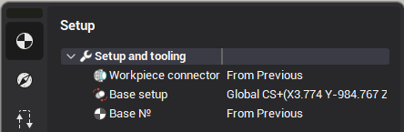
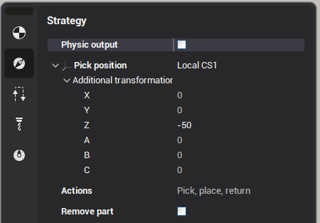
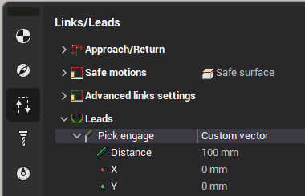
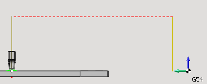

# ピックアンドプレース

#### ツールパスパラメータ

"<strong>ピックアンドプレース</strong>"オペレーションは、グリッパー工具を制御して、マシンの加工領域内でワークを移動するために設計されています。

ワークは、前のオペレーションで定義された位置から <strong>ワークコネクター</strong> および <strong>ワークセットアップ</strong> によって定義された新しい位置に移動します。グリッパーのすべての動作は、定義された <strong>ワーク座標系</strong>内で生成されます。

ピックアンドプレースオペレーションのツールパスには、ピック、プレース、リターンの3つの主要なセクションがあります。

 <strong>ピックセクション</strong> には、工具の初期位置(通常は工具交換位置)から、パーツのピック位置までのグリッパーの移動が含まれます。ピック位置は、図形の座標系に追加のオフセットを適用して定義されます。 <strong>配置セクション</strong> には、ワークを保持したグリッパーが、ピック位置から新しい位置へ移動する動作が含まれます。この動作は、安全サーフェスを経由して実行するか、衝突回避オプションを有効にして実行することができます。 <strong>リターンセクション</strong> は、ワークを保持していないグリッパーが、プレース位置から最終位置(通常は工具交換位置)まで移動する動作です。 <strong>アクション</strong>パラメータでは、生成すべきセクションを定義します。<strong>パーツを除去</strong>オプションが有効な場合、配置後にワークは消去されます。

#### 接近／退避の追加

これらのパラメータを使用すると、ピック位置およびプレース位置への接近/リトラクト動作の長さと方向を定義できます。「ピック・接近動作」を例に挙げます。このパラメータは、部品をピックするための工具の接近動作（専用の "接近動作 "送りを使用）を開始する位置を定義します。接近動作には3つのタイプがあります。<strong>なし</strong> - 接近動作を無効にします。 <strong>自動</strong> - 工具軸方向に沿って接近動作を実行します。 <strong>カスタムベクトル</strong> - 指定した方向に沿って接近動作を実行します。

<strong>距離</strong>パラメータは、選択した方向に沿った工具の移動距離を設定します（この動作は接近動作送りを使用して実行されます）。

上のスクリーンショットは、ピックアンドプレース軌跡の一例を示しています。垂直方向のセグメントが接近／退避動作に対応しています。（この例では同じ長さになっています。）赤色は早送り、オリーブ色は接近／退避送りを示します。

#### 「次工程へ配置」

これは特殊なピックアンドプレースオペレーションで、"引き渡し "と同様に、部品を置く位置を <strong>次の</strong>オペレーション(通常は<strong>セットアップステージ</strong>か<strong>パーツ</strong>グループ)から取得します。その他のパラメーターは、一般的なピックアンドプレースオペレーションと同じです。

このオペレーションは、主にロボットおよびフライス加工機で使用します。旋盤加工または複合旋盤加工では、代わりに専用の「<strong>引き渡し</strong>」オペレーションを使用することを推奨します。

#### ピックアンドプレースプロジェクト作成チュートリアル

以下の動画では、アセンブリプロジェクトの作成方法を解説しています。[詳細を見る](https://www.youtube.com/watch?v=ldhIhf3v1nY)

#### プロジェクト例

ピックアンドプレースの使用例は、サンプルプロジェクト「<em>Milling/WoodWorking/FrameAssembly.stcp</em>」、および「<em>Robots/Pick and place</em>」フォルダー内のプロジェクトを参照してください。
