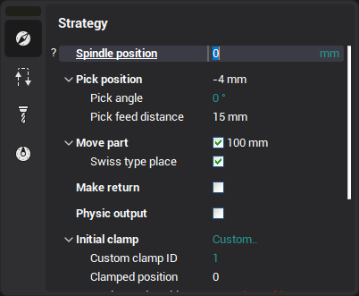
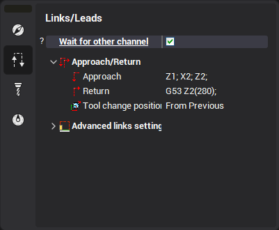
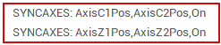

# サブスピンドルの動作

#### オペレーション概要

<strong>サブスピンドルの動作</strong>オペレーションは、サブスピンドルを備えた複合旋盤向けに、一般的な<strong>ピックアンドプレース</strong>オペレーションを適用および拡張したものです。このオペレーションでは、次のことが 可能です。 メインスピンドルとカウンタースピンドルを同期させる 両方のスピンドルで後続の加工を行うために、カウンタースピンドルでパーツを把持する インスピンドル(カウンタースピンドル)でパーツを移動する

したがって、このオペレーションのツールパスには、一般的なピックアンドプレースと同じセクションがすべて含まれます。

#### サブスピンドルの動作パラメータ

 

###### スピンドル位置

このオペレーションにおけるメインスピンドルの初期位置を、物理座標系で指定します（2軸仕様の旋盤／スイス型旋盤の場合）。この位置は、<strong>前のオペレーション</strong>の<strong>リターン</strong>セクションに出力されます。

###### ピック位置

パーツを把持するサブスピンドルの位置です

###### ピック送りの距離

パーツを把持する前に接近送りで行われる移動距離です。

###### プレース実行

このパラメータを有効にすると、アクティブなスピンドル内でのワークの新しい位置（WCSからスピンドルの基点までの距離）を定義できます。無効にすると、アクティブなスピンドル内でのワーク位置は変更されません。

###### スイス型旋盤用プレース

このパラメータを有効にすると、アクティブなスピンドルはワークなしで移動します。無効にすると、サブスピンドルは把持したワークと共に移動します。

###### リターン

このパラメータを有効にすると、メインスピンドルと反対側のスピンドルの同期が解除され、ホームポジションへ移動します。メインスピンドルとサブスピンドルを同期および連結した状態のままにする場合は、このパラメータを無効にします。リターン動作を行わない場合、それ以降のすべてのオペレーションは両方のスピンドルで実行されます。

###### リターン送りの距離

パーツを把持した後に、退避送りで行われる移動の距離です。

###### クランプパラメータ

メインスピンドルまたは反対側のスピンドルで使用するクランプ装置を定義します。クランプ制御パラメータの詳細については、 [クランプ装置の制御](10403.md) を参照してください。

###### 他のチャンネルを待機

このパラメータを有効にすると、サブスピンドルの接近動作の前に "<strong>Wait</strong>" CL-data コマンドが挿入されます。つまり、他のチャンネルのオペレーションによる加工が完了した後にのみ、このオペレーションが加工を開始することになります。

このパラメータは、マシンスキーマに2つ以上のチャンネルがあり、かつ直前のオペレーションが <strong>他のチャンネル</strong> のものである場合にのみ表示されます。

###### アプローチ/リターンパラメーター

CAMシステムオペレーションで共通して使用されるパラメータ群で、オペレーションのアプローチセクションおよびリターンセクションを定義します。詳細は [アプローチリターンルール](10071.md) のドキュメントを参照してください。

#### スピンドルの同期

<strong>サブスピンドルの加工オペレーション</strong>では、スピンドルを同期させるための新しいCL データコマンドが自動的に生成されます。

#### プロジェクト例

スピンドル同期を使用した旋盤部品加工の例については、 <em>Turn-Milling/Hanwha</em> サンプルプロジェクトを参照してください。

<strong>詳細を見る</strong>:

[パーツ移動](10402.md)

[スイス型旋盤のプログラミング](104011.md)

[パーツ移動の機械要件](10413.md)

[クランプ装置の制御](10403.md)
