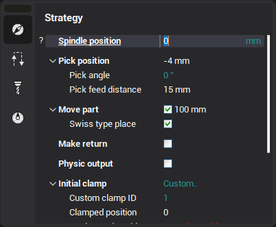
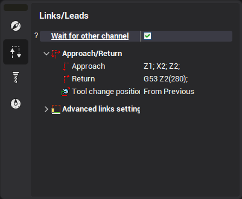
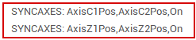

# Trabalho com contrafuso

#### Visão geral da operação

A operação <strong>Sub spindle working</strong> é uma adaptação da operação comum de <strong>pick-and-place</strong> para máquinas de torneamento-fresamento com contrafuso. Ela permite: sincronizar o fuso principal e o contrafuso; pegar a peça com o contrafuso para a usinagem posterior em ambos os fusos; mover a peça no fuso principal (contrafuso).

Portanto, o percurso da ferramenta dessa operação tem todas as mesmas seções que o pick-and-place comum.

#### Parâmetros de Sub spindle working

 

###### Posição do fuso

Posição inicial do fuso principal nas coordenadas físicas para essa operação (se a máquina for um torno/torno de cabeçote móvel com 2 fusos). Ela é emitida na seção de <strong>retorno</strong> da <strong>operação anterior</strong>.

###### Posição de pega

A posição do contrafuso em que ele segurará a peça.

###### Distância de avanço da pega

O comprimento do movimento executado com o avanço de entrada antes de pegar a peça.

###### Colocar

Se o parâmetro estiver ativado, você poderá definir a nova posição do bruto no fuso ativo (distância do WCS até o ponto base do fuso). Se o parâmetro estiver desativado, a posição do bruto no fuso ativo não será alterada.

###### Colocação tipo suíço

Se o parâmetro estiver ativado, o fuso ativo será movido sem o bruto; caso contrário, o contrafuso será movido com o bruto fixado.

###### Fazer retorno

Se o parâmetro estiver ativado, os fusos principal e oposto serão dessincronizados e movidos para a posição inicial. Desative esse parâmetro se quiser que o fuso e o contrafuso permaneçam sincronizados e conectados. Todas as operações seguintes são realizadas em ambos os fusos se não houver movimento de retorno.

###### Distância de avanço de retorno

O comprimento do movimento executado com o avanço de retração após pegar a peça.

###### Parâmetros de fixação

Defina os dispositivos de fixação usados pelo fuso principal ou oposto. Para obter mais informações sobre os parâmetros de controle de fixação, consulte o artigo [Controle de dispositivos de fixação](10403.md).

###### Esperar por outro canal

Se esse parâmetro estiver ativado, o comando CL-data <strong>Wait</strong> será inserido antes da aproximação da operação Sub spindle working. Isso significa que essa operação iniciará a usinagem somente depois que a operação do outro canal concluir a usinagem.

Esse parâmetro fica visível somente se houver pelo menos 2 canais no esquema da máquina e a operação anterior for de <strong>outro canal</strong>.

###### Parâmetros de aproximação/retorno

O grupo de parâmetros comum (à maioria das operações do sistema CAM) que define as seções de aproximação e retorno da operação. Consulte a documentação [Regras de aproximação e retorno](10071.md) para obter mais informações.

#### Sincronização de fusos

A operação <strong>Sub spindle working</strong> gera automaticamente o comando New CL-data para a <strong>sincronização dos fusos.</strong>

#### Exemplo de projeto(s)

Consulte o projeto de exemplo <em>Turn-Milling/Hanwha</em> para ver um exemplo de usinagem de peças de torno com a sincronização de fusos.
