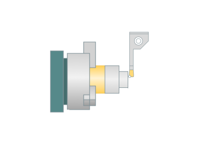
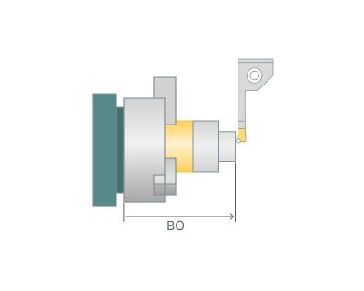

# Stangenvorschub

## Anwendungsbereich:

Die Operation **Bar feeding** automatisiert das Zuführen langer Stangen in die Maschine, insbesondere in CNC-Drehzentren und Drehmaschinen.

## Einrichtung:

Auf **Setup** werden grundlegende Parameter wie Bauteillage und Werkstückkoordinatensystem festgelegt. [Details](1022.md)

## Strategie:

### Stangenüberstand

Axialer Abstand zwischen Spindelbasispunkt und Werkzeugbezugspunkt.

Weitere Informationen anzeigen

**BO –** Stangenüberstand

### Werkzeugkontaktposition

Kontaktposition der Werkzeugspitze im Werkstückkoordinatensystem G54.

Weitere Informationen anzeigen

**X, Y, Z.** Auswahl der als Drehachse verwendeten Achse des angegebenen Koordinatensystems.

### Start mit Ziel

Weitere Informationen anzeigen

**Aktiviert:** Das Koordinatensystem bleibt beim Verschieben des Werkstücks an seiner Position.

**Deaktiviert:** Das Koordinatensystem wird mit dem Werkstück verschoben.

### WCS / Festzyklus verwenden

Weitere Informationen anzeigen

**Aktiviert:** Der Stangenvorschub wird als Zyklus zur weiteren Verarbeitung im Postprozessor ausgegeben.

**Deaktiviert:** Ausgabe als Folge elementarer Befehle.

### Physische Ausgabe

Weitere Informationen anzeigen

**Aktiviert:** Verwendet **Physicgoto** und physische Maschinenkoordinaten.

**Deaktiviert:** Verwendet **Multigoto** oder **Goto** und die entsprechenden Koordinaten.

### Ursprüngliches Spannmittel

Das Spannmittel, das das Werkstück anfangs hält. Die Befehle zum Spannen und Lösen werden automatisch ausgegeben. Die Parameter entsprechen denen der Werkstückübernahme. [Details](10406.md)
