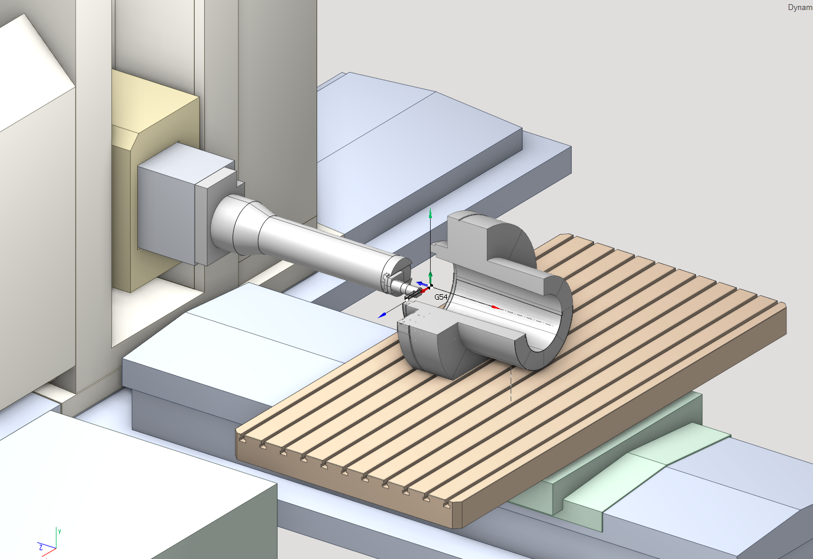
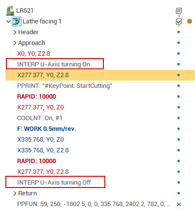

# Drehen mit U-Achse

<a id="about-machine-tools-with-u-axis"></a>

## Maschinen mit U-Achse



Diese Funktion bearbeitet große, unwuchtige Bauteile. Das Werkstück bleibt unbewegt, während das Werkzeug rotiert. Die U-Achse verändert den Bearbeitungsradius.

<a id="machine-schema-requirements"></a>

## Anforderungen an das Maschinenschema

Das mitgelieferte Schema **LR521** zeigt eine U-Achs-Maschine. In seiner Teilmaschinenliste enthält **TrevisanSubMachine** die U-Achskennung. Weitere Angaben zu Teilmaschinen: [Details](10410.md).

```
                    Trevisan submachine definition example
<TrevisanSubMachine>
   <!--turning-->
   <ToolNode>AxisU</ToolNode>
   <WrkNode>Workpiece1</WrkNode>
   <XAxisID>AxisX</XAxisID>
   <YAxisID>AxisY</YAxisID>
   <ZAxisID>AxisZ</ZAxisID>
   <ToolAxisID></ToolAxisID>
   <UAxisID>AxisU</UAxisID>
   <OriginG54BaseNode>AxisW</OriginG54BaseNode>
   <ApproachRule>G53 Z0; G53 B; LHPos;U;XY; G53 W;Z;</ApproachRule>
   <ReturnRule>Z10;XY </ReturnRule>
 </TrevisanSubMachine>
```

<a id="project-and-tool-path"></a>

## Projekt und Werkzeugweg

Das Beispielprojekt **U-axis turning.stcp** ist im Standardpaket enthalten. Die Drehachse verläuft durch den Werkstücknullpunkt G54–G59. Legen Sie Ursprung und B-Achsstellung vor dem Erstellen der Drehoperation fest. Daraus berechnet das System die Dreherzeugende und stellt den Rotationskörper dar.

CLData enthält einen Befehl zum Umschalten zwischen X- und U-Interpolation, der im Postprozessor verarbeitet werden muss. Auch der Werkzeugbezugspunkt hängt vom Modus ab.


