# Laufradbearbeitung

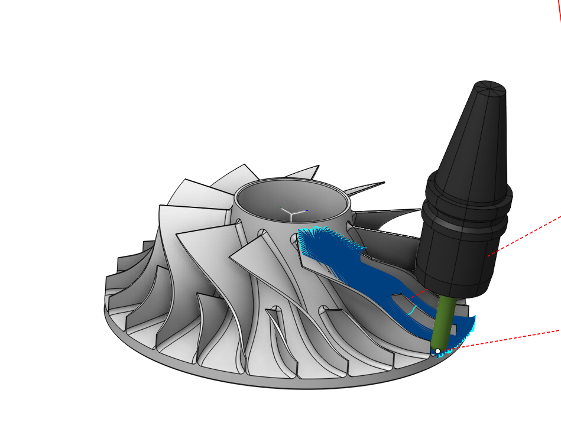

## Anwendungsbereich:

Diese Operation unterstützt die effiziente 5-Achsen-Bearbeitung von Laufrädern und integral beschaufelten Rädern. Sie umfasst Schruppstrategien, das Schlichten von Schaufeln und Naben sowie die Nachbearbeitung von Verrundungen. Zusätzliche Funktionen vermeiden Kollisionen mit Werkzeug, Halter und Rohteil.

### Auftragszuweisung:

**Blade Surfaces (Schaufelflächen).** Definiert die Schaufelwände. Ohne ausgewählte Schaufelgeometrie wird der Bereich zwischen Naben- und Deckflächen bearbeitet. Zum Schruppen wählen Sie die Flächen zweier benachbarter Schaufeln. Beim Schlichten werden die ausgewählten Schaufelflächen bearbeitet. Die Auswahl sollte die Arbeitsflächen, oberen und unteren Flächen sowie Verrundungen umfassen.

**Hub Surfaces (Nabenflächen).** Bestimmt die Drehachse und begrenzt zusammen mit den Deckflächen den Bereich für die Bahnerzeugung. Die Nabe muss eine Rotationsfläche sein. Zum Schlichten genügt eine Nabenfläche, die von der Eintritts- bis zur Austrittskante der Schaufel reicht.

**Shroud Surfaces (Deckflächen).** Begrenzt den Bearbeitungsraum gegenüber der Nabe und dient bei bestimmten Strategien als Bezugsgeometrie. Wählen Sie die Flächen, die die äußere Kontur des Laufrads begrenzen.

**Properties (Eigenschaften).** Öffnet die Elementeigenschaften, beispielsweise zur Eingabe eines Aufmaßes. Auch durch Doppelklick auf einen Listeneintrag erreichbar.

**Delete (Löschen).** Entfernt ein Element aus der Liste.

**Restrictions (Begrenzungen).** Definiert nicht zu bearbeitende Bereiche. [Details](101231.md)

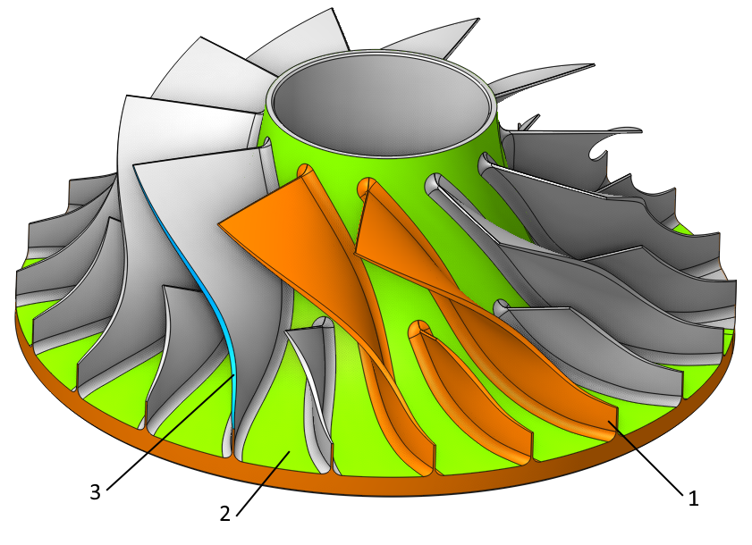

**1 – Schaufelflächen; 2 – Nabenflächen; 3 – Deckflächen.**

### Strategie:

#### Bearbeitungsart:

Wählt die Bearbeitungsart und die zu bearbeitenden Flächen.

Weitere Informationen anzeigen

**Roughing (Schruppen).** Entfernt Rohteilmaterial im Bereich zwischen Nabenflächen, Deckflächen und den zwei ausgewählten benachbarten Schaufeln.

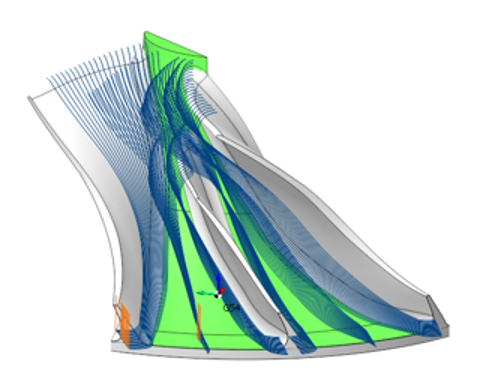

**Blade Finishing (Schaufeln schlichten).** Schlichtet die gewählten Schaufelflächen. Definieren Sie zunächst Naben- und Deckflächen. Sind keine Schaufelflächen ausgewählt, werden alle Schaufeln des Laufrads bearbeitet.

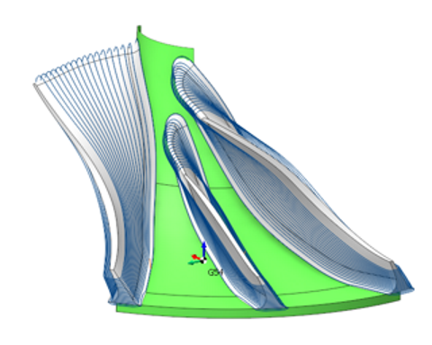

**Hub Finishing (Nabe schlichten).** Schlichtet die Nabenflächen zwischen den ausgewählten Schaufelflächen.

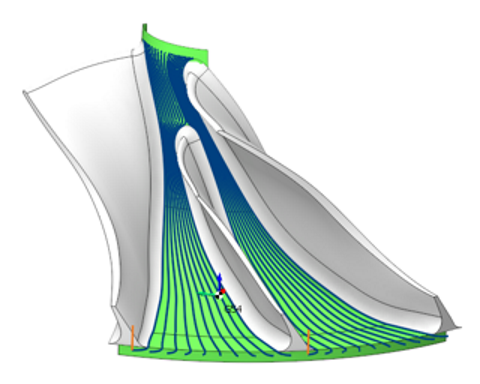

**Fillet Finishing (Verrundungen schlichten).** Bearbeitet die Übergänge zwischen Schaufel und Nabe. Definieren Sie zunächst Naben- und Deckflächen. Eine Schaufelauswahl begrenzt den Bereich; ohne Auswahl werden alle entsprechenden Verrundungen des Laufrads bearbeitet.

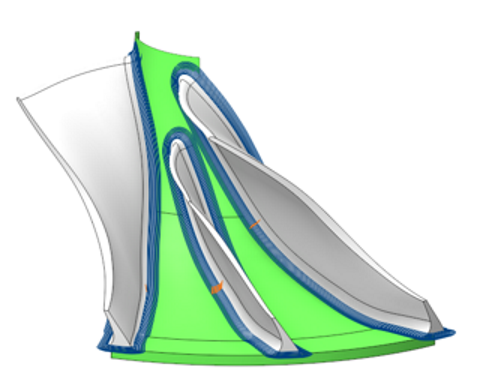

**Step (Bahnabstand).** Maximal zulässige Schnittbreite.

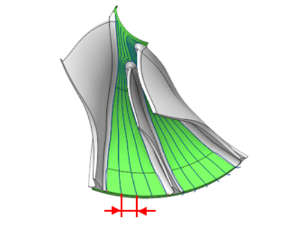

**Depth step (Tiefenzustellung).** Abstand zwischen den Schruppdurchgängen.

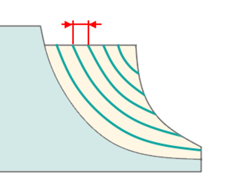

**Count (Anzahl).** Anzahl der Durchgänge beim Verrundungsschlichten. Diese Anzahl wird von der Mitte der Verrundung aus auf jeder Seite erzeugt.

#### Strategie:

Diese Parameter bestimmen die Werkzeugbahn:

Weitere Informationen anzeigen

**Morph Between Shroud and Hub.** Erzeugt Bahnen durch einen stetigen Übergang von den Erzeugenden der Deckflächen zu denen der Nabe. Der Abstand wird beim Schlichten durch **Step**, beim Schruppen durch **Roughing Step** festgelegt.

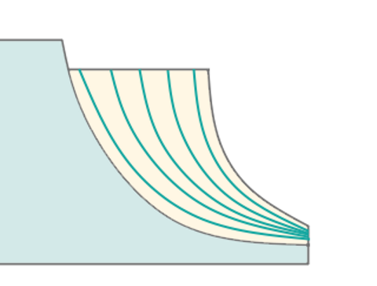

**Offset from Hub.** Erzeugt Bahnen auf versetzten Nabenflächen. Der Versatz wird beim Schlichten durch **Step**, beim Schruppen durch **Roughing Step** bestimmt.

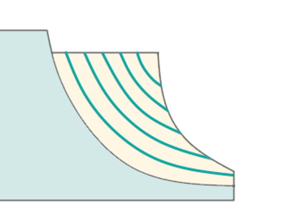

#### Werkzeugausrichtung:

Steuert die Werkzeugachse.

Weitere Informationen anzeigen

**Lead Angle (Vorlaufwinkel).** Zusätzliche Werkzeugneigung in der Ebene der Bewegungsrichtung.

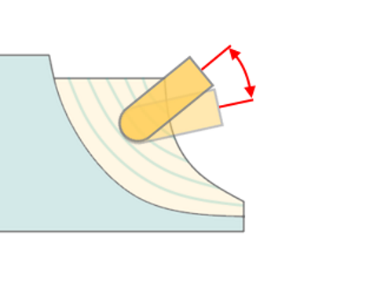

#### Kollisionen vermeiden:

**Check Holder** erkennt Halterkollisionen mit dem Bauteil und verändert betroffene Bahnabschnitte entsprechend der gewählten Strategie. [Details](11211.md)

#### Drehachse:

Ermöglicht das manuelle Festlegen der Laufradachse. Wählen Sie eine Achse des Werkstück- oder globalen Koordinatensystems, mit der die geometrische Laufradachse übereinstimmt.

Weitere Informationen anzeigen

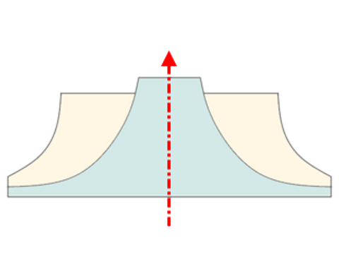

#### Sortierung:

Steuert die Reihenfolge der Bearbeitungsbahnen.

Weitere Informationen anzeigen

**Start Point (Startpunkt).** Ermöglicht bei Aktivierung die Eingabe des Startpunkts der Arbeitsbahnen. Die Parameter entsprechen denen der 5D-Flächenbearbeitung. [Details](10135.md)

**Milling Type (Fräsart).** Legt Gleich- oder Gegenlauf fest. Die Einstellung steht in den meisten Operationen außer der Kurvenbearbeitung zur Verfügung. Die Parameter entsprechen denen beim Wasserlinien-Schruppen. [Details](736.md)

#### Kantenumfahrungen beschneiden.

An scharfen Außenecken umfährt der Fräser die Modellkante. Die dabei glatte Bahn ist nicht immer optimal. **Trim rolls** wird wie beim Wasserlinien-Schruppen eingestellt. [Details](736.md)

### Parameter:

Diese Registerkarte enthält die grundlegenden Einstellungen für Bauteil, Rohteil, Spannmittel und weitere Elemente, die die Werkzeugbahn beeinflussen. [Details](100112.md)

### Verbindungen und An-/Abfahrbewegungen:

Auf der Registerkarte **Links/Leads** werden die Verbindungsbewegungen festgelegt: Anfahren von der Werkzeugwechselposition, Einfahren zum Beginn der Arbeitsbahn, Abfahren nach dem letzten Arbeitsgang, Verbindungen zwischen den Bahnen und Rückkehr zur Werkzeugwechselposition. Einstellbar sind die Reihenfolge der Achsbewegungen, der Bahnverlauf und die Abstände.

Weitere Informationen anzeigen

**Parametergruppen:**

**Approach/Return (Anfahren/Rückkehr).** Steuert die Bewegung von der Werkzeugwechselposition zum Beginn der Werkzeugbahn und zurück. [Details](100116.md).

**Links (Verbindungen).** Legt die Regeln für Ein- und Ausfahrverbindungen sowie Verbindungen zwischen Arbeitsbewegungen fest. [Details](100130.md).

**Leads (An-/Abfahrbewegungen).** Ergänzt zusätzliche Ein- und Ausfahrbewegungen an den Arbeitsbahnen mit den dafür vorgesehenen Vorschüben. [Details](100136.md).

**Safe motions (Sichere Bewegungen).** Legt die Art der Sicherheitsfläche und ihren Abstand zum Rohteil fest. Die Fläche dient für Verbindungen zwischen bearbeiteten Flächen oder Werkzeugbahnen sowie für die erste Phase des Anfahrens bzw. der Rückkehr. [Details](100117.md).

**Advanced links settings (Erweiterte Verbindungseinstellungen).** Steuert die Bahnerzeugung insbesondere bei 5-Achsen-Operationen unter Berücksichtigung günstiger Drehachsbewegungen. [Details](100118.md).

**Distances (Abstände).** Abstände für die Verbindungsregeln. [Details](100140.md).

### Vorschübe und Drehzahlen:

Legt Spindeldrehzahl, Eilgang und Vorschübe für die verschiedenen Bahnabschnitte fest. Die Drehzahl kann direkt in Umdrehungen pro Minute oder über die Schnittgeschwindigkeit vorgegeben werden. Der vorgegebene Wert wird unterstrichen; der andere wird anhand des Werkzeugdurchmessers berechnet. [Details](100142.md)

### Transformationen:

Koordinatentransformationen des berechneten Werkzeugwegs. [Details](10168.md).

### Bauteil:

Geometrische Elemente zur Prüfung auf unerwünschte Einschnitte. [Details](330.md)

### Rohteil:

Modell des zu bearbeitenden Materials. [Details](738.md)

### Spannmittel:

Hier werden Spannmittel wie Spannfutter, Greifer und Spannpratzen sowie weitere Sperrbereiche angegeben. [Details](10283.md)
