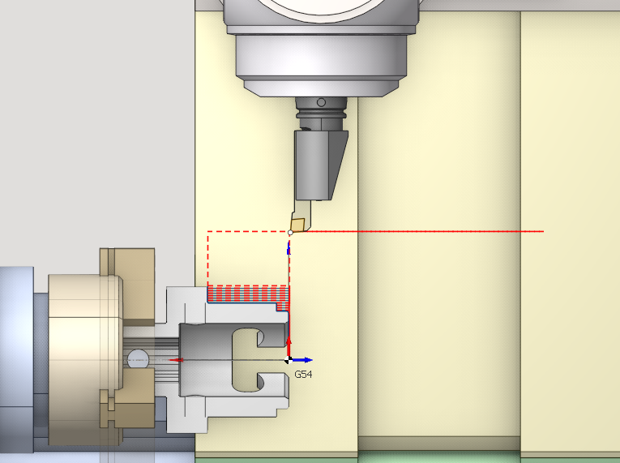
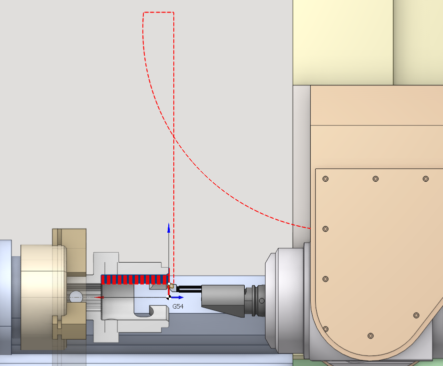
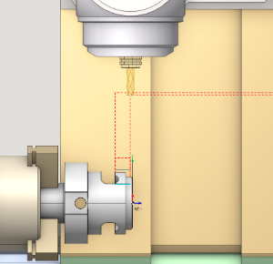
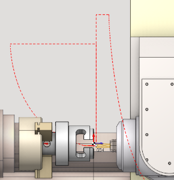
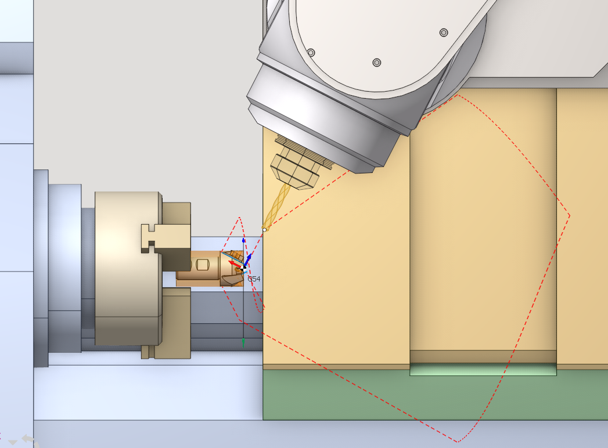
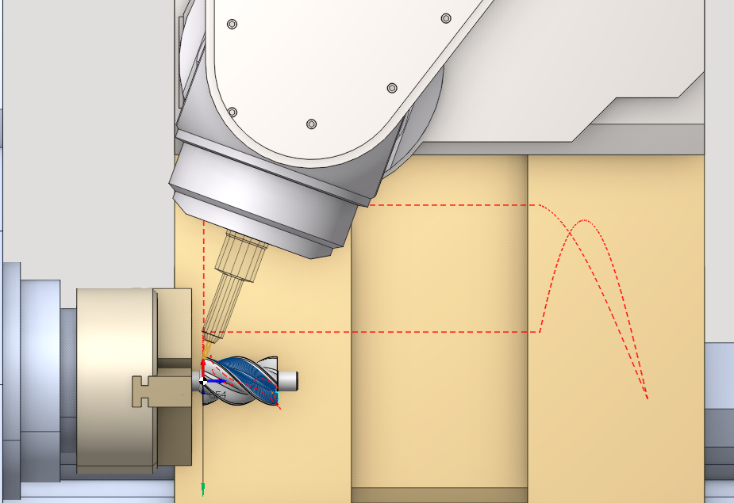

# Definição da submáquina nos esquemas da máquina

Uma submáquina é uma lista de parâmetros para o par `tool holder, workpiece holder` (porta-ferramentas, porta-peça). Isso é especialmente relevante para máquinas complexas com vários fusos, várias posições para o bruto etc.

```
                    Submachine definition example for the
		<SubMachinesList Expanded="false">
				<SCType ID="MainMill" Caption="Main spindle - Mill head" Type="SubMachine">
					<ToolNode DefaultValue="AxisS"/>
					<WrkNode DefaultValue="AxisC"/>
					<Channel DefaultValue="1"/>
					<XAxisID DefaultValue="AxisX"/>
					<YAxisID DefaultValue="AxisY"/>
					<ZAxisID DefaultValue="AxisZ"/>
					<ToolAxisID DefaultValue=""/>
					<OriginG54BaseNode DefaultValue="Base"/>
					<ApproachRule DefaultValue="BC; Y Z(10); X"/>
					<ReturnRule DefaultValue="Z(10); X; Z"/>
					<DetailedApproachRules>
						<TurnRadial DefaultValue="BS;Z;X"/>
						<TurnAxial DefaultValue="BS;Z(10);X;"/>
						<MillRadial DefaultValue="BC;Z;X"/>
						<MillAxial DefaultValue="BC;Z;X"/>
						<MillLCS DefaultValue="BC;Z;X;LCS;XY;Z"/>
						<MillTCPM DefaultValue="BC;Z;X;LCS;XY;Z"/>
					</DetailedApproachRules>
					<DetailedReturnRules>
						<TurnRadial DefaultValue="X;Z"/>
						<TurnAxial DefaultValue="Z(10);X;Z"/>
						<MillRadial DefaultValue="X;Z"/>
						<MillAxial DefaultValue="Z(10);X;Z"/>
						<MillLCS DefaultValue="LCS;X;Z"/>
						<MillTCPM DefaultValue="LCS;X;Z"/>
					</DetailedReturnRules>
				</SCType>
```

- <strong>ToolNode</strong> é o nó pai comum de todos os porta-ferramentas que pertencem à submáquina
- <strong>WrkNode</strong> é o nó pai comum de todos os porta-peças que pertencem à submáquina
- <strong>XAxisID, YAxisID, ZAxisID</strong> - os eixos responsáveis pelo movimento ao longo de X, Y, Z.
- <strong>ToolAxisID</strong> - o ID do eixo da torre, se existir.
- <strong>OriginG54BaseNode</strong> - o ID do eixo ao qual o sistema de coordenadas do bruto (WCS) está vinculado
- <strong>OriginG54</strong> - transformação adicional do WCS. Por exemplo, permite inverter o eixo Z no contrafuso
- <strong>ApproachRule, ReturnRule</strong> - as regras padrão usadas para construir as aproximações ou retornos da submáquina em geral.
- <strong>DetailedApproachRules, DetailedReturnRules</strong> - as regras padrão desta submáquina para diferentes configurações de ferramenta. As aproximações e os retornos da ferramenta devem considerar as particularidades das posições da ferramenta e do bruto. Por isso, o sistema permite definir esquemas de aproximação e retorno individualmente para cada posição da ferramenta na submáquina. As regras de aproximação são definidas na seção da submáquina correspondente, entre as tags **DetailedApproachRules**. Essas regras são especificadas individualmente para cada tipo e posição de ferramenta, dentro das tags apropriadas. Estão disponíveis as seguintes tags:
  - <strong>TurnRadial</strong> – ferramenta de torneamento com montagem radial.



- <strong>TurnAxial</strong> – ferramenta de torneamento (por exemplo, uma broca não rotativa) com montagem axial.



- <strong>MillRadial</strong> – ferramenta de fresamento (inclusive uma broca rotativa) com orientação radial (o eixo da ferramenta é perpendicular ao eixo do bruto).



- <strong>MillAxial</strong> - ferramenta de fresamento (também uma broca rotativa) com disposição axial (o eixo da ferramenta é paralelo ao eixo do bruto).



- <strong>MillLCS</strong> - ferramenta de fresamento (também uma broca rotativa) usada em operações de usinagem indexada em quatro ou cinco eixos.



- <strong>MillTCPM</strong> - ferramenta de fresamento (também uma broca rotativa) usada em processos de usinagem contínua em quatro ou cinco eixos com suporte a TCPM.



<strong>DefaultValue</strong> - a regra de aproximação/retorno aplicada por padrão para a configuração específica da ferramenta. Ela aparece na guia Links de cada submáquina depois que os conectores correspondentes do bruto e da ferramenta são definidos. O formato das regras é o mesmo das [Regras de aproximação e retorno](10071.md) gerais.

Quando as regras de aproximação/retração das submáquinas ou de uma configuração específica da ferramenta não estão especificadas, são aplicadas as regras padrão gerais da máquina.

Se nenhuma submáquina for declarada no esquema, qualquer porta-ferramentas poderá ser usado com qualquer porta-peça. Isso garante a compatibilidade com os esquemas desenvolvidos para versões anteriores do sistema CAM.

Por exemplo, para a máquina de torneamento-fresamento MTM com duas torres e dois fusos, podem ser definidas as seguintes submáquinas:

1. <strong>`Upper turret, main spindle`</strong>
2. <strong>`Upper turret, counter spindle`</strong>, se a torre superior puder trabalhar com o contrafuso
3. <strong>`Lower turret, main spindle`</strong>, se a torre inferior puder trabalhar com o fuso principal
4. <strong>`Lower turret, counter spindle`</strong>
5. <strong>`Main spindle, counter spindle`</strong>, para a transferência da peça do fuso principal para o contrafuso
6. <strong>`Counter spindle, main spindle`</strong>, para a transferência da peça do contrafuso para o fuso principal

O sistema CAM não permite escolher na operação um porta-ferramentas que não possa ser usado com o porta-peça atual (quando não há submáquina para esse par, mas existem outras submáquinas).

Exemplos de declaração de submáquinas estão disponíveis nos esquemas "<em>Index G160</em>" e "<em>Hanwha 32</em>", incluídos no pacote padrão.
