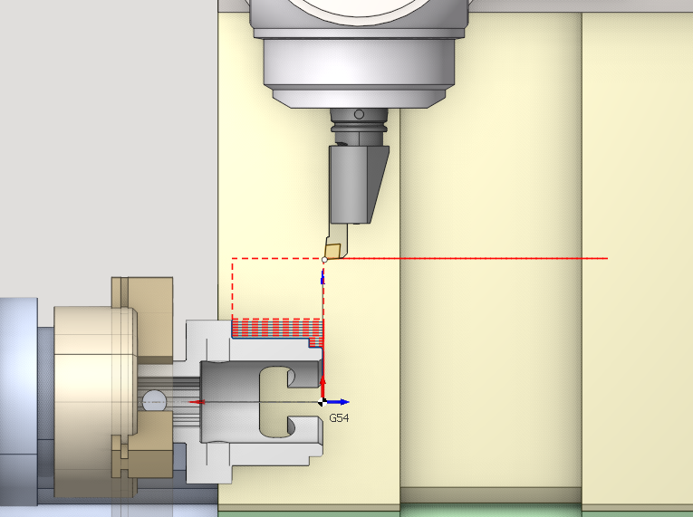
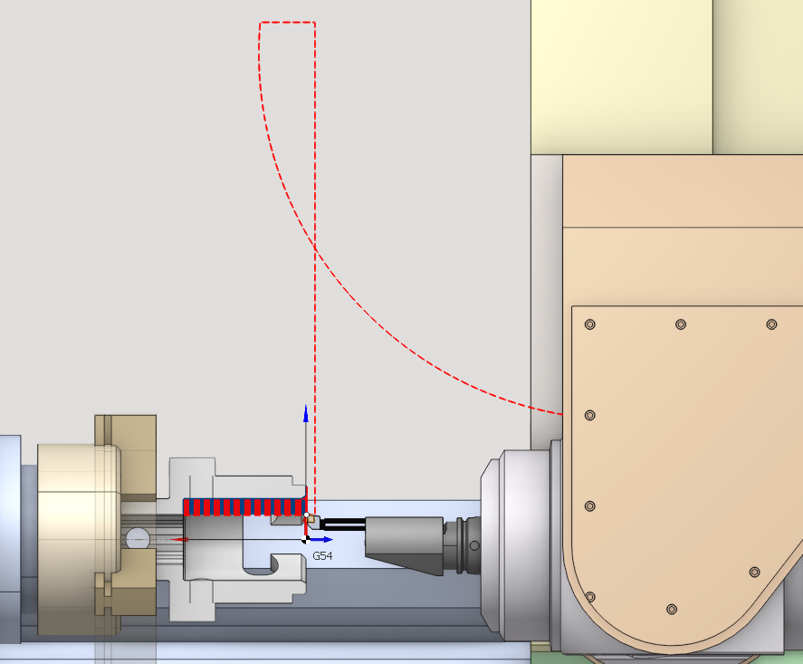
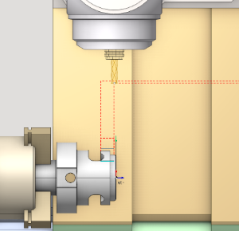
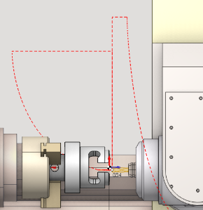
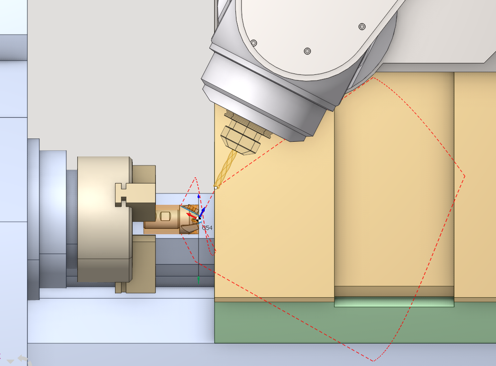
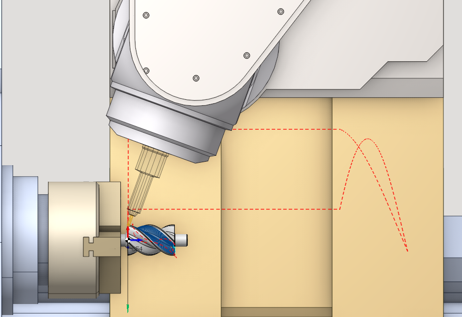

# マシンスキーマにおけるサブマシン定義

サブマシンは`工具ホルダー、ワークホルダー`ペアのパラメータ一覧です。これは、複数のスピンドルや複数のワーク設置位置などを備えた複雑な機械では特に重要です。

```
                    Mill-Turn複合機における〈メインスピンドル – ミルヘッド〉ペアのサブマシン定義例
		<SubMachinesList Expanded="false"> 				<SCType ID="MainMill" Caption="Main spindle - Mill head" Type="SubMachine"> 					<ToolNode DefaultValue="AxisS"/> 					<WrkNode DefaultValue="AxisC"/> 					<Channel DefaultValue="1"/> 					<XAxisID DefaultValue="AxisX"/> 					<YAxisID DefaultValue="AxisY"/> 					<ZAxisID DefaultValue="AxisZ"/> 					<ToolAxisID DefaultValue=""/> 					<OriginG54BaseNode DefaultValue="Base"/> 					<ApproachRule DefaultValue="BC; Y Z(10); X"/> 					<ReturnRule DefaultValue="Z(10); X; Z"/> 					<DetailedApproachRules> 						<TurnRadial DefaultValue="BS;Z;X"/> 						<TurnAxial DefaultValue="BS;Z(10);X;"/> 						<MillRadial DefaultValue="BC;Z;X"/> 						<MillAxial DefaultValue="BC;Z;X"/> 						<MillLCS DefaultValue="BC;Z;X;LCS;XY;Z"/> 						<MillTCPM DefaultValue="BC;Z;X;LCS;XY;Z"/> 					</DetailedApproachRules> 					<DetailedReturnRules> 						<TurnRadial DefaultValue="X;Z"/> 						<TurnAxial DefaultValue="Z(10);X;Z"/> 						<MillRadial DefaultValue="X;Z"/> 						<MillAxial DefaultValue="Z(10);X;Z"/> 						<MillLCS DefaultValue="LCS;X;Z"/> 						<MillTCPM DefaultValue="LCS;X;Z"/> 					</DetailedReturnRules> 				</SCType>
```

- <strong>ToolNode -</strong> サブマシンに属するすべての工具ホルダーの共通親ノードです。
- <strong>WrkNode -</strong> サブマシンに属するすべてのワークホルダの共通親ノードです。
- <strong>XAxisID, YAxisID, ZAxisID</strong> - それぞれ X、Y、Z 方向の移動に対応する軸を示します。
- <strong>ToolAxisID</strong> - タレット軸が存在する場合、その軸の ID です。
- <strong>OriginG54BaseNode</strong> -ワーク座標系（WCS）が取り付けられる軸の ID です。
- <strong>OriginG54</strong> -ワーク座標系（WCS）に対する追加の変換です。例えば、カウンタースピンドルで Z軸を反転させることができます。
- <strong>ApproachRule、ReturnRule</strong> - サブマシン全体に対してアプローチまたはリターン動作を生成する際に使用されるデフォルトルールです。
- <strong>DetailedApproachRules, DetailedReturnRules</strong> - このサブマシンの工具構成ごとのデフォルトルールです。工具のアプローチおよびリターンは、工具とワークの位置関係を考慮する必要があります。そのため、本システムでは、サブマシン上の各工具位置に対して、アプローチおよびリターンのスキーマを個別に設定することができます。アプローチルールは、対応するサブマシンのセクションの**DetailedApproachRules**タグの間に定義します。これらのルールは、各工具タイプおよび工具位置ごとに、対応するタグ内で個別に定義します。利用可能なタグは以下の通りです。
  - <strong>TurnRadial</strong> - ラジアル（径方向）にセットされた旋盤用切削工具です。



- <strong>TurnAxial</strong> -アキシャル（軸方向）にセットされた旋盤用工具（例：回転しないドリルなど）



- <strong>MillRadial</strong> - ラジアル（径方向）に配置されたフライス加工用工具（回転ドリルを含む。工具軸がワーク軸に対して垂直。）



- <strong>MillAxial</strong> - アキシャル（軸方向）に配置されたフライス加工用工具（回転ドリルを含む。工具軸がワーク軸に対して平行。）



- <strong>MillLCS</strong> - 4軸または5軸の割出加工で使用するミーリング工具（回転ドリルを含む）



- <strong>MillTCPM</strong> - TCPM対応の連続4軸または5軸加工で使用するミーリング工具（回転ドリルを含む）



<strong>DefaultValue</strong> - 特定の工具設定に対してデフォルトで適用されるアプローチ／リターンルールです。該当するワークおよび工具のコネクターを定義すると、DefaultValue は各サブマシンのリンクタブに表示されます。ルールの形式は、一般的な[アプローチとリターンのルール](10071.md)と同じです。

サブマシンまたは特定の工具設定に対するアプローチ／リターンルールが指定されていない場合、マシン全体のデフォルトルールが適用されます。

スキーム内にサブマシンが定義されていない場合、任意の工具ホルダーを任意のワークホルダーと組み合わせて使用できます。これは、以前のバージョンの CAMシステム用に作成されたスキームとの互換性を確保するためです。

例えば、タレット2基とスピンドル2基を備えたMTM複合加工機では、以下のサブマシンを定義することができます。

1. <strong>`上タレット、主軸`</strong>
2. <strong>`上タレット、カウンター主軸`</strong> 上タレットがカウンター主軸に対して加工可能な場合
3. <strong>`下タレット、主軸`</strong> 下タレットが主軸に対して加工可能な場合
4. <strong>`下タレット、カウンター主軸`</strong>
5. <strong>`主軸、カウンタ主軸`</strong> 主軸からカウンタ主軸への掴み換え
6. <strong>`カウンタ主軸、主軸`</strong> カウンタ主軸から主軸への掴み換え

現在のワークホルダーと組み合わせて使用できない工具ホルダーは、オペレーションで選択できません。（その組み合わせに対応するサブマシンが存在しない場合でも、他のサブマシンがあればそちらは使用可能です。）

サブマシンの定義例は、標準パッケージに含まれるスキーマ "<em>Index G160</em>" と "<em>Hanwha 32</em>" にて確認できます。
