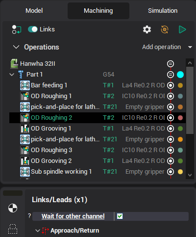
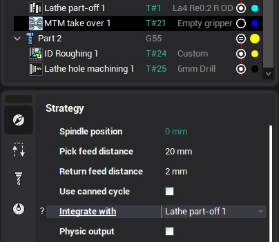

# Wartebefehle automatisch einfügen

Enthält das Projekt mehrere Bauteile, müssen die Operationen vor dem Einfügen der Wartebefehle im Reihenfolgemodus geordnet werden.

Auf der Seite **Links/Leads** kann eine Operation den Parameter **Wait other channel** (Auf anderen Kanal warten) besitzen. Er wird nur angezeigt, wenn die vorherige Operation in der geordneten Folge in einem anderen Kanal ausgeführt wird.

Ist **Wait other channel** aktiviert, wird automatisch der CLData-Befehl **Wait** eingefügt. Die aktuelle Operation beginnt dann erst, wenn die vorherige abgeschlossen ist.

Eine weitere Möglichkeit ist die Operation **[Turn take over](10406.md)** (Werkstückübernahme), die mit einer **Abstechoperation** synchronisiert werden kann.

