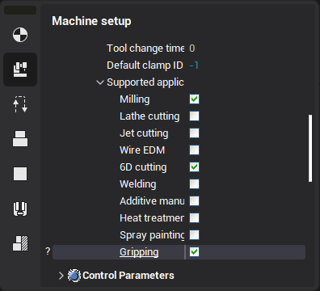
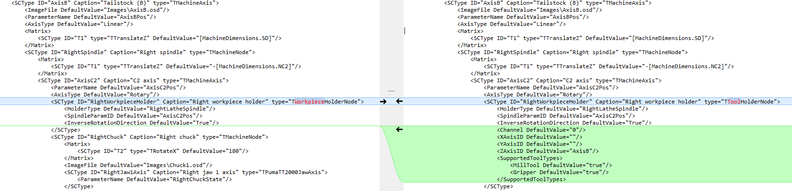

# パーツ移動の機械要件

パーツ移動オペレーションは、フライス盤、サブスピンドル付き旋盤、産業用ロボットなど、あらゆる種類の工作機械で使用できます。工作機械に必要となる主な要件は、 <strong>グリッパー</strong>として定義された専用の工具ホルダーが存在することです。現在のマシンスキーマにグリッパーが存在しない場合、パーツ移動オペレーションは使用できません。

このオプションは <strong>マシンセットアップ</strong>ページ、またはマシンスキーマ記述ファイルで有効にすることができます。



工具ホルダーの定義に関するマシンスキーマの一部を以下に示します。 <strong>SupportedToolTypes</strong>内で<strong>グリッパー</strong> が有効になっていることに注意してください。

```
<SCType ID="MillSpindle" Caption="Mill Spindle" Type="TToolHolderNode">
 <VisualProperties>
 <Metallic DefaultValue="True"/>
 </VisualProperties>
 <XAxisID DefaultValue="AxisX"/>
 <YAxisID DefaultValue="AxisY"/>
 <ZAxisID DefaultValue="AxisZ"/>
 <SupportedToolTypes>
 <MillTool DefaultValue="true"/>
 <LatheCutter DefaultValue="true"/>
 <Gripper DefaultValue="true"/>
 </SupportedToolTypes>
</SCType>
```

## サブスピンドル付き複合旋盤の適応

ピックアンドプレースオペレーションを使用して、複合旋盤のメインスピンドルとサブスピンドルの間でワークを移動させることができます。これを可能にするには、サブスピンドルをグリッピングアプリケーションで工具ホルダーとして定義する必要があります。

以前のバージョンのCAMシステム用に作成されたサブスピンドル付き複合旋盤のマシンスキーマを使用している場合は、マシン定義を修正する必要があります。以下に、旧スキーマ（左）と修正後のスキーマ（右）の違いを示します。



1. サブスピンドル定義の <strong>TWorkpieceHolderNode</strong> が <strong>TToolHolderNode</strong> に置き換えられます。

2. <strong>XAxisID, YAxisID, ZAxisID</strong> - 各軸に沿った工具の移動を担う軸の名前が追加されます。

3. <strong>SupportedToolTypes</strong>に<strong>グリッパー</strong> を追加します。
