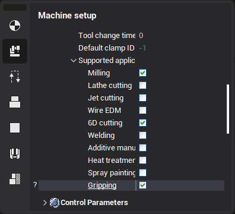
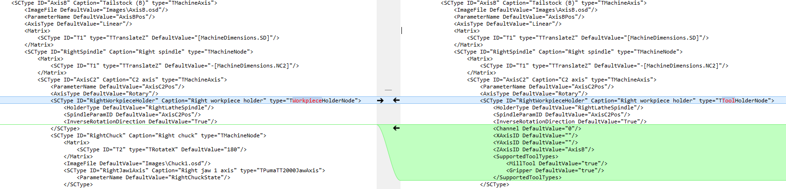

# Requisitos da máquina para operações de movimentação da peça

As operações de movimentação de peças podem estar disponíveis em qualquer tipo de máquina-ferramenta: centro de usinagem de fresamento, torno com subfuso, robô industrial. O principal requisito para a máquina-ferramenta é a existência de um porta-ferramenta especial marcado como <strong>gripper</strong> (garra). Se não houver garra no esquema da máquina atual, a operação de movimentação da peça não estará disponível.

É possível ativar essa opção na página de <strong>machine setup</strong> (configuração da máquina) ou no arquivo de descrição do esquema da máquina.



Abaixo é mostrado o fragmento do esquema da máquina com a definição do porta-ferramenta. Observe que <strong>Gripper</strong> está ativado dentro de <strong>SupportedToolTypes.</strong>

```
<SCType ID="MillSpindle" Caption="Mill Spindle" Type="TToolHolderNode">
   <VisualProperties>
       <Metallic DefaultValue="True"/>
   </VisualProperties>
   <XAxisID DefaultValue="AxisX"/>
   <YAxisID DefaultValue="AxisY"/>
   <ZAxisID DefaultValue="AxisZ"/>
   <SupportedToolTypes>
      <MillTool DefaultValue="true"/>
      <LatheCutter DefaultValue="true"/>
      <Gripper DefaultValue="true"/>
   </SupportedToolTypes>
</SCType>
```

## Adaptação de tornos com fresamento e subfuso

A operação Pick and place pode ser usada para mover a peça entre o fuso principal e o subfuso em máquinas de torneamento e fresamento. Para isso, o subfuso deve ser declarado como porta-ferramenta com a função de preensão. Se você tiver um esquema de máquina de torneamento e fresamento com subfuso criado para o sistema CAM e versões anteriores, será necessário modificar a descrição da máquina. Abaixo são mostradas as diferenças entre o esquema antigo (à esquerda) e o adaptado (à direita).



1. Na definição do subfuso, <strong>TWorkpieceHolderNode</strong> é substituído por <strong>TToolHolderNode</strong>.

2. <strong>XAxisID, YAxisID, ZAxisID</strong> - são adicionados os nomes dos eixos responsáveis pelo movimento da ferramenta ao longo do eixo correspondente.

3. <strong>Gripper</strong> é adicionado a <strong>SupportedToolTypes</strong>
