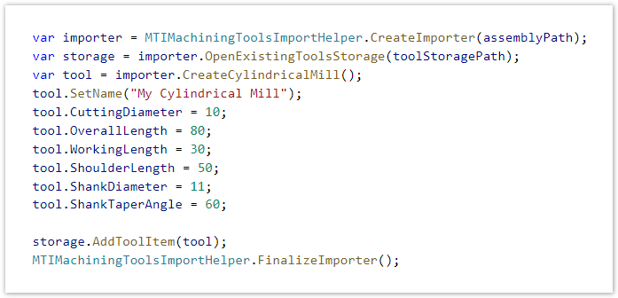
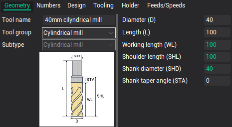

# API di importazione degli utensili

Esiste un'interfaccia di programmazione (API) con cui è possibile scrivere un proprio programma per importare gli utensili nel sistema CAM da qualsiasi sistema esterno (come sistemi TDM/PDM/PLM). Consente di creare un semplice programma (come mostrato nell'immagine sottostante) all'interno del quale è possibile, ad esempio:

- creare un nuovo utensile del tipo desiderato (tornitura, fresatura o tipo personalizzato);
- specificare le proprie dimensioni geometriche e i parametri di tale utensile;
- aggiungere l'utensile a un archivio (libreria utensili) e salvarlo in un file su disco. Questa libreria potrà poi essere usata nella [finestra utensili del CAM](615.md) nel modo consueto.

Per informazioni complete sull'uso di questa API, visitare [questa pagina](https://docs.encycam.com/CAMAPI/1/en/src/MachiningToolsImport/MTIStartPage.html).

 Esempio di codice 
