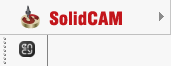

# Barra de ferramentas e suplemento de importação do SolidCAM™

A barra de ferramentas permite exportar dados geométricos do SolidCAM™. É possível ver a versão do sistema CAD suportado. [Detalhes](10039.md)

O suplemento permite importar arquivos de projeto do SolidCAM™.

Extensões de arquivo suportadas: SLDASM, ASM, SLDPRT, PRT, SLDDRW, DRW, X_B, X_T, STP, STEP. Para que esta opção funcione corretamente, o aplicativo necessário (SolidCAM™) deve estar instalado no computador.
