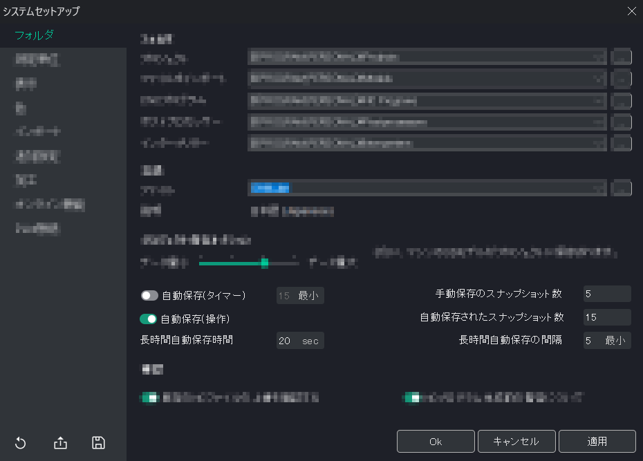
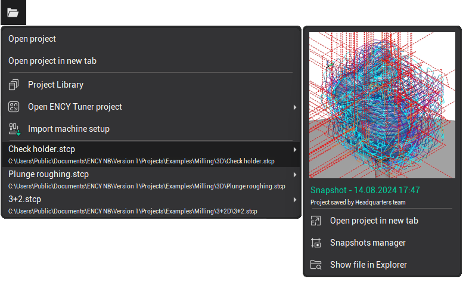
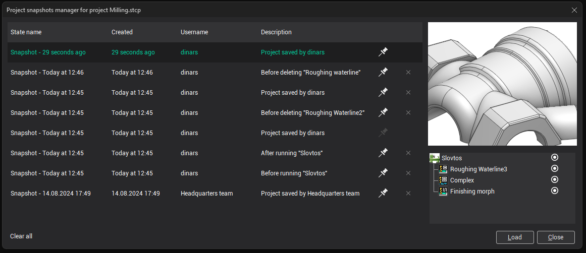

# 自動保存とプロジェクトのスナップショット

このプログラムはプロジェクトの自動バックアップシステムを備えており、予期せぬ問題が発生した場合、ユーザーはどのプロジェクトでも以前のバージョンに戻すことができます。

このシステムの中心となる概念は<strong>スナップショット</strong>で、ある時点におけるプロジェクトの完全な状態を表します。プロジェクトを保存するたびに、スナップショットが生成されます。最新のスナップショットは、常にプロジェクトの*.stcpファイル内に保存されます。通常は複数のバックアップ版を保持し、古いスナップショットは、プロジェクトの隣にある履歴サブフォルダのバックアップファイル`projectfolder\__history\projectname.stcp.~back`に保存されます。

- <strong>projectfolder</strong> は現在のプロジェクトを含むフォルダを指します。
- <strong>projectname</strong> は現在のプロジェクトの名前です。

スナップショットはプロジェクトの全状態を記録しますが、2つのスナップショットのサイズが2つの完全なプロジェクトのサイズに等しいわけではありません。 後続の各スナップショットを保存する際、システムは前回のスナップショット以降に変更されたデータのみを保存し、ディスク使用量を削減します。

新しいスナップショットは主に2つのケースで作成されます。

1. ユーザーが手動でプロジェクトを保存する場合（手動スナップショット）。
2. システムが自動的にプロジェクトを保存する場合（自動保存スナップショット）。

この2つのタイプは別々に管理され、自動保存が手動で保存したスナップショットを上書きすることはありません。どちらもスナップショットリスト内に並行して保存されます。

自動保存とスナップショットのオプションは [システム設定](715.md)で設定できます。

自動保存はオプションで、2つの方法があります。

- <strong>自動保存（タイマー）</strong>オプションが有効な場合、指定された間隔でタイマーを使用します。
- 操作の削除前、ツールパス計算前、ツールパス計算直後など、特定のシステム操作による(システム設定の「<strong>自動保存（操作）</strong>」オプションを使用します)

長時間のプロジェクト作業では、数多くのスナップショットが蓄積されることがあります。ディスクのオーバーフローを避けるため、スナップショットの数がシステム設定で指定された制限を超えた場合、プログラムは自動的にスナップショットを削除します。手動で保存されたスナップショットはシステムにより重要視されるため、2つの異なるスナップショット制限を設定できます。

- <strong>手動保存のスナップショット数</strong>：ユーザー保存スナップショットの最大数（デフォルトは5）。
- <strong>自動保存されたスナップショット数</strong>：タイマーまたはイベントによって自動的に保存されるスナップショットの最大数（デフォルトは15）。

任意のスナップショットを<strong>永続化</strong>としてマークすることもできます。永続的なスナップショットは手動でしか削除できないため、同じプロジェクトの別バージョンを維持することができます。

大きなプロジェクトの場合、節約には時間がかかります。中断を減らすために、システムは自動保存を前の保存の後、指定された期間より早く実行しません - "<strong>長時間自動保存の間隔</strong>" オプションで設定します(デフォルトは5分です)。最後の保存が"<strong>長時間自動保存時間</strong>"パラメータ(デフォルトは20秒)で指定された時間より長い場合、システムはプロジェクトが大きいと見なします。例えば、前のスナップショットの保存に20秒以上かかった場合、次の自動保存は少なくとも5分後まで行われません。

ユーザーインターフェースにより、保存されたプロジェクトの状態を素早く読み込むことができます。スナップショットのリストは、 [メインツールバー](51.md)の最近のプロジェクトリストのプロジェクト名の横のドロップダウンメニューに表示されます。スナップショットは逆時系列で表示され、最新のものが上部に表示されます。現在のスナップショットは緑色で強調表示されます。 <strong>ピン</strong>ボタンを使用すると、スナップショットを永続としてマークし、自動削除を防ぐことができます。

メニューを簡潔に保つため：

- 現在のプロジェクトでは、最新のスナップショット最大10件と、すべての永続的なスナップショットが表示されます。
- 現在進行中でないプロジェクトについては、永続的なスナップショットのみが表示されます。

より多くのスナップショットを表示するには、 <strong>プロジェクトスナップショットマネージャー</strong> ウィンドウを開きます。

<strong>プロジェクトスナップショットマネージャー</strong>では、次のことができます。

- スナップショット一覧を見る
- 名前や説明を編集
- サムネイルを確認
- スナップショットを保存したユーザー
- 各スナップショットに関連する操作のリストを確認
- スナップショットを削除するか、永続的なものとしてマーク
- スナップショットの読み込み

作成日の上にカーソルを置くと、完全な日付が表示されます。
