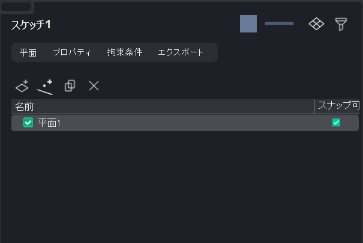
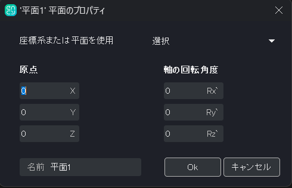

# Piani

I piani vengono gestiti nella scheda corrispondente:

Dove:

-  - creazione di un nuovo piano,
-  - copia del piano selezionato,
-  - eliminazione del piano corrente.

Per modificare il sistema di coordinate del piano corrente, fare doppio clic su di esso oppure selezionare la voce corrispondente nel menu contestuale.

Finestra di creazione/modifica del piano:

Il piano viene definito specificando l'origine delle coordinate e le rotazioni attorno agli assi coordinati.

In seguito, tutti i nuovi oggetti verranno creati nel piano corrente. L'aggancio (snap) agli oggetti di un altro piano non viene eseguito.
