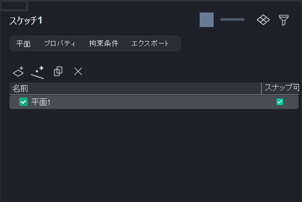

# 平面

平面は対応するタブで操作します。

-  - 新しい平面の作成
-  - 選択した平面のコピー
-  - 現在の平面の削除

現在の平面の座標系を編集するには、その平面をダブルクリックするか、コンテキストメニューから項目を選択します。

平面作成/編集ウィンドウ：

平面は、座標の原点を指定し、座標軸を中心に回転させることで定義されます。

なお、新しい要素はすべて現在の平面上に作成されます。別の平面にあるオブジェクトへのスナップは実行されません。
