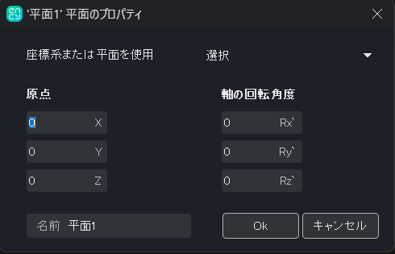

# Planes

Planes are controlled on the corresponding tab:

Here:

-  - making new plane,
-  - copying selected plane,
-  - deleting current plane.

To edit the coordinate system of the current plane, double-click on it or select an item in the context menu.

Plane making/editing window:

The plane is defined by specifying the origin of coordinates and rotating about the coordinate axes.

Further, all new objects will be created in the current plane. Snapping to another plane is controlled by its **Snappable** checkbox.

**Snappable.** Enables projected snapping to points of objects on another plane and to space curves. Clicking such an object activates its plane. A plane with this checkbox disabled is transparent to these interactions.

**Add plane.** Creates a plane.

**Copy plane.** Copies the plane with its objects and constraints.

**Delete plane.** Deletes without confirmation and cannot be undone.

**Add plane by line and point.** Creates a plane from the specified line and point.

Plane changes are not recorded in undo history.
