# プロジェクトライブラリ

<strong>プロジェクトライブラリ</strong>では、オンラインライブラリからサンプルプロジェクトを検索して開くことができます。 <strong>プロジェクトライブラリ</strong>は、CAMシステムの「プロジェクトを開く」メニューから直接アクセスできます。

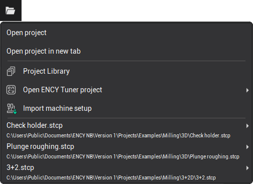

<strong>プロジェクトライブラリ</strong>のメインウィンドウには、CAMシステムに読み込むことができるすべてのプロジェクトが表示されます。

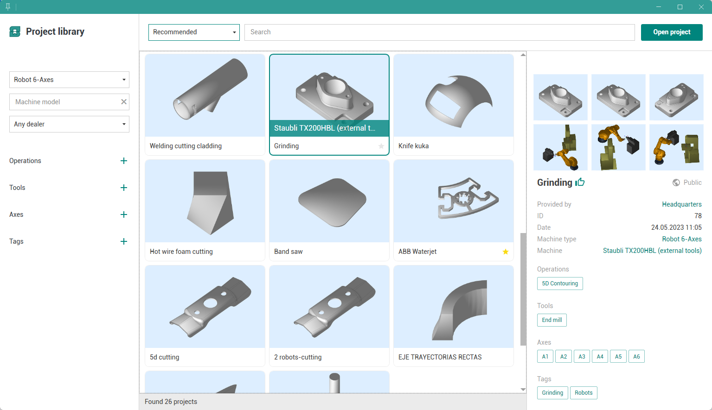

<strong>プロジェクトソースセレクタ</strong> を使って、 <strong>すべてのプロジェクト、お気に入り、おすすめ、個人</strong>、 <strong>人気</strong> プロジェクトを表示することができます。

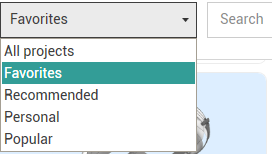

プロジェクトは、 <strong>ID、名前、マシンモデル、マシンタイプ、オペレーション、工具</strong>などで検索できます。ウィンドウの左側にあるフィルターにより、より詳細な検索が可能です。

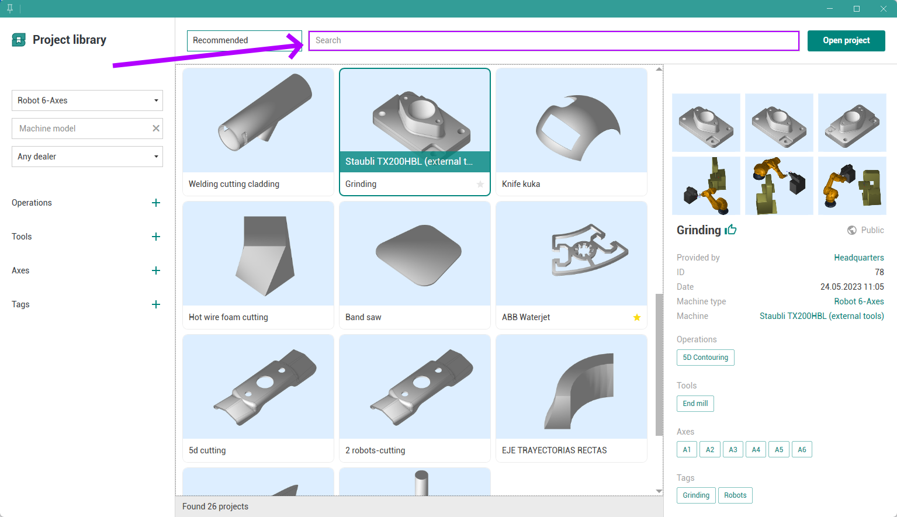

また、 <strong>オペレーション、工具、軸</strong>、 <strong>タグ</strong>の検索メニューを使ってプロジェクトを検索することもできます。

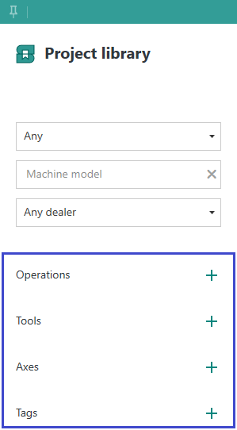

プロジェクトIDをクリップボードにコピーするには、  ボタンをクリックしてください。プロジェクトIDは今後の検索に便利です。

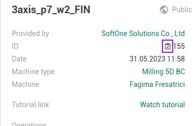

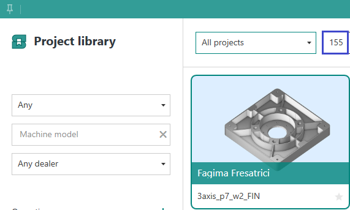

プロジェクトをお気に入りリストに保存するには、  アイコンを使用します。

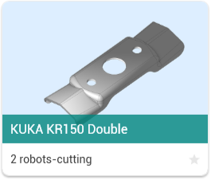

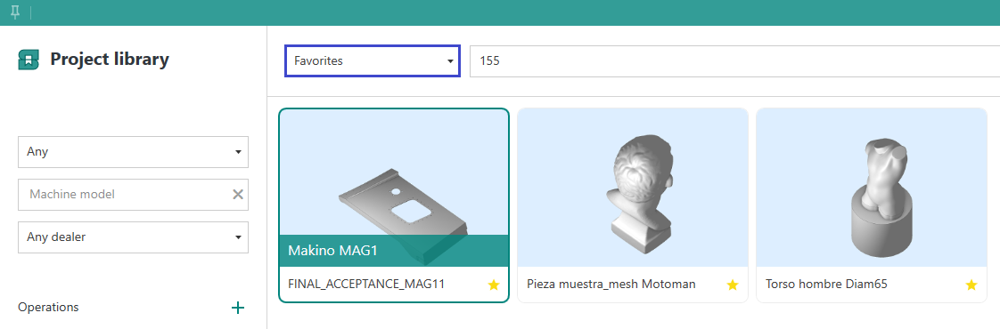

プロジェクト詳細パネルの緑色の値はすべてクリック可能です。値をクリックするとフィルターリストに追加され、フィルターパネルでもう一度クリックすると削除されます。

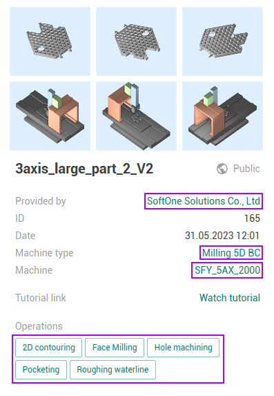 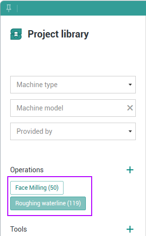

プロジェクトを右クリックして、アクションのリストを開きます。このメニューでは、以下のことができます。

- プロジェクトを開く
- プロジェクトのローカライズ版を開く
- プロジェクトファイルのダウンロード

<strong>プロジェクトを開く</strong> ボタンをクリックするか、プロジェクトをダブルクリックして開くこともできます。

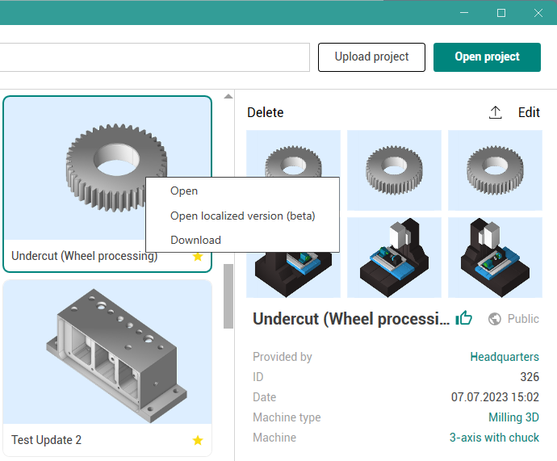

自分のプロジェクトをアップロードするには、 <strong>プロジェクトのアップロード</strong> ボタンをクリックしてください。

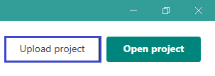

プロジェクトを選択すると、 <strong>プロジェクトライブラリ</strong>に読み込まれます。

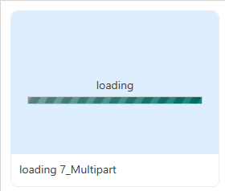

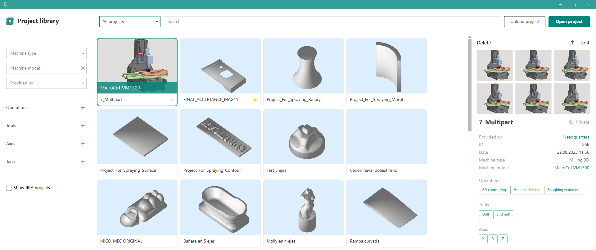

プロジェクトの削除や編集ができます。

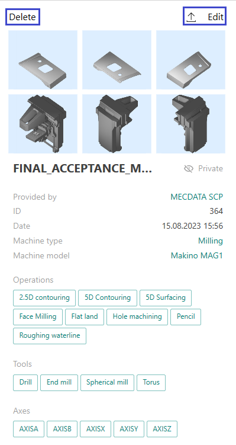

編集時には、説明を追加したり、プロジェクト名を変更することができます。

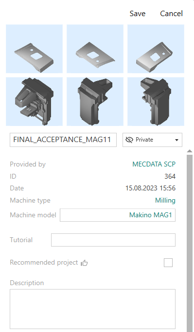

ウィンドウの左上にある <strong>ピンウィンドウ</strong> ボタンは、 <strong>プロジェクトライブラリ</strong> をコンパクトモードに切り替え、ウィンドウを一番上に表示します。

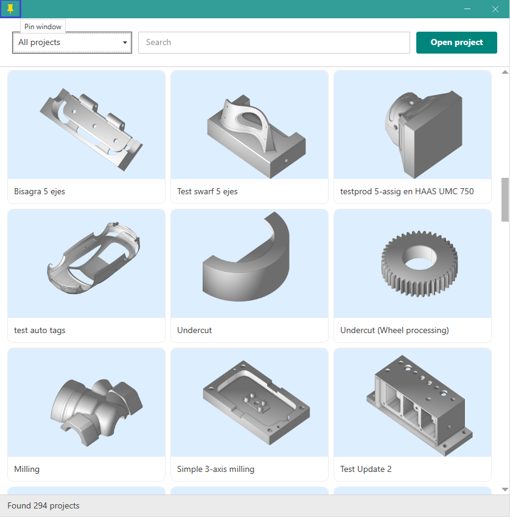
