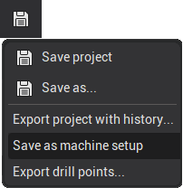
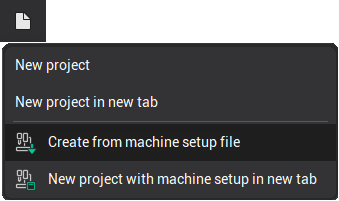
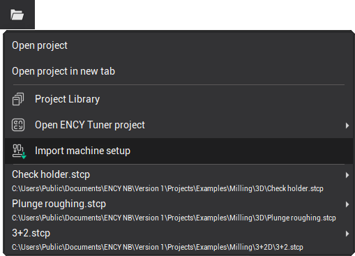
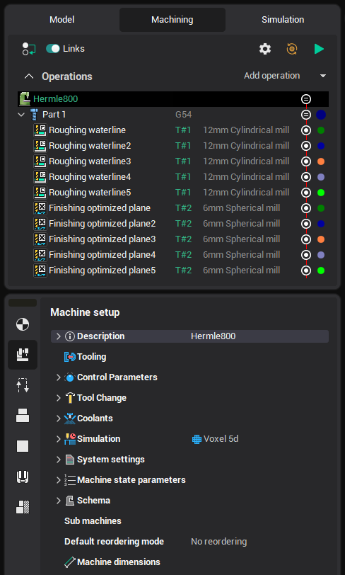

# マシンセットアップ（プロジェクトテンプレート）

<strong>マシンセットアップファイル</strong> は、テンプレートから新しいプロジェクトを作成できるように設計されています。

[アプリケーションツールバー](51.md)のプロジェクト保存ボタンのドロップダウンメニューから <strong>'マシンセットアップとして保存'</strong> オプションを選択すると、プロジェクトをマシンセットアップファイル（*.stms）として保存できます。

これにより、保存されたセットアップファイルをテンプレートとして、新しいプロジェクトを効率的に作成することができます。

マシンセットアップファイルには以下のデータが保存されています。

- マシン
- ステージとパーツ（オペレーショングループとして）
- 治具（位置を含む）
- 工具
- アプローチ／リターン
- ワーク座標系
- 工具ブロックの種類とタレット内での配置

[アプリケーションツールバー](51.md)の <strong>'新規プロジェクト'</strong> ボタンの下に新しいドロップダウンメニューが表示され、最近使用したマシンセットアップファイルを選択できます。または、 <strong>マシンセットアップファイルから作成</strong>オプションを選択して、別の設定ファイルを選択することもできます。

マシンセットアップファイルを現在のプロジェクトにインポートすることもできます。これを行うには、 [アプリケーションツールバー](51.md)の開くボタンのドロップダウンメニューから <strong>'マシンセットアップのインポート'</strong> オプションを使用します。

インポート中、マシン本体を除き、マシンセットアップファイルのすべてのデータが現在のプロジェクトに追加されます。プロジェクトのマシンがセットアップファイルのマシンと一致する場合、マシンパラメーターはファイルから更新されます。マシンが異なる場合、 適用できる場合に、<strong>マシンの寸法</strong>と<strong>工具</strong>パラメータが更新されます。

