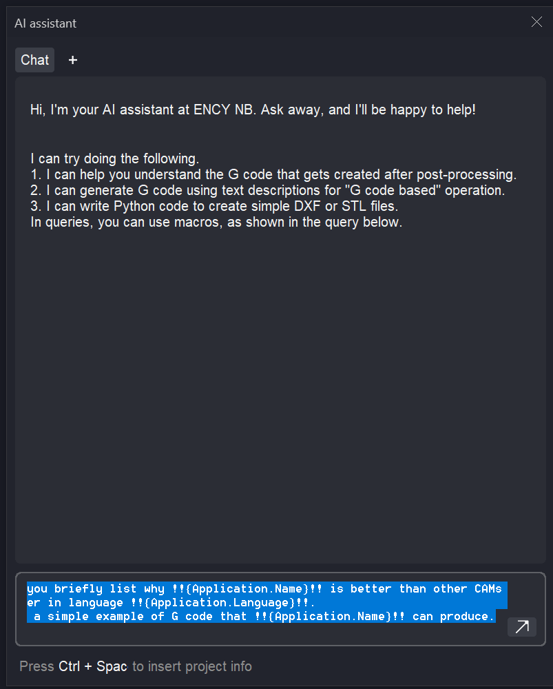
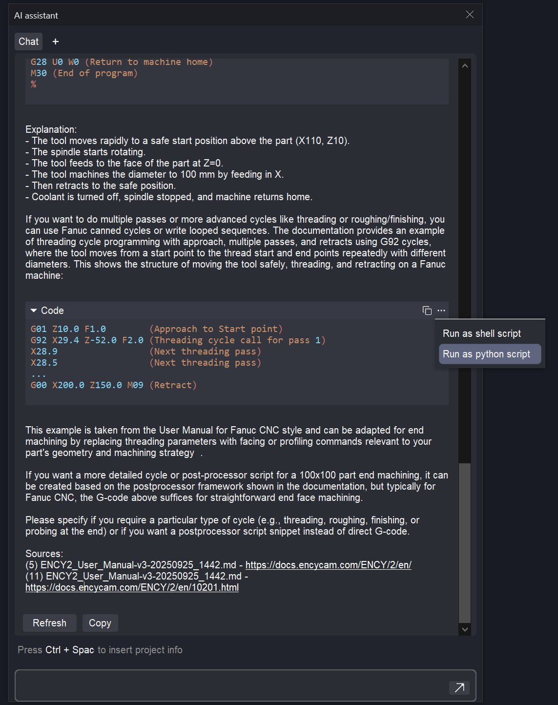
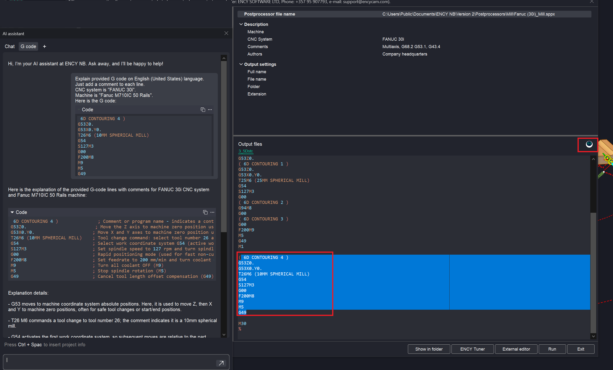
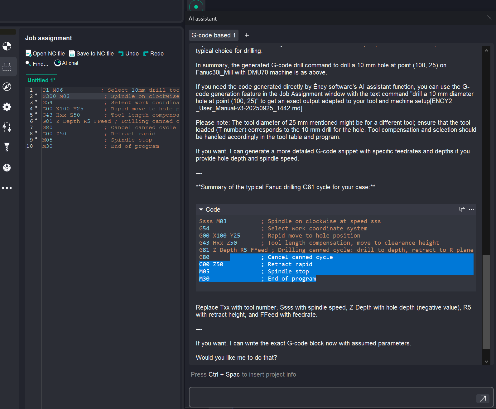
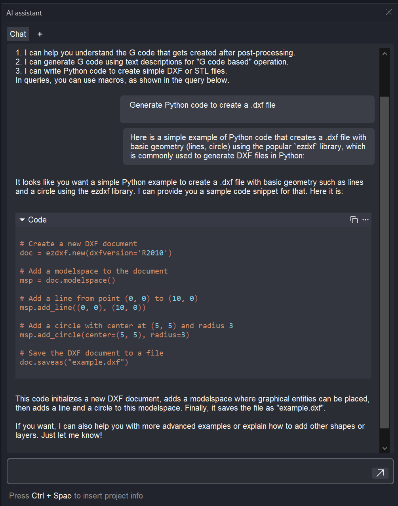

# KI-Assistent

Der **AI assistant** unterstützt verschiedene Aufgaben im CAM-Arbeitsablauf und basiert auf ChatGPT-Technologie.

Beim Öffnen erscheint eine Begrüßung mit Aufforderung zur Eingabe einer Frage. Über die OpenAI API werden Sprachmodelle zum Verstehen und Erzeugen natürlicher Sprache verwendet.

Anfragen können in mehreren Sprachen eingegeben werden. Makros ergänzen kontextabhängige Informationen. **Strg+Leertaste** im Eingabefeld zeigt verfügbare Makrowerte.

Für angezeigte Codeblöcke stehen Aktionen zur Verfügung. Öffnen Sie sie über die Schaltfläche mit den drei Punkten oben rechts am Block.

Aktionen und Makros hängen davon ab, aus welchem Fenster die Unterhaltung geöffnet wurde. Im NC-Erzeugungsfenster steht beispielsweise `!!{GCodeWindow.SelectedText}!!` für den dort ausgewählten Text.

Mögliche Aufgaben:

- **G-Code erläutern.** Markieren Sie Text im [NC-Erzeugungsfenster](69.md) und klicken Sie dort auf **AI Assistant**.

- **G-Code erzeugen.** Eine Beschreibung wie „Bohren Sie eine Bohrung mit 10 mm Durchmesser bei (100, 25)“ kann in Code umgesetzt werden. Öffnen Sie den Assistenten aus der Auftragszuweisung einer G-Code-basierten Operation. Die Codeblockaktionen ermöglichen dann das Übernehmen, Berechnen und Anzeigen des Ergebnisses.

- **Python-Code erstellen.** Lassen Sie ein Skript zur Erzeugung einer gewünschten DXF- oder STL-Datei erstellen und wählen Sie **Run as Python Script**. Bei erfolgreicher Ausführung wird die Datei unter **My Documents** im Unterordner `$(ApplicationName)\AIActions` gespeichert und kann regulär importiert werden. Bei Fehlern können Sie die Meldung zur Korrektur an den Assistenten übergeben.

- **Sachinformationen bereitstellen.** Bei der Erstellung von Maschinenschemata in MachineMaker können Informationen zu Robotern und CNC-Maschinen angefragt werden, etwa Abmessungen, Eigenschaften, Möglichkeiten und Einschränkungen.
