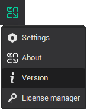
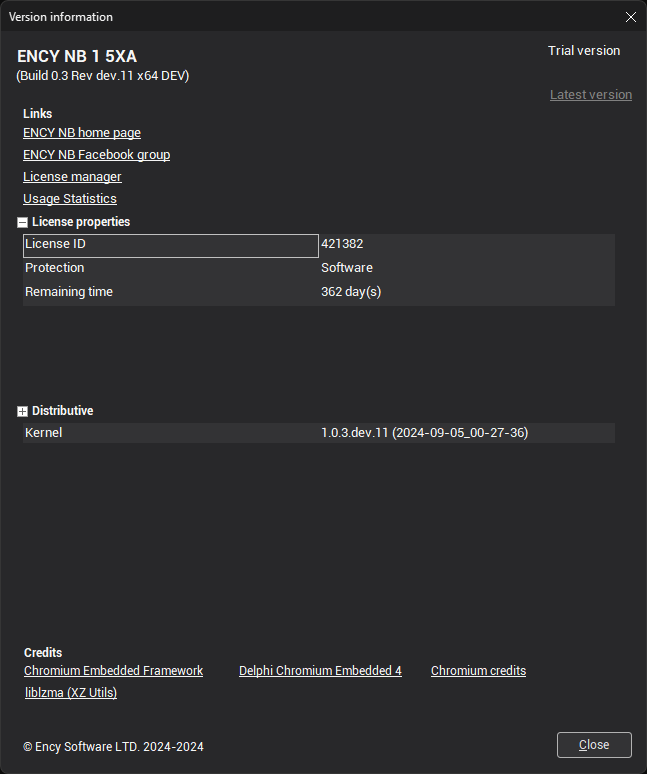

# バージョン情報ウィンドウ

<strong>バージョン情報</strong> ウィンドウは、アプリケーションのツールバー上部の最初のボタンからアクセスできます。

このウィンドウでは、以下の情報が確認できます：

- アプリケーション名
- アプリケーションのビルド識別子
- 当社Webリリースの便利なリンク集
- 基本的なライセンスプロパティ
- 各アプリケーションモジュールのバージョンリスト
- ソフトウェア販売店に関する情報
- 著作権情報

