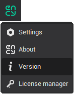
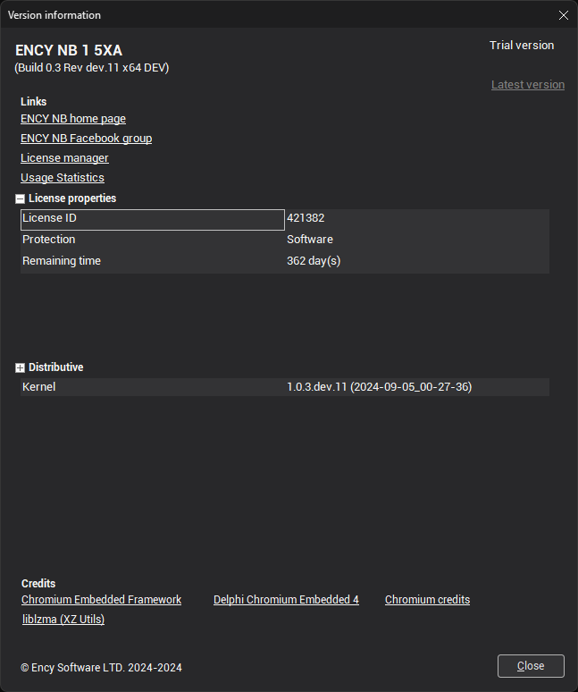

# Fenster mit Versionsinformationen

Das Fenster **Version information** (Versionsinformationen) wird über die erste Schaltfläche oben auf der Anwendungssymbolleiste geöffnet.

Das Fenster enthält:

- den Namen der Anwendung;
- die Build-Kennung;
- Links zu den Webressourcen;
- grundlegende Eigenschaften der Lizenz;
- Versionsangaben zu den einzelnen Anwendungsmodulen;
- Informationen zum Softwarehändler;
- Urheberrechtshinweise.

