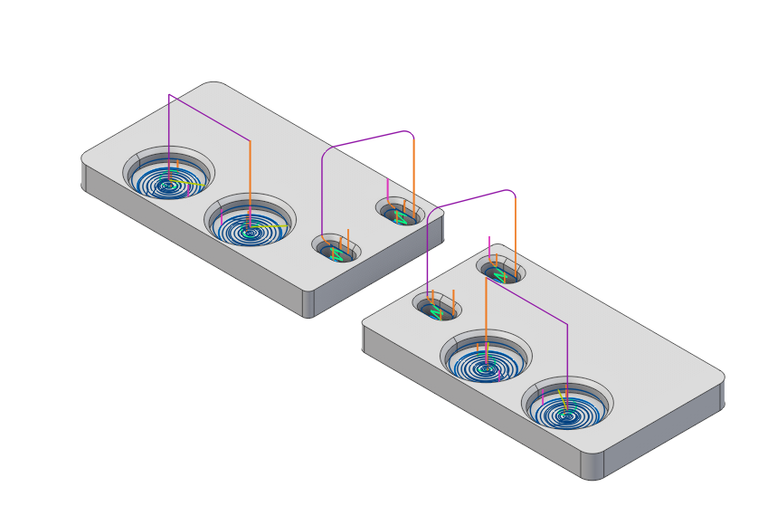
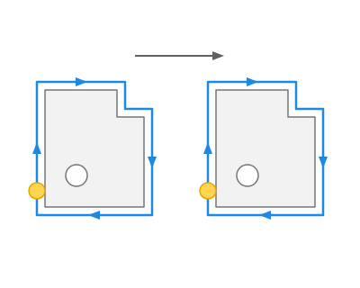
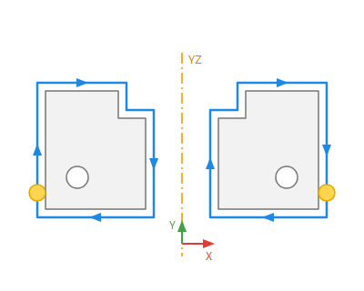

# Mirror of part

## Application area:

**Mirror of part** is a copy of a prototype part reflected across the YZ plane of the prototype part coordinate system (X → −X). It is intended for milling left-hand and right-hand versions of a part. Only one model needs to be imported: the CAM system generates the mirrored part and its toolpaths without creating a separate mirrored model in the model tree.

Like a regular [copy of part](1026.md), the mirrored copy is synchronized with its prototype. Operations are added and deleted in the prototype, and these changes are automatically applied to the copy. Changing a prototype operation resets the corresponding copy operation, which must then be recalculated.

A regular copy transfers the existing prototype toolpath, whereas a mirrored copy calculates a toolpath for the reflected part while preserving the selected cutting direction. **Climb milling remains climb milling**, and conventional milling remains conventional milling. This differs from simply reflecting a toolpath using toolpath transformations.

### Creating a mirrored copy:

1. Create the prototype part, add the required milling operations, and calculate them.
2. Select the prototype part or any of its operations in the operation tree.
3. Open the operation creation menu and select **Mirror of part** in the **Structure** group, next to **Copy of part**.
4. A node with the part name followed by **: mirror** appears in the tree and contains copies of the prototype operations.
5. On the copy's **Setup** tab, specify its workpiece setup, coordinate system, and work coordinate system, for example G54. Check the part position and adjust the copy's setup translation or rotation as required. The reflection plane remains the YZ plane of the prototype part coordinate system. [Details](1022.md)
6. Click **Run** to calculate the mirrored copy operations.

### Switching between regular and mirrored copies:

**Mirrored.** This checkbox is on the **Setup** tab, in the **Part properties** group, below **Part number** and **Workpiece material**. It is available only for a part copy.

- **ON.** The copy is mirrored.
- **OFF.** The copy is a regular part copy.

Changing the checkbox applies to this copy in all setup stages of the project. The copy operations are reset and must be recalculated using **Run**. The prototype toolpaths and calculation status remain unchanged.

### Calculation features:

- **Cutting direction.** The selected climb or conventional milling mode is preserved. When both directions are allowed (**Both**), the prototype toolpath is reflected without changing its traversal order.
- **2D contouring.** The contour traversal direction and machining side are preserved. Lead-in, lead-out, and overrun remain at the corresponding ends of the prototype contour.
- **NC program.** G2/G3 arcs and G41/G42 compensation are recalculated for mirrored machining.
- **Hole machining.** Hole positions and axes are reflected.
- **Part, workpiece, and fixtures.** Reflected prototype objects are displayed and simulated. The mirrored copy has its own reflected initial workpiece; it does not share a workpiece with the prototype.
- **Prototype.** Calculating the mirrored copy does not change the prototype operation toolpaths or calculation status.

### Limitations:

- **Reflection plane.** Only the YZ plane of the prototype part coordinate system is supported.
- **Machining types.** Mirrored copies are intended only for milling, including hole machining. Turning and auxiliary operations are not mirrored: they use the prototype toolpath without reflection.
- **Unsupported operations.** Operations that do not generate a regular toolpath, such as **Pick and Place** and wire EDM operations, report *The operation does not support a mirrored part*.
- **Subroutines.** The mirrored copy is output as a complete toolpath in the NC program, even when the prototype is configured to output copies as subroutine calls.
- **Gouge and collision checking.** Gouge checking is disabled for mirrored copy operations. The part body is excluded from collision checking; the workpiece and fixtures are included.
- **5D contouring with zigzag.** With **Inverse lead angle** switched **OFF**, the lead angle becomes a lag angle in the mirrored copy, and the side tilt is mirrored.
