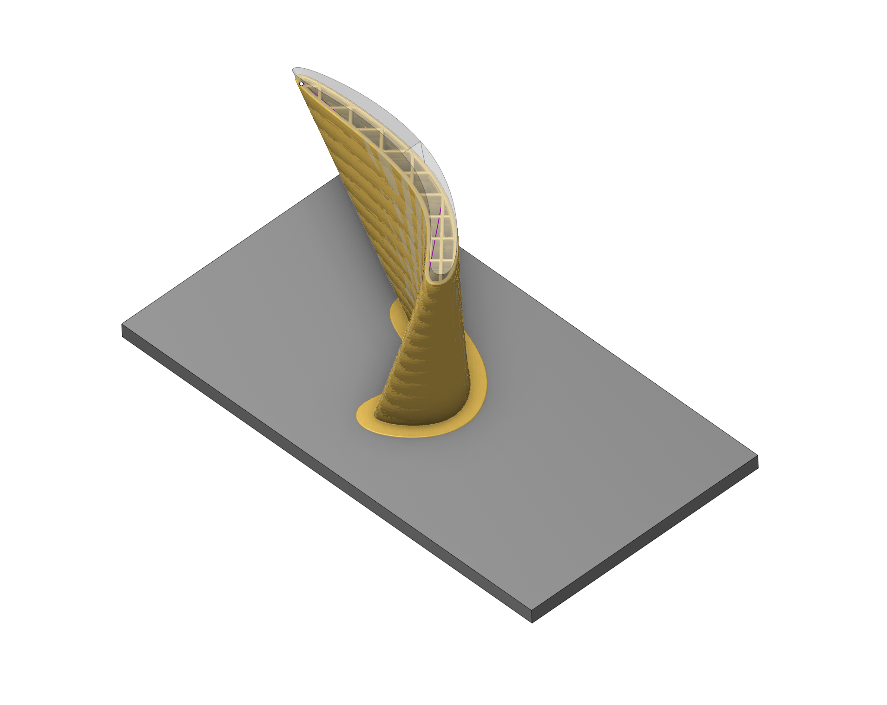

# Planar slicing

## Application area:

The new operation allows for 3D printing. The trajectory is built based on Ultimaker Cura's calculations.

### Setup:

The **Setup** tab is used to configure the primary parameters of the project. This can involve the positioning of the part on the equipment, the coordinate system of the part, and more. [Details](1022.md)

### Job assignment:

**Faces.** Select various surfaces of the part as the working task. The system will calculate the trajectory based on the chosen surfaces.

**Properties.** Displays the properties of an element. It is possible to add the stock. You can also call this menu by double clicking on an item in the list.

**Delete.** Removes an item from the list

### Strategy:

#### Auto tool parameterization.

Automatic change of tool parameters (Diameter, Working Length) based on Cura parameters

#### General.

List of parameters for presetting

Click here to expand..

**Manufacturer.** Brands of printers

**Printers.** List of printers of the selected brand

**Extruders.** List of extruders of the selected printer

**Material brand.** Brands of materials

**Materials.** List of materials of the material brand

**Variants.** The variant, in case of the extruder, hold settings that have to do with nozzle size or specific settings that relate to this

**Profiles.** Intent profiles contain settings that modify the quality by giving them an intent. These profiles depend on the material, variant and quality/resolution.

**Resolutions.** Quality profiles hold the resolution of the print by setting the layer height.

**Show custom parameters.** Customizing print settings. Custom mode offers more settings for experienced users. Can be **basic. advanced, expert, all.**

#### Other parameters required to use Cura functionality are described in the help. See more

### Transformations:

Parameter's kit of operation, which allow to execute converting of coordinates for calculated within operation the trajectory of the tool. [Details](10168.md)

### Part:

A Part is a group of geometrical elements that defines the space to check for gouges. [Details](330.md)

### Workpiece:

A workpiece model of an operation defines the material to be machined. [Details](738.md)

### Fixtures:

As the Fixtures the fixing aids such as chucks, grips, clamps, etc., and the restriction areas of any other nature are usually specified. [Details](10283.md)

### Installation:

The operation is supplied as the **Extension for Planar slicing operation based on Cura** extension. To install it:

1. On the **Home page**, open the **Extension Store** tab and go to the **Store** page.
2. Find **Extension for Planar slicing operation based on Cura** and click **Install**.
3. The operation appears in the **Additive** group of the new operation window. If it does not, restart the CAM system.

You can also install the extension from the web storefront [apps.encycam.com](https://apps.encycam.com/). [Details](162964210.md)
